# シェファミ

## ライブデモ

**[https://homelog-demo.nyproducts.workers.dev/demo](https://homelog-demo.nyproducts.workers.dev/demo)**

### ライブデモの使い方と注意事項

- **通常利用との違い**：デモでは「デモ太郎」「デモ花子」をボタンで切り替えられます。通常利用では、同じ世帯でも別のメンバーに切り替えるボタンはありません。各自が自分のアカウントでログインします。
- 新規登録は不要です。リンク先で「デモを試す（登録不要）」を押してください。
- 架空のデータで試す環境です。実在の個人情報は入力しないでください。利用期限は作成から24時間です。

<details>
<summary>操作手順と利用制限を詳しく読む</summary>

登録なしで試せるデモ環境を公開しています。

- **デモを始める**：ログイン画面で「デモを試す（登録不要）」を押すと、架空の2人がいるデモ世帯が作られ、デモ太郎としてホーム画面が開きます。
- **デモ花子の表示に変える**：画面上部の「デモ花子に切り替える」を押すと、ログイン画面には戻らず、デモ花子としてホーム画面が開きます。口座一覧には花子の口座が表示され、太郎の口座は表示されません。食材など、同じ世帯で共有している在庫は、どちらで開いても同じです。
- **PC で開いたとき**：スマホ用の表示で確認してもらえるよう、スマホの枠の中にアプリを表示します。スマホで開いたときは、そのままログイン画面が開きます。
- **見どころ**（帯の「見どころ」からも見られます）
  - 家計簿・口座：切り替え前後に一覧を開くと、各デモ利用者自身の記録を見比べられます。
  - 割り勘：立て替えた側には相手から受け取る分、相手の画面には自分が支払う分が表示されます。
  - 在庫・買い物リスト・献立・レシピ：どちらから見ても同じ。片方が追加すると、もう片方にも出る
  - 予定・固定費：「世帯」のものは2人に、「個人」のものは本人だけに見える
- **利用期限とデータの削除**。デモのデータはすべて架空のものです。デモの利用期限は作成から24時間です。期限切れのデータは毎時の定期処理で削除されます。ログイン画面の「デモを試す」からもう一度始められます。同じ接続元からは1時間に5回まで、同時に試せるのは300世帯までです。
- **デモでは使えない操作**：新規登録、パスワード・メールアドレスの変更、退会、パスワード再設定、世帯の作成・参加・脱退、招待コードの作り直し、手書きメモの画像アップロードはできません。表示名の変更、レシピフォームへの URL の手入力はできます。端末の共有メニューから直接登録する手順は、通常利用向けです。
- **同じブラウザで見るとき**：通常のタブ同士ではログイン状態を共有します。太郎と花子の表示を見比べるには、同じデモ内で上記の切り替えボタンを使い、順に確認してください。

デモは本番とは別の Worker・データベースで動いており、本番の利用者データには影響しません。構成と更新手順は [docs/deployment.md](docs/deployment.md#デモ環境) を参照してください。

</details>

シェファミは、家計簿・在庫・献立を一つにまとめた Web アプリです。旧称は HomeLog です。名称変更後も、既存の URL・アカウント・保存データはそのまま利用できます。

アプリの公開 HTML には、対応する検索エンジンに検索結果への掲載を控えるよう求める `noindex` を設定しています。`noindex` は、URL を知っている人のアクセスを制限する設定ではありません。

同じ世帯のメンバーと、在庫・買い物リスト・献立を共有できます。家計簿で見える情報は、本人の明細、世帯の集計、割り勘の当事者に見える情報に分かれます。詳しくは「[家計簿（支出・収入）](#家計簿支出収入)」をご覧ください。

PC・スマホのブラウザで使えます。対応する端末ではホーム画面に追加して、アプリアイコンから開けます。

> 画面の GIF はすべて、ローカル環境に入れた架空のデモデータで録画しています。

---

## 目次

- [制作背景](#制作背景)
- [アプリ紹介](#アプリ紹介)
- [ライブデモの使い方と注意事項](#ライブデモの使い方と注意事項)
- [できること](#できること)
- [機能の紹介](#機能の紹介)
- [技術構成](#技術構成)
- [ディレクトリ構成](#ディレクトリ構成)
- [ローカルで動かす](#ローカルで動かす)
- [テスト](#テスト)
- [デプロイ](#デプロイ)
- [ドキュメント](#ドキュメント)

---

## 制作背景

買い物、家計、献立はどれも家のことなのに、用事ごとに別のアプリを開くのは手間だと感じていました。そこで、自分たちの暮らしに必要な機能を一つにまとめた「シェファミ」を作りました。

**在庫管理と買い物リスト。** 買い物に出かけても、買うつもりだったものを忘れて帰ることがよくありました。在庫が少なくなった品目を買い物リストに出し、店でリストを見ながら買うものを確認できるようにしました。

**家計簿。** 妻と私は共働きで、それぞれのお金は個人で管理し、二人に関わる支出は共有したいと考えていました。また、誕生日の贈り物やお年玉など、毎年の行事で何にいくら使ったかを後から思い出せるように、支出をイベントにひも付けてダッシュボードから振り返れるようにしました。

**献立表とレシピ。** 仕事が終わってから夕食を何にするか悩むことが多かったので、お互いに食べたい料理を献立表で共有し、その中から選べるようにしました。家にある手書きのレシピはデジタル化し、Webで見つけたレシピも同じ場所に登録できます。作りたい料理を、いくつものアプリを開き直さずに探せるようにしたかったからです。

家のことを一か所で確認できるようになり、今も自分の暮らしの中で使い続けています。

---

## アプリ紹介

機能の概要と紹介動画をまとめた [アプリ紹介ページ](https://yamamotonaoki3.github.io/HomeLog/) を公開しています。

---

## できること

| 領域 | 主な機能 |
| --- | --- |
| 🏠 ダッシュボード | 月のカレンダー（収入・支出・イベント）、今日の収支、今週の献立、買い物リスト・在庫、口座残高、今月のお金、イベント別支出。表示するカードと並び順は自由に変更できる |
| 💰 家計簿 | 支出・収入の登録／編集／削除、カテゴリー管理、口座・カード（クレジット／チャージ型）、固定費の毎月自動計上、イベントごとの支出集計、世帯合計の対象額 |
| 🤝 割り勘・精算 | 世帯のメンバーや世帯外の友人との割り勘。請求 → 支払報告 → 受け取り確認の流れで精算し、精算額は家計簿と口座残高に自動で反映 |
| 📦 在庫・買い物リスト | 在庫数が閾値以下になると買い物リストに自動で追加。買った数を合わせて「購入を反映」すると在庫に加算される |
| 🍳 レシピ・献立 | レシピを手入力・手書きメモの写真（AI で読み取り）・Web ページ／YouTube の URL から登録。週ごとの「作りたい料理リスト」にレシピやメモを追加 |
| 👤 アカウント | 世帯の作成・招待コードでの参加・退出、表示名／パスワード／メールアドレスの変更、退会（30日以内なら取り消し可） |

---

## 機能の紹介

### ダッシュボード

カレンダーの下に、よく見る情報をカードで並べます。カードは見出しの右端で折りたためます。カードの表示・非表示と順番は「設定 → 表示設定」で変えられます。

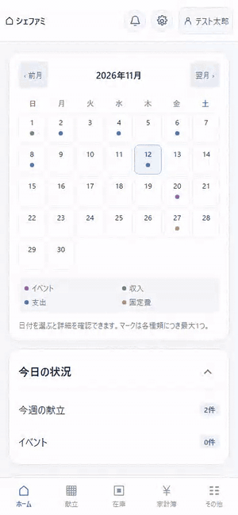

### 家計簿（支出・収入）

「収支を登録」から支出・収入を記録します。一覧の行を押すと詳細が開き、そこから編集・削除できます。口座を選んで収支を記録すると、アプリ内の口座残高に反映されます。

| 誰が見るか | 何が見えるか |
| --- | --- |
| 本人 | 自分が登録した支出の明細を、家計簿の一覧で確認できます。 |
| 同じ世帯のメンバー | 世帯合計の対象にした支出や固定費の合計額を確認できます。この集計に個別の支出明細は出ません。 |
| 割り勘の当事者 | 自分が関わる割り勘の内容・日付・金額などを、割り勘の画面で確認できます。 |

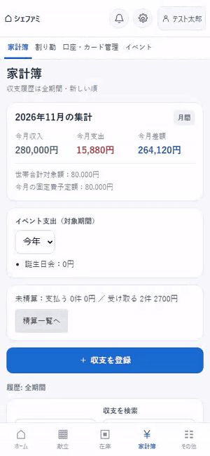

### 割り勘・精算

支出を登録するときに「割り勘する」を選ぶと、相手ごとの負担額を記録できます。一覧は日付・相手・金額だけで見やすくし、行を押すと詳細と操作（請求・支払う・受け取りました・精算済みにする など）が出ます。

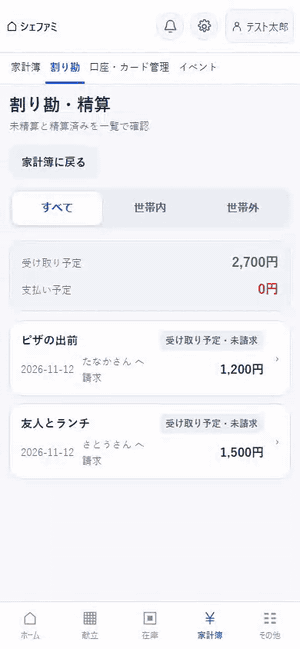

### 固定費

家賃やスマホ代などを登録しておくと、支払日に毎月自動で支出として計上されます。世帯で共有する固定費や、割り勘する固定費も登録できます。

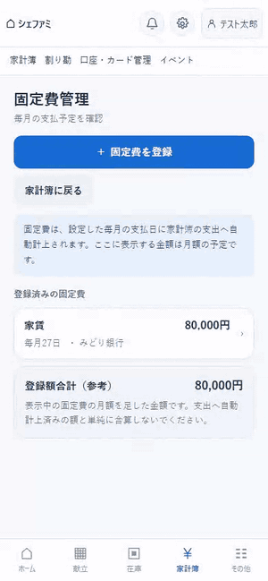

### 口座・カード

銀行口座や電子マネーを、支出・収入の記録先として登録できます。チャージ型のカードは、チャージ額や残高も記録できます。

銀行・カード会社との自動連携はありません。カード番号や金融機関のログイン情報を入力する機能はなく、表示する残高はアプリ内の記録から計算します。

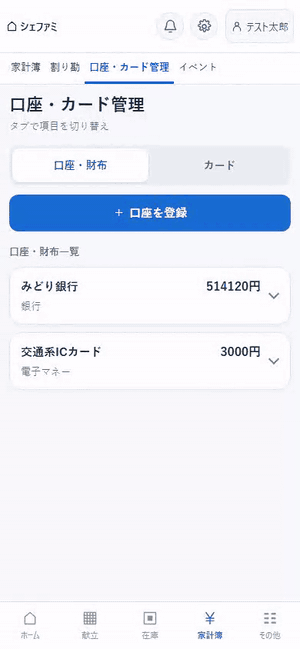

### 在庫・買い物リスト

在庫一覧の品物を押すと、その場に数量の操作欄が開き、＋／－（増減幅は1／0.1）や増減量の入力で個数を変更できます。一覧での個数変更はすぐに確定します。「詳細を編集」からは在庫個数・品名・カテゴリー・買う店・値段などを編集でき、「保存」でまとめて確定します。キャンセルすると詳細での変更を破棄します。在庫が閾値以下の品目は、自動で買い物リストに入ります。買い物リストでは、買った数を行の－／＋で合わせるとチェックが付き、「購入を反映」で確定すると在庫に加算されます。

選択肢にないカテゴリーは、同じモーダルの「＋カテゴリーを登録」から追加できます。追加後は自動で選ばれ、同じ世帯で共有されます。カテゴリーは追加時に保存され、在庫の登録・編集をキャンセルしても残ります。

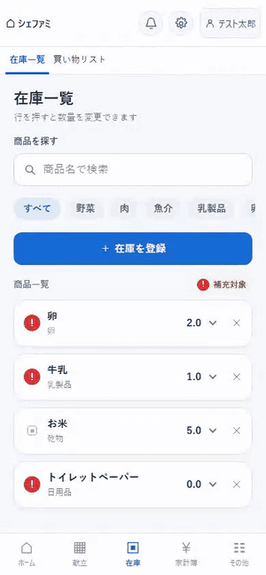

### イベント

家計簿のイベント一覧から自分が登録したイベントを押すと、編集画面が直接開きます。項目の編集・支出集計・削除確認は、すべて同じモーダルで行えます。家族が登録した共有イベントは閲覧専用です。

### レシピ

レシピは3つの方法で登録できます。

- **手入力**：タイトル・材料・手順を入力
- **手書きメモの写真**：写真から文字を読み取り、AI がタイトル・材料・手順に整理（確認してから保存）
- **Web ページ／YouTube**：URL を入力すると、ページのタイトルとサムネイルを取得します。この操作で材料・手順まで自動入力するわけではありません。下の表は、見ているページから URL を登録フォームへ渡す方法です。

| 端末 | 見ているページから登録する方法 |
| --- | --- |
| PC | レシピ一覧の「シェファミに登録」をブックマークバーへドラッグして置き、レシピのページでそのブックマークを押す |
| iPhone | レシピ一覧の「ショートカットを追加する」からショートカットを追加し、Safari などの共有メニューで「シェファミに登録」を選ぶ |
| Android | Chrome のメニュー（︙）の「アプリをインストール」または「ホーム画面に追加」でシェファミをインストールし、ブラウザやアプリの共有メニューで「シェファミ」を選ぶ |

どの方法でも URL を入れた登録画面が開き、「登録」を押すまでは保存されません。

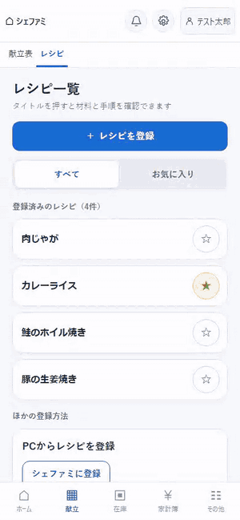

> この GIF の URL（`recipe.example.com`）は録画用の架空のページです。外部のサイトに接続しないよう、ページの読み込みとサムネイル画像だけを録画の中で差し替えています。

一覧の星を押すと、そのレシピをお気に入りに登録できます。「お気に入り」を選ぶと登録したレシピだけが表示され、「すべて」を選ぶと一覧全体に戻ります。この表示の変更でレシピは削除されません。

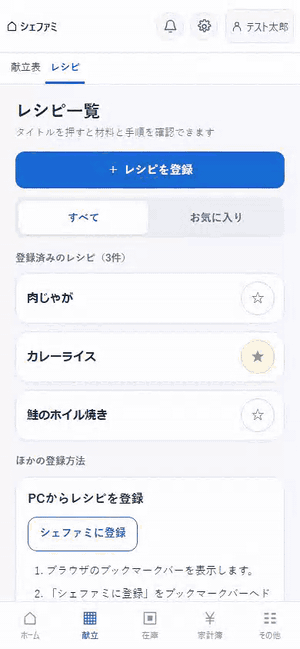

### 献立表

在庫の登録・詳細編集で「献立と連携する」を選ぶと、レシピごとの予定回数とメモを設定できます。検索・登録済みレシピの選択・新しい料理名の手入力に対応し、関連の追加・解除も在庫とまとめて保存します。予定合計は在庫数以内。「食べた」1回でその在庫と予定を1ずつ減らし、「取り消す」で直近の1回を戻します。献立は料理名・残り回数・メモを1行にまとめ、詳細を展開して操作します。翌週へ持ち越すのは残り予定だけで、補充しても消費済みの予定は復活しません。

週ごとに「作りたい料理リスト」を作ります。レシピはキーワードで絞り込んで選べ、「外食」などの自由メモも追加できます。登録済みのレシピを参照できる献立では、行を押すと「レシピを見る」が表示されます。有効な元 URL がある Web レシピは元のページを別タブで開き、それ以外はアプリ内のレシピ詳細を開きます。

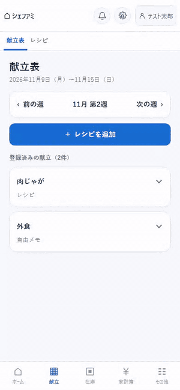

### 設定・アカウント

右上の歯車から、世帯設定（招待コード・メンバー・退出）、表示設定、アカウント設定（表示名・パスワード・メールアドレスの変更、退会）を開けます。

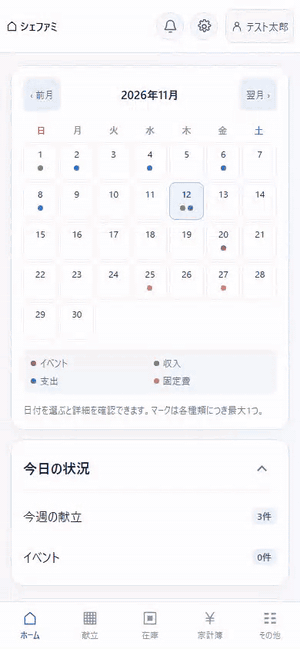

---

## 技術構成

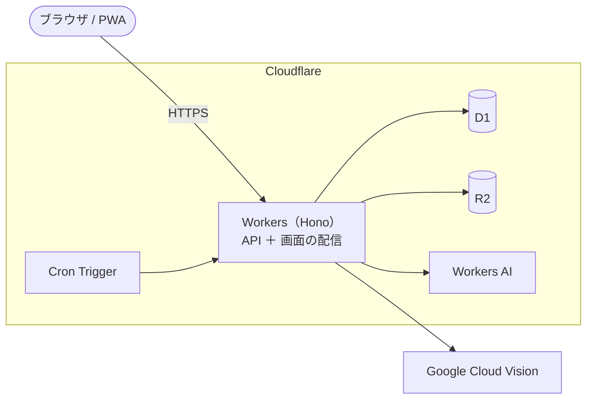

| 役割 | 技術 |
| --- | --- |
| フロントエンド | React 19 / TypeScript / Vite / React Router / axios / vite-plugin-pwa |
| バックエンド | Cloudflare Workers / Hono / TypeScript / zod |
| データベース | Cloudflare D1（SQLite 互換）/ drizzle-orm |
| ファイル・AI | Cloudflare R2（手書きレシピ画像の一時保存）/ Google Cloud Vision（文字認識）/ Workers AI（レシピの構造化） |
| 定期処理 | Cron Trigger：毎日 JST 0:00 に過去週の献立を削除。JST 1:00 に固定費の自動計上、在庫の自動消費、画像・退会アカウント・回数制限データの清掃と献立削除の再試行 |
| テスト | Vitest（`@cloudflare/vitest-pool-workers` / Testing Library / msw）/ Playwright |
| 品質 | ESLint / oxlint / TypeScript / GitHub Actions / gitleaks |
| デプロイ | Cloudflare Workers Builds（`production` ブランチへの push で自動デプロイ） |

詳しくは [docs/技術スタック.md](docs/技術スタック.md) と [docs/details/system-architecture.md](docs/details/system-architecture.md) を参照してください。

---

## ディレクトリ構成

```text
.
├── frontend/          React の画面（Vite）
├── backend-workers/   Cloudflare Workers の API（Hono + D1）
│   ├── src/routes/    機能ごとの API
│   ├── src/lib/       共通処理（固定費の自動計上・退会処理など）
│   └── drizzle/       D1 のマイグレーション
├── e2e/               Playwright の E2E テスト
├── docs/              要件定義書・設計書
├── backend/           移行元の Java / Spring Boot 版（現在は未使用）
└── prototype/         初期の画面プロトタイプ
```

---

## ローカルで動かす

必要なもの：Node.js 24.22.1（LTS）、npm。開発・CIの指定はルートの[.node-version](.node-version)を正とします。Windowsのnvm-windowsでの切り替え方と、Cloudflareビルド側の設定は[配信手順](docs/deployment.md#nodejsの導入更新)を参照してください。

初回は `backend-workers/.dev.vars.example` を `backend-workers/.dev.vars` にコピーし、ローカル用の `JWT_SECRET` を設定します。値はコミットしません。

リポジトリのルートから依存関係を導入し、Workers が参照する静的アセットをビルドして、ローカル API（`http://localhost:8787`）を起動します。画面を変更した際も Workers が参照するビルドを更新します。

```sh
cd frontend
npm ci
npm run build
cd ../backend-workers
npm ci
npx wrangler d1 migrations apply DB --local
npx wrangler dev --local --port 8787
```

別のターミナルでリポジトリのルートから画面を起動します。

Bash の場合

```bash
cd frontend
VITE_API_PROXY_TARGET=http://localhost:8787 npx vite --port 5181 --strictPort
```

Windows PowerShell の場合

```powershell
cd frontend
$env:VITE_API_PROXY_TARGET = 'http://localhost:8787'
npx vite --port 5181 --strictPort
```

ブラウザで http://localhost:5181 を開き、新規登録 → 世帯の作成から始めます。

---

## テスト

```bash
# Workers のテスト前に静的アセットをビルドする
cd frontend && npm run build && cd ..

# バックエンド（本物の D1 を使う単体テスト）
cd backend-workers && npm run lint && npm run typecheck && npm test

# フロントエンド
cd frontend && npm run lint && npm test && npm run build

# E2E（API と画面を自動で起動し、1280 / 390 / 320px で確認）
cd e2e && npm ci
npx playwright install chromium # 初回のみ
npm test
```

各ブロックの `cd` はリポジトリルートから実行します。`npm test` は通常E2Eを実行します。献立削除・デモ・Workers静的配信・PWAの手動更新の専用E2Eは、[e2e/README.md](e2e/README.md#実行)の手順で順番に実行してください。

README の GIF は `e2e/tests/readme-gifs.spec.ts` で録画し、ffmpeg で GIF に変換しています。

```bash
cd e2e && README_GIF_DIR=<出力先> npm test -- tests/readme-gifs.spec.ts --workers=1
# <出力先>/raw/*.webm ができるので、ffmpeg で docs/images/readme/*.gif に変換する
ffmpeg -ss 0.4 -i <出力先>/raw/<名前>.webm \
  -vf "fps=10,scale=300:-1:flags=lanczos,split[s0][s1];[s0]palettegen=max_colors=64:stats_mode=diff[p];[s1][p]paletteuse=dither=bayer:bayer_scale=5:diff_mode=rectangle" \
  -loop 0 docs/images/readme/<名前>.gif
```

詳しくは [docs/結合テスト.md](docs/結合テスト.md) を参照してください。

---

## デプロイ

`main` を `production` ブランチに push すると、Cloudflare Workers Builds が D1 のマイグレーション適用とデプロイを自動で行います。手順と確認方法は [docs/deployment.md](docs/deployment.md) を参照してください。

---

## ドキュメント

| ドキュメント | 内容 |
| --- | --- |
| [docs/manual/index.html](docs/manual/index.html) | 利用者向けの取扱説明書（ブラウザで開く） |
| [docs/構想.md](docs/構想.md) | アプリの背景とコンセプト |
| [docs/requirements.md](docs/requirements.md) | 要件定義書（機能一覧・非機能要件・実装状況） |
| [docs/details/features/](docs/details/features/) | 機能ごとの要件（F-01〜F-13） |
| [docs/details/api-design.md](docs/details/api-design.md) | API 設計とエンドポイント一覧 |
| [docs/details/data-model.md](docs/details/data-model.md) | データモデル |
| [docs/details/screen-transitions.md](docs/details/screen-transitions.md) / [wireframes.md](docs/details/wireframes.md) | 画面一覧・画面遷移・ワイヤーフレーム |
