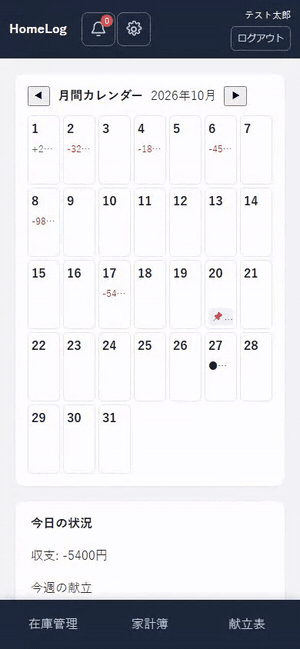
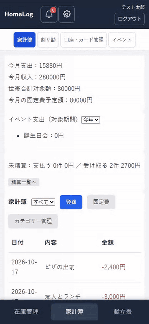
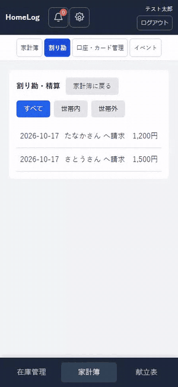
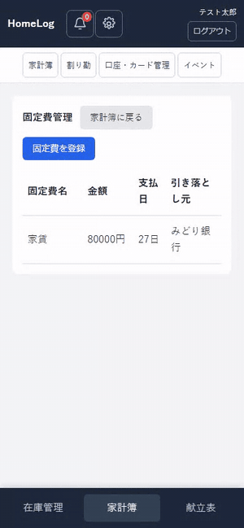
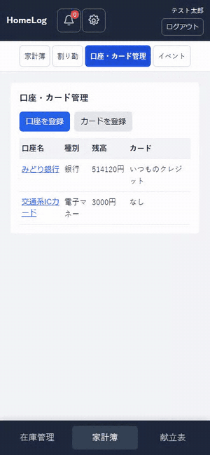
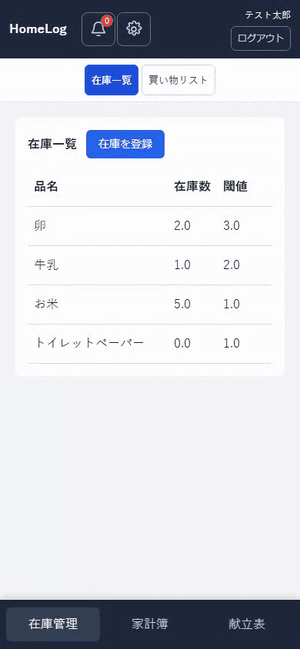
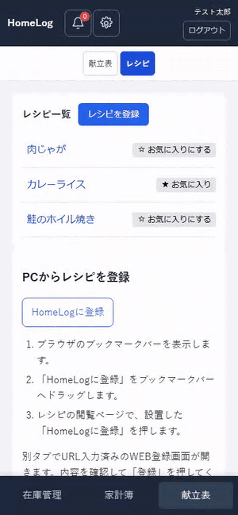
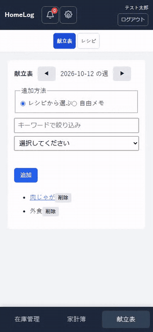
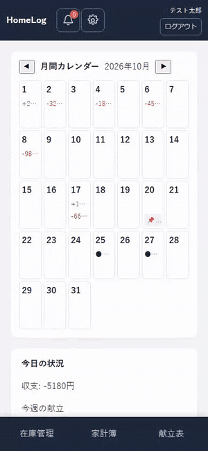
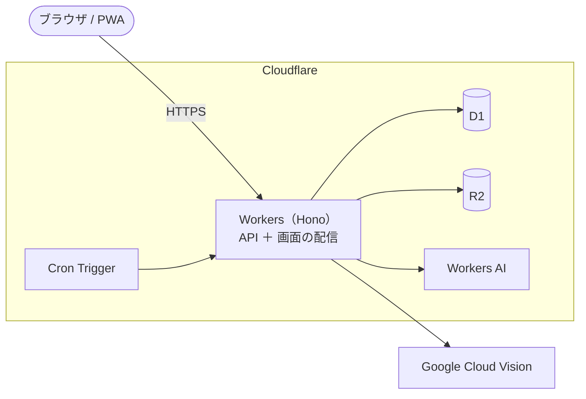

# HomeLog

**家計簿・在庫・献立を、世帯でまとめて管理する Web アプリ**です。

個人のお金の記録は自分だけのものとして守りつつ、同居する家族やシェアハウスの仲間と「立て替えたお金の精算」「食材や日用品の在庫」「今週の献立」を共有できます。PC とスマホのブラウザで使え、ホーム画面に追加すれば PWA としても動きます。

> 画面の GIF はすべて、ローカル環境に入れた架空のデモデータで録画しています。

---

## 目次

- [できること](#できること)
- [機能の紹介](#機能の紹介)
- [技術構成](#技術構成)
- [ディレクトリ構成](#ディレクトリ構成)
- [ローカルで動かす](#ローカルで動かす)
- [テスト](#テスト)
- [デプロイ](#デプロイ)
- [ドキュメント](#ドキュメント)

---

## できること

| 領域 | 主な機能 |
| --- | --- |
| 🏠 ダッシュボード | 月のカレンダー（収入・支出・イベント）、今日の収支、今週の献立、買い物リスト・在庫、口座残高、今月のお金、イベント別支出。表示するカードと並び順は自由に変更できる |
| 💰 家計簿 | 支出・収入の登録／編集／削除、カテゴリー管理、口座・カード（クレジット／チャージ型）、固定費の毎月自動計上、イベントごとの支出集計、世帯合計の対象額 |
| 🤝 割り勘・精算 | 世帯のメンバーや世帯外の友人との割り勘。請求 → 支払報告 → 受け取り確認の流れで精算し、精算額は家計簿と口座残高に自動で反映 |
| 📦 在庫・買い物リスト | 在庫数が閾値を下回ると買い物リストに自動で追加。買ったものにチェックして「更新」すると在庫に戻る |
| 🍳 レシピ・献立 | レシピを手入力・手書きメモの写真（AI で読み取り）・Web ページ／YouTube の URL から登録。週ごとの「作りたい料理リスト」にレシピやメモを追加 |
| 👤 アカウント | 世帯の作成・招待コードでの参加・退出、表示名／パスワード／メールアドレスの変更、退会（30日以内なら取り消し可） |

---

## 機能の紹介

### ダッシュボード

カレンダーの下に、よく見る情報をカードで並べます。カードの表示・非表示と順番は「設定 → 表示設定」で変えられます。



### 家計簿（支出・収入）

「登録」から支出と収入を記録します。一覧の行を押すと詳細が開き、そこから編集・削除できます。口座を選ぶと残高が自動で増減します。



### 割り勘・精算

支出を登録するときに「割り勘する」を選ぶと、相手ごとの負担額を記録できます。一覧は日付・相手・金額だけで見やすくし、行を押すと詳細と操作（請求・支払う・受け取りました・精算済みにする など）が出ます。



### 固定費

家賃やスマホ代などを登録しておくと、支払日に毎月自動で支出として計上されます。世帯で共有する固定費や、割り勘する固定費も登録できます。



### 口座・カード

銀行口座・電子マネーなどの口座と、その口座にひもづくカードを管理します。チャージ型のカードは、口座からのチャージと残高も記録できます。



### 在庫・買い物リスト

在庫の数を ＋／− で増減します。在庫が閾値を下回った品目は、自動で買い物リストに入ります。



### レシピ

レシピは3つの方法で登録できます。

- **手入力**：タイトル・材料・手順を入力
- **手書きメモの写真**：写真から文字を読み取り、AI がタイトル・材料・手順に整理（確認してから保存）
- **Web ページ／YouTube**：URL からタイトルとサムネイルを取得。PC はブックマーク、iPhone はショートカット、Android は共有メニューから、見ているページをそのまま登録できる



### 献立表

週ごとに「作りたい料理リスト」を作ります。レシピはキーワードで絞り込んで選べ、「外食」などの自由メモも追加できます。リストのレシピ名を押すと、レシピの詳細（Web レシピなら元のページ）が開きます。



### 設定・アカウント

右上の歯車から、世帯設定（招待コード・メンバー・退出）、表示設定、アカウント設定（表示名・パスワード・メールアドレスの変更、退会）を開けます。



---

## 技術構成



| 役割 | 技術 |
| --- | --- |
| フロントエンド | React 19 / TypeScript / Vite / React Router / axios / vite-plugin-pwa |
| バックエンド | Cloudflare Workers / Hono / TypeScript / zod |
| データベース | Cloudflare D1（SQLite 互換）/ drizzle-orm |
| ファイル・AI | Cloudflare R2（手書きレシピ画像の一時保存）/ Google Cloud Vision（文字認識）/ Workers AI（レシピの構造化） |
| 定期処理 | Cron Trigger（毎日 JST 1:00）：固定費の自動計上、画像の後片付け、退会アカウントの削除 |
| テスト | Vitest（`@cloudflare/vitest-pool-workers` / Testing Library / msw）/ Playwright |
| 品質 | ESLint / oxlint / TypeScript / GitHub Actions / gitleaks |
| デプロイ | Cloudflare Workers Builds（`production` ブランチへの push で自動デプロイ） |

詳しくは [docs/技術スタック.md](docs/技術スタック.md) と [docs/details/system-architecture.md](docs/details/system-architecture.md) を参照してください。

---

## ディレクトリ構成

```text
.
├── frontend/          React の画面（Vite）
├── backend-workers/   Cloudflare Workers の API（Hono + D1）
│   ├── src/routes/    機能ごとの API
│   ├── src/lib/       共通処理（固定費の自動計上・退会処理など）
│   └── drizzle/       D1 のマイグレーション
├── e2e/               Playwright の E2E テスト
├── docs/              要件定義書・設計書
├── backend/           移行元の Java / Spring Boot 版（現在は未使用）
└── prototype/         初期の画面プロトタイプ
```

---

## ローカルで動かす

必要なもの：Node.js（LTS）、npm

```bash
# 1. 依存関係を入れる
cd backend-workers && npm install && cd ..
cd frontend && npm install && cd ..

# 2. 環境変数を用意する（値はコミットしない）
cp backend-workers/.dev.vars.example backend-workers/.dev.vars
#   → JWT_SECRET などを設定する

# 3. ローカルの D1 にマイグレーションを適用して API を起動する（http://localhost:8787）
cd backend-workers
npx wrangler d1 migrations apply DB --local
npx wrangler dev --local --port 8787

# 4. 別のターミナルで画面を起動する（http://localhost:5181）
cd frontend
VITE_API_PROXY_TARGET=http://localhost:8787 npx vite --port 5181
```

ブラウザで http://localhost:5181 を開き、新規登録 → 世帯の作成から始めます。

---

## テスト

```bash
# バックエンド（本物の D1 を使う単体テスト）
cd backend-workers && npm run lint && npm run typecheck && npm test

# フロントエンド
cd frontend && npm run lint && npx tsc -b && npx vitest run && npm run build

# E2E（API と画面を自動で起動し、1280 / 390 / 320px で確認）
cd e2e && npm install && npm test
```

README の GIF は `e2e/tests/readme-gifs.spec.ts` で録画し、ffmpeg で GIF に変換しています。

```bash
cd e2e && README_GIF_DIR=<出力先> npm test -- tests/readme-gifs.spec.ts --workers=1
# <出力先>/raw/*.webm ができるので、ffmpeg で docs/images/readme/*.gif に変換する
```

詳しくは [docs/結合テスト.md](docs/結合テスト.md) を参照してください。

---

## デプロイ

`main` を `production` ブランチに push すると、Cloudflare Workers Builds が D1 のマイグレーション適用とデプロイを自動で行います。手順と確認方法は [docs/deployment.md](docs/deployment.md) を参照してください。

---

## ドキュメント

| ドキュメント | 内容 |
| --- | --- |
| [docs/構想.md](docs/構想.md) | アプリの背景とコンセプト |
| [docs/requirements.md](docs/requirements.md) | 要件定義書（機能一覧・非機能要件・実装状況） |
| [docs/details/features/](docs/details/features/) | 機能ごとの要件（F-01〜F-13） |
| [docs/details/api-design.md](docs/details/api-design.md) | API 設計とエンドポイント一覧 |
| [docs/details/data-model.md](docs/details/data-model.md) | データモデル |
| [docs/details/screen-transitions.md](docs/details/screen-transitions.md) / [wireframes.md](docs/details/wireframes.md) | 画面一覧・画面遷移・ワイヤーフレーム |
