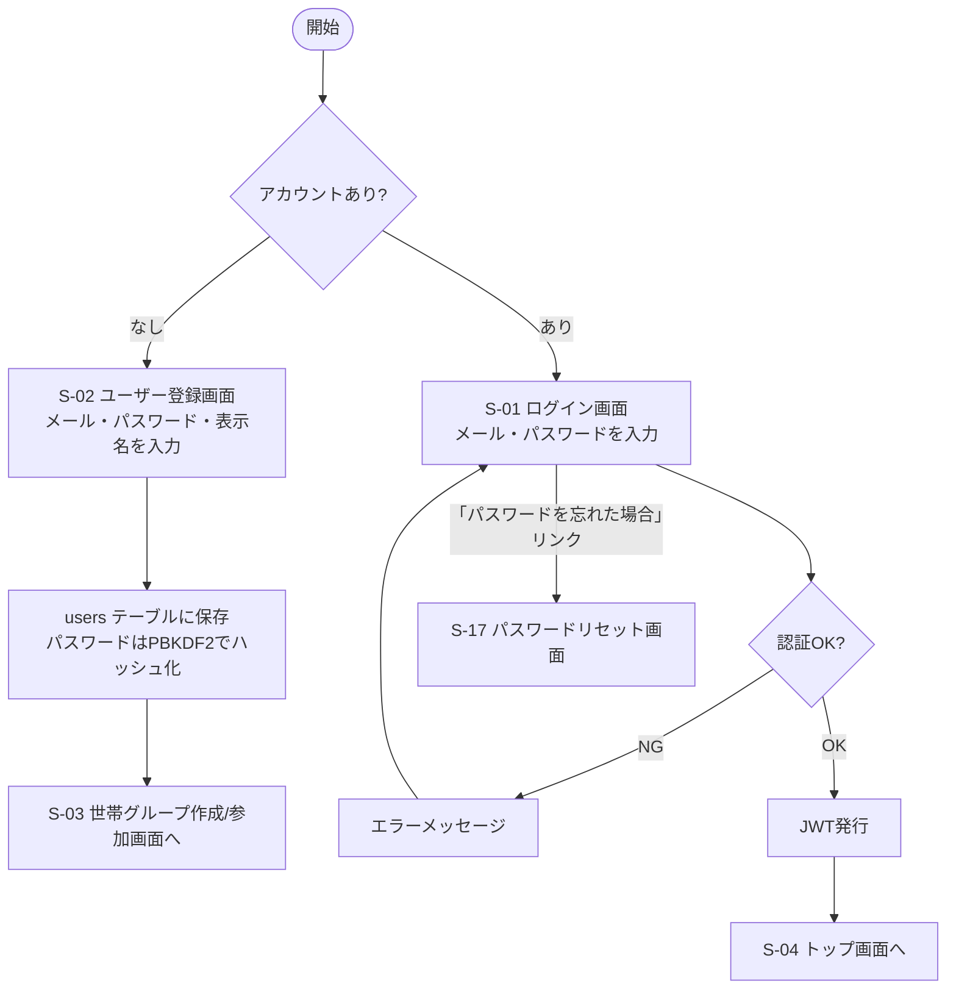
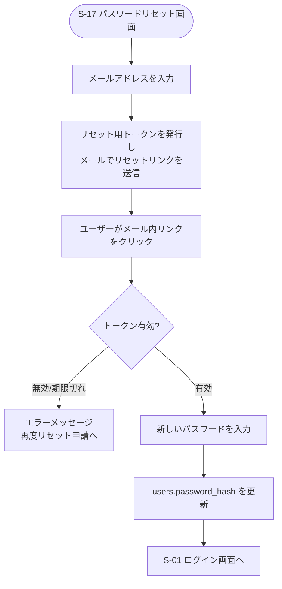

# F-01 認証（ユーザー登録・ログイン）

[← 要件定義書に戻る](../../requirements.md)

---

## 1. 概要

メールアドレス・パスワードによるユーザー登録とログイン。JWTによる認証を行う（[技術スタック.md](../../技術スタック.md)参照）。

## 1-1. JWT・リフレッシュトークンの方針

- JWT署名鍵（`jwt.secret`）はアプリケーション設定のデフォルト値をローカル開発専用とし、共有環境・本番環境では必ず環境変数`JWT_SECRET`で上書きする。デフォルト値のまま運用すると、鍵を知る第三者が任意のユーザーIDでアクセストークンを偽造できてしまう。

| 項目 | 内容 |
| --- | --- |
| アクセストークン有効期限 | 15分（`application.yml`の`jwt.access-expiration=900000`と一致） |
| リフレッシュトークン有効期限 | 7日（`application.yml`の`jwt.refresh-expiration=604800000`と一致） |
| リフレッシュトークンの保存方式 | `refresh_tokens`テーブルで管理する（DBに保存し、都度有効性を検証） |
| ログアウト時の扱い | 該当ユーザーの`refresh_tokens`を失効（`revoked_at`を設定）させ、以後そのリフレッシュトークンではアクセストークンを再発行できないようにする |
| アクセストークン再発行 | リフレッシュトークンが有効な間、クライアントはリフレッシュエンドポイントで新しいアクセストークンを取得できる |

## 1-2. 本人情報取得（Workers、#258）

- 認証必須の `GET /api/auth/me` で、JWTから識別した本人の現在の `id`（数値）と `displayName`（1〜50文字）のみを返す。世帯未所属でも利用できる。
- メールアドレス・パスワードハッシュ等は返さず、ユーザーIDをリクエストで選択させない。
- トークンなし・不正・期限切れ、またはユーザー不存在は401 `UNAUTHORIZED`（「認証が必要です」）。詳細は[API設計](../api-design.md)を参照。
- JWT・login/refresh応答・DBスキーマは従来どおり。#257でAuthProviderが本人情報を取得し、共通ヘッダーのログアウト上に表示名を1行省略で表示する。取得中・失敗時の文言は[ワイヤーフレーム](../wireframes.md)を参照。

## 2. 対象画面

| 画面ID | 画面名 |
| --- | --- |
| S-01 | ログイン画面 |
| S-02 | ユーザー登録画面 |
| S-17 | パスワードリセット画面 |

## 3. 業務フロー

## 3-1. パスワードリセットフロー

## 4. IPO

### ユーザー登録

| 項目 | 内容 |
| --- | --- |
| 入力 | メールアドレス・パスワード・表示名 |
| 処理 | 入力チェック → メール重複チェック → パスワードハッシュ化 → users テーブルに保存 |
| 出力 | 登録完了 / エラーメッセージ |

### ログイン

| 項目 | 内容 |
| --- | --- |
| 入力 | メールアドレス・パスワード |
| 処理 | ユーザー検索 → パスワード照合 → JWT発行 |
| 出力 | アクセストークン・リフレッシュトークン / エラーメッセージ |

### パスワードリセット申請

| 項目 | 内容 |
| --- | --- |
| 入力 | メールアドレス |
| 処理 | ユーザー検索 → `password_reset_tokens`にトークンを発行（有効期限30分） → メール送信（**未実装**：メール送信サービスが未導入のため、現在はトークンを発行するだけでメールは送らない。7章参照） |
| 出力 | 送信完了メッセージ（メール存在有無に関わらず同一メッセージを返し、メールアドレスの存在を推測されないようにする） |

### パスワードリセット実行

| 項目 | 内容 |
| --- | --- |
| 入力 | リセットトークン・新しいパスワード |
| 処理 | `password_reset_tokens`でトークンの有効性・期限・使用済み(`used_at`)を確認 → users.password_hash を更新 → `used_at`を設定してトークンを無効化 |
| 出力 | リセット完了 / エラーメッセージ |

### パスワードリセットトークンの方針

| 項目 | 内容 |
| --- | --- |
| 保存方式 | `password_reset_tokens`テーブル（JWT等に埋め込まず、DBで一元管理） |
| 有効期限 | 発行から30分 |
| 使用済み管理 | `used_at`に日時を設定し、一度使用したトークンは再利用不可とする |
| 再発行時の扱い | 同一ユーザーが再度リセットを申請した場合、古い未使用トークンは無効化し、新しいトークンのみ有効とする |

## 5. 入力チェック仕様

| 項目 | 必須 | 形式・制約 |
| --- | --- | --- |
| メールアドレス | ○ | メール形式、UNIQUE |
| パスワード | ○ | 8文字以上、英字と数字を両方含む |
| 表示名 | ○ | 1〜50文字 |

## 6. データ設計（関連テーブル）

[data-model.md](../data-model.md) の `users`, `refresh_tokens`, `password_reset_tokens` テーブルを参照。

## 7. 今後の検討事項

- 同一ユーザーが同時にパスワードリセットを複数回申請した場合、DBレベルでの排他制御は行っていないため、稀に複数の有効なリセットトークンが並存しうる（アプリケーション層で「新しい申請時に既存トークンを無効化」は行うが、真の同時実行は防げない）。厳密に1件のみに制限する場合は、行ロックやDB制約による排他制御の追加を検討する
- パスワードリセット・ログイン通知等のメール送信基盤の実装方式（送信サービスの選定は今後）。実装されるまでの暫定措置として、環境変数`APP_PASSWORD_RESET_LOG_TOKEN_ENABLED=true`を設定したローカル開発環境に限り発行した生トークンをアプリケーションログに出力する（デフォルトはfalseで出力しない）。共有環境・本番環境では有効化せず、メール送信サービスを導入したらメール送信へ置き換える（本番は2026-10時点でメール未送信のため、利用者はパスワード再設定を使えない）

## 8. アカウント情報の変更・削除

- メールアドレス変更・パスワード変更・アカウント削除は本人のみ実行でき、操作前に再認証を求める。
- メールアドレス変更は新しいメールアドレスの確認が完了した後に確定する。変更通知・旧アドレスからの復旧方法等の詳細は運用設計で確定する。
- アカウント削除は、本人の明示確認後に30日間の取消可能期間へ入り、その間は新規ログイン・通常API・トークン更新を停止する。申請時にリフレッシュトークンを全失効し、未失効のアクセストークンも各リクエストでアカウント状態を確認して拒否する。本人は期間内に専用の取消手段で削除申請を取り消せる。
- 未精算の割り勘・固定費負担を精算または引き継ぎ、世帯共有固定費の登録者と引き落とし元を後任に移す（または自動計上を停止・削除する）。その後、申請前に世帯から退出する。最後の世帯管理者の場合は後任を指定する。期限後に本人専用データとアカウント識別情報を削除し、世帯に残す必要のある共有記録は個人プロフィールとの紐付けを解除して「退会したユーザー」と表示する。詳細と未決事項は[common-notes.md](../common-notes.md) 12章を参照。
- 削除申請時に全リフレッシュトークンを失効させ、取消後に利用を再開する場合の再認証・アカウント復帰方法は実装設計で定める。
- メールアドレスはログイン・通知等に原文が必要となるため、単純なハッシュ化を要件としない。保存時の保護と閲覧権限の最小化は[common-notes.md](../common-notes.md) 12章に従う。

## 8-1. アカウント設定の実装範囲（Workers、#291/#292）

アカウント設定画面（設定画面から遷移）で、表示名・パスワード・メールアドレスを変更できる。アカウント削除（退会）は未決事項が多いため対象外とし、別Issueで扱う。

| API | 内容 | 主なエラー |
| --- | --- | --- |
| `GET /api/auth/account` | 本人のid・メールアドレス・表示名を返す。`GET /api/auth/me` はヘッダー表示用に id・表示名だけを返すまま変えない | 401 |
| `PATCH /api/auth/account` | 表示名を変更する。前後の空白を除いて1〜50文字 | 400 / 401 |
| `PUT /api/auth/password` | `currentPassword` で再認証し、`newPassword`（8文字以上・英字と数字を含む）に変更する。`refreshToken` に今の端末のトークンを渡すと、それ以外の本人のリフレッシュトークンを全て失効させる | 400（現在のパスワード誤り・規則違反）/ 401 / 409（並行してパスワードが変わった） |
| `PUT /api/auth/email` | `currentPassword` で再認証し、`newEmail` に変更する | 400 / 401 / 409（他ユーザーが使用中・並行してパスワードが変わった） |

- **暫定仕様**: メール送信サービスが未導入のため、メールアドレス変更は新しいアドレスの確認メールを送らず即時確定する。8章の「確認完了後に確定」と旧アドレスへの通知は、メール送信基盤の導入時に対応する。
- 現在のパスワードの誤りは `VALIDATION_ERROR`（`details[].field = currentPassword`）で返し、アクセストークンの失効と区別するため 401 にしない。
- パスワード・メールアドレスを変更すると、未使用のパスワード再設定トークンを無効にする。再認証で検証したパスワードハッシュのままの場合だけ更新し、並行して変わっていたら 409 `RESOURCE_CONFLICT` を返す。

## 8-2. 退会（アカウント削除）の実装仕様（Workers、#295）

8章と[common-notes.md](../common-notes.md) 12.5を、現在のWorkers実装に合わせて次のとおり確定する。世帯の管理者ロールは未実装のため、後任管理者の指定は扱わない。

### 申し込み

- アカウント設定画面から申し込む。現在のパスワードによる再認証と、取り消し期限・削除されるデータを示したうえでの明示的な確認を必須とする。
- 次のいずれかが残っている間は申し込めず、残っている件数と種類を返して画面に示す。
  - 本人が立替者または負担者である、精算済み以外の割り勘内訳（`expense_splits.status <> 'settled'`）
  - 本人が登録した固定費のうち、本人以外の負担（`fixed_cost_splits`）があるもの
  - 他の人が登録した固定費のうち、本人が負担者になっているもの
- 申し込むと `users.deletion_requested_at` に日時を記録し、本人の全リフレッシュトークンと未使用のパスワード再設定トークンを失効させる。以後、通常APIとトークン更新は拒否する（未失効のアクセストークンも各リクエストでアカウント状態を確認して拒否する）。
- 取り消し期間中も世帯のメンバーからは外さない（取り消し後に世帯へ戻れるようにするため）。他のメンバーからは従来どおりの表示名で見える。

### 取り消し

- 申し込みから30日以内に、同じメールアドレスとパスワードでログインすると、退会を取り消すかどうかを確認する。取り消すと `deletion_requested_at` を消し、通常どおり利用を再開する。
- 30日を過ぎたアカウントではログインできない。

### 削除（申し込みから30日後）

毎日の定期処理（既存のCron Trigger）で、申し込みから30日を過ぎたアカウントを1件ずつ1つのD1バッチで処理する。

| 対象 | 扱い |
| --- | --- |
| 認証情報（リフレッシュトークン・パスワード再設定トークン） | 削除 |
| ダッシュボード表示設定（`user_settings`） | 削除 |
| 本人の口座・カード・チャージ履歴 | 削除。残す記録からの参照（`expenses.account_id`/`card_id`、他の人の固定費の `account_id`/`card_id`、`expense_splits.debtor_account_id`）は先に外す。本人の口座からのチャージ履歴（`card_charges.from_account_id`）も削除する |
| 本人の支出 | 割り勘内訳の無いものは削除。割り勘内訳のあるもの（精算済み）は他のメンバーの精算記録として残す |
| 本人の収入 | 削除 |
| 本人が登録した固定費（本人だけのもの・世帯共有のもの） | 削除して以後の自動計上を止める。固定費の編集・削除は登録者しかできず、残すと誰も変更できなくなるため。計上済みの支出は残る（`fixed_cost_id` はNULLになる） |
| レシピ・世帯共有のイベント・精算コメント・精算済みの割り勘内訳 | 残す。登録者・投稿者・負担者の表示は「退会したユーザー」になる |
| 本人だけのイベント（`events.owner_user_id` が本人） | 削除 |
| 世帯メンバー | 外す。最後のメンバーだった場合は既存の世帯退出と同じく世帯ごと削除する（世帯のデータはカスケードで削除） |
| ユーザー行 | 下記のとおり識別情報を消した「退会済み」行として残す |

- **ユーザー行の扱い（data-model.mdからの変更）**: 登録者・投稿者などの列の多くがNOT NULLで外部キーを持つため、外部キーをNULLにする代わりに、ユーザー行を識別情報の無い退会済み行に置き換える。メールアドレスは `deleted-<id>@deleted.invalid`（RFC 2606の予約ドメイン）、パスワードハッシュはログインできない値、表示名は「退会したユーザー」とし、`deleted_at` に日時を記録する。これにより共有記録の表示は自動的に「退会したユーザー」になり、元のメールアドレス・表示名・パスワードは残らない。
- 退会済み行のメールアドレスは元のアドレスと異なるため、同じメールアドレスで新規登録できる（別のアカウントとして扱う）。
- バックアップからの消去時期など運用上の扱いは、引き続き[common-notes.md](../common-notes.md) 12.6の未決事項とする。

### API（#297）

| API | 内容 | 主なエラー |
| --- | --- | --- |
| `GET /api/auth/account/deletion-check` | `{ canRequest, unsettledSplits, fixedCostsWithOthers }` を返す | 401 |
| `POST /api/auth/account/deletion` | `currentPassword` で再認証して申し込み、`{ deletionScheduledAt }` を返す | 400（パスワード誤り）/ 401 / 409（未精算などが残る・並行してパスワードが変わった） |
| `POST /api/auth/account/deletion/cancel` | 認証不要。`email`・`password` で本人確認して取り消し、ログインと同じトークンを返す | 400（申し込んでいない）/ 401（誤り・期限切れ） |
| `POST /api/auth/login` | 取り消し期間中は 403 `ACCOUNT_DELETION_PENDING`（`details[].field = deletionScheduledAt`）を返す | — |

- 取り消し期間中に他の人が本人を負担者にした割り勘などが増えた場合、日次処理は削除を保留し、解決するまで毎日再判定する。
