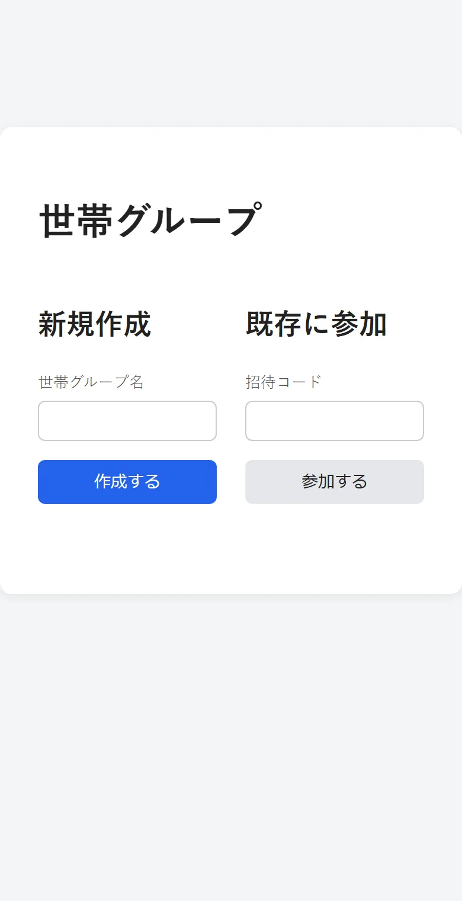
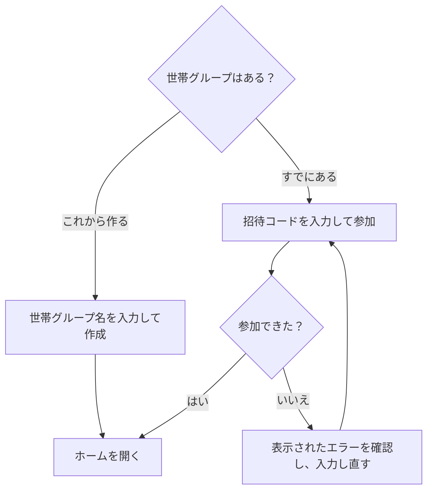
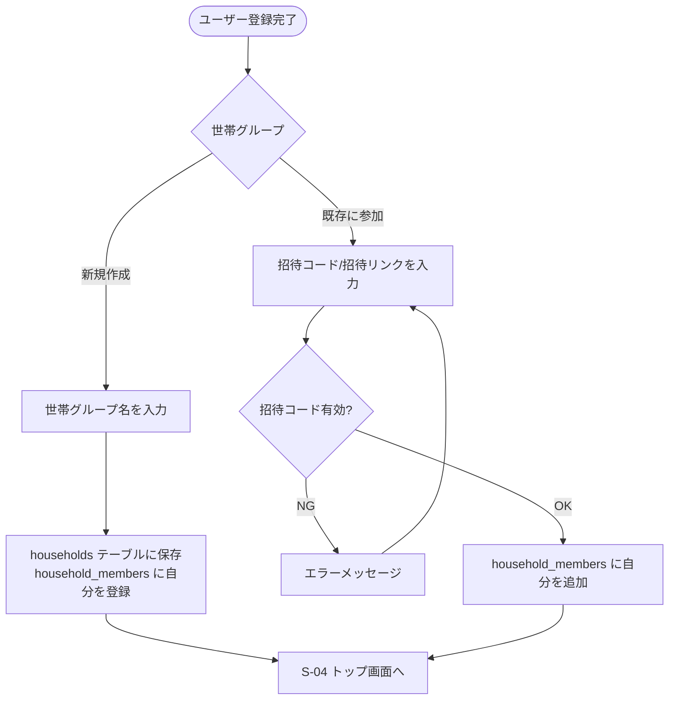

# F-02 世帯グループ管理

[← 要件定義書に戻る](../../requirements.md)

---

## 使い方

世帯に入ると、在庫・献立などの記録や割り勘をメンバーと使えます。ログイン後に「世帯グループ」画面が開いたら、作成か参加を選びます。

| やりたいこと | 画面での操作 |
| --- | --- |
| 世帯を作る | 「新規作成」で世帯グループ名を入力し、「作成する」を押します。 |
| 世帯に入る | 「既存に参加」でメンバーから受け取った招待コードを入力し、「参加する」を押します。 |
| メンバーを招待する | 下部メニューの「その他」から「世帯設定」を開き、招待コードをコピーして招待する相手に伝えます。 |

[退出するときの確認](#退出するときの確認) ｜ [技術詳細](#技術詳細)

## 実画面

世帯グループ名を入力して作る欄と、招待コードで参加する欄が並びます（操作マニュアル・架空データ）。

## 操作フローチャート

## 退出するときの確認

「世帯設定」の「世帯グループから退出する」を押して確認します。退出するとその世帯の共有データにアクセスできなくなります。最後のメンバーが退出すると、世帯と在庫・買い物リストなどの共有データが削除されます。

同時に所属できる世帯は1つです。個人の家計簿は本人が管理します。

技術詳細

## 1. 概要

ユーザーが「世帯グループ」を作成・参加し、精算・在庫・献立を世帯単位で共有できるようにする（[common-notes.md](../common-notes.md) 1章参照）。個人の家計簿は世帯グループに関わらず個人管理のまま。

**MVPでは1ユーザーにつき1世帯グループのみに所属可能とする**（複数世帯への同時所属は不可）。既に世帯グループに所属しているユーザーが別の世帯を作成・参加しようとした場合はエラーとする。将来的に複数世帯への所属が必要になった場合は`household_members`テーブル構造はそのまま多対多に対応できるため、アプリケーション層の制約を緩和するだけで拡張可能。

## 2. 対象画面

| 画面ID | 画面名 |
| --- | --- |
| S-03 | 世帯グループ作成/参加画面 |
| S-27 | 世帯設定画面（世帯名・招待コード・メンバー・退出） |

## 3. 業務フロー

## 4. IPO

### 世帯グループ作成

| 項目 | 内容 |
| --- | --- |
| 入力 | 世帯グループ名 |
| 処理 | 既にいずれかの世帯グループに所属していないか確認 → households テーブルに保存（`invite_code`を自動生成） → household_members に作成者を登録 |
| 出力 | 作成した世帯グループ（招待コードを含む） / エラーメッセージ |

### 世帯グループ参加

| 項目 | 内容 |
| --- | --- |
| 入力 | 招待コード |
| 処理 | 既にいずれかの世帯グループに所属していないか確認 → 招待コードの有効性確認（[data-model.md](../data-model.md)の`households.invite_code`と照合） → household_members に自分を追加 |
| 出力 | 参加完了 / エラーメッセージ |

## 5. データ設計（関連テーブル）

[data-model.md](../data-model.md) の `households`, `household_members` テーブルを参照。API仕様は[api-design.md](../api-design.md) 3章を参照。

### 世帯グループからの退出（実装済み）

| 項目 | 内容 |
| --- | --- |
| 入力 | なし（S-27 の「世帯グループから退出する」→ 確認ダイアログ） |
| 処理 | household_members から本人を削除する。残りのメンバーが0人になった場合は、同じバッチで households を削除し、世帯のデータ（在庫・買い物リスト・レシピ・献立など）もカスケードで削除する |
| 出力 | 退出完了（S-03 へ） |

### 招待コードの再発行（実装済み）

漏えい時などに `POST /api/households/invite-code/regenerate` で招待コードを作り直し、古いコードを無効にする。

## 6. 今後の検討事項

- 他のメンバーを世帯から外す（メンバー削除）フロー
- 将来的に複数世帯への同時所属を許容するかどうか（MVPでは1ユーザー1世帯に限定）

## 7. 世帯管理者・メンバーの権限と退出（未実装の要件）

> 2026-10 時点では世帯管理者のロールは未実装で、世帯のメンバーは全員同じ権限を持つ。以下は将来実装する場合の要件として残す。

- 世帯を作成したユーザーを最初の世帯管理者とする。世帯管理者は複数人設定でき、既存の管理者は信頼する世帯メンバーに管理者権限を付与・解除できる。
- 世帯管理者は世帯の基本設定、招待・メンバー管理等を行う。個人の収入・支出明細、口座・カード名、残高等は世帯管理者にも開示しない。権限表は[common-notes.md](../common-notes.md) 2章および12章を参照。
- 管理者権限の変更は本人確認を伴う操作とし、変更者・対象者・日時を記録する。実装時にはサーバー側認可を必須とする。唯一の世帯管理者を解除・降格する場合は、後任管理者への引継ぎと同一操作でなければならない。
- 世帯から退出する管理者は、他の管理者がいれば管理体制を維持した状態で退出できる。最後の管理者は先に後任を指定する。
- 退会者が作成した世帯共有データの保持・表示、および最後の管理者が後任を設定できない場合の世帯の扱いは、[common-notes.md](../common-notes.md) 12章にある未決事項を実装着手前に確定する。

## 8. デモ環境での扱い

デモ環境（`DEMO_MODE="true"`）では、利用者ごとに専用の世帯「デモ家」とデモ太郎・デモ花子の2人を作って始める（`POST /api/demo/start`。データモデルは[data-model.md](../data-model.md)の `demo_households`）。

- **止める操作**：次の API は 403 `DEMO_DISABLED`（「デモでは使えません」）を返す。`POST /api/households`（作成）、`POST /api/households/join`（参加）、`POST /api/households/leave`（退出）、`POST /api/households/invite-code/regenerate`（招待コードの再発行）。世帯の取得（`GET /api/households/me`）は使える。
- **世帯の寿命**：デモ世帯は作成から24時間で期限切れになり、毎時の Cron で世帯・2人・関連する全データが削除される。通常の世帯・利用者には触れない。
- 本番（`DEMO_MODE` なし）では、これらの API は従来どおり動く。

### 関連する変更

- [専用世帯で2人のアカウントを切り替えるデモ環境](https://github.com/yamamotonaoki3/HomeLog/issues/529)

