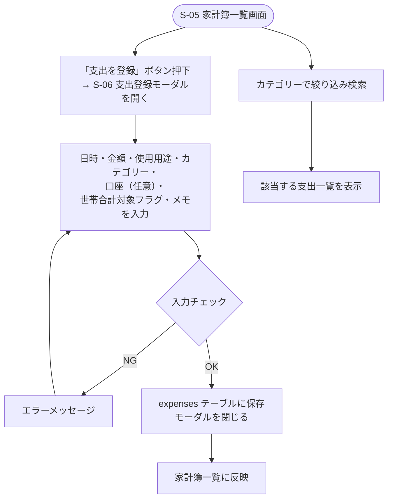

# F-03 個人支出管理

[← 要件定義書に戻る](../../requirements.md)

---

## 1. 概要

個人の日々の支出を記録し、カテゴリー別に検索できる（[common-notes.md](../common-notes.md) 2章：本人のみ編集可能）。

## 2. 対象画面

| 画面ID | 画面名 |
| --- | --- |
| S-05 | 家計簿一覧画面 |
| S-06 | 支出登録モーダル |
| S-23 | 家計簿カテゴリー管理画面 |

## 3. 業務フロー

## 4. IPO

### 支出登録

| 項目 | 内容 |
| --- | --- |
| 入力 | 日時（必須）・金額（必須）・使用用途（任意）・カテゴリー（必須）・口座（任意）・世帯合計対象フラグ（必須、デフォルトは要検討）・メモ（任意） |
| 処理 | 入力チェック → expenses テーブルに保存 |
| 出力 | 登録した支出オブジェクト / エラーメッセージ |

### カテゴリー別検索

| 項目 | 内容 |
| --- | --- |
| 入力 | カテゴリーID |
| 処理 | expenses テーブルを category_id で検索 |
| 出力 | 該当する支出一覧 |

## 5. 入力チェック仕様

| 項目 | 必須 | 形式・制約 |
| --- | --- | --- |
| 日時 | ○ | 日付形式 |
| 金額 | ○ | 0より大きい整数 |
| 使用用途 | — | 0〜100文字（空欄可） |
| カテゴリー | ○ | kakeibo_categories から選択 |
| 口座 | — | accounts / cards から選択（[F11_kakeibo_account](F11_kakeibo_account.md)参照） |
| 世帯合計対象フラグ | ○ | true/false。デフォルトfalse（[common-notes.md](../common-notes.md) 11章参照） |
| メモ | — | 0〜255文字 |

「支払った人」に相当する項目（＝支出を払った人）は登録者本人固定とし、選択式にはしない（[F13_kakeibo_income](F13_kakeibo_income.md) 6章と同じ設計思想。他人を選択できてしまうと「本人のみ編集可能」という権限方針と矛盾するため）。

## 6. カテゴリーマスタ初期リスト

食費／日用品／交際費／光熱費／住居費／通信費／医療費／趣味・娯楽／固定費／その他（[common-notes.md](../common-notes.md) 11章参照）

## 6-2. カテゴリー管理（追加・編集・削除）

S-05（家計簿一覧画面）ツールバーの「カテゴリー管理」リンクからS-23（家計簿カテゴリー管理画面）に遷移し、支出カテゴリーを自分で追加・編集・削除できる。

- 6章の初期リストは**デフォルトカテゴリー**として世帯単位で初回アクセス時に冪等シードされ、編集・削除できない。
- ユーザーは**カスタムカテゴリー**を追加できる。名前は1〜50文字必須。
- カスタムカテゴリーは編集（名前変更）・削除ができるが、既に支出（`expenses`）に紐づいて使用中のカテゴリーは削除できない（先に付け替えが必要）。
- API：`GET/POST/PATCH/DELETE /api/kakeibo-categories`（バックエンド実装済み。[api-design.md](../api-design.md)は現時点でMVPスコープのみを記載しているため、家計簿系エンドポイントは未追記）。

## 7. データ設計（関連テーブル）

[data-model.md](../data-model.md) の `expenses`, `kakeibo_categories`, `accounts` テーブルを参照。

## 7-2. 一覧・詳細閲覧（Issue #214）

- S-05は「すべて／支出／収入」の絞り込みを持ち、全モードで日付・内容・金額の3列を表示する。金額は支出を「-1,000円」、収入を「+1,000円」とし、既存の支出・収入配色と符号で区別する。
- 行全体（日付・金額セルを含む）のタップ、または内容ボタンのEnter／Spaceで本人の支出詳細を開く。空用途は「内容なし」と表示する。
- 詳細は日付・内容・金額・種別・カテゴリー・口座またはチャージ型カード・世帯合計対象・イベント・メモ・割り勘内訳（相手、割合／負担額、状態）を表示する。creditカードは保存済み親口座を表示し、元カード名を推測しない。
- 割り勘は同じ支出IDの支払者側内訳だけを表示し、取得中・取得失敗・取得成功後の0件を区別する。
- 閉じる・Escape・背景タップで閉じ、内容ボタンへフォーカスを戻す。詳細は閲覧専用で、編集・削除ボタンや更新・削除APIは追加しない。

## 8. 今後の検討事項

- 支出そのものの編集・削除は別Issueで検討する（残高補正、割り勘・精算済み明細・自動計上の扱いを含む）。
