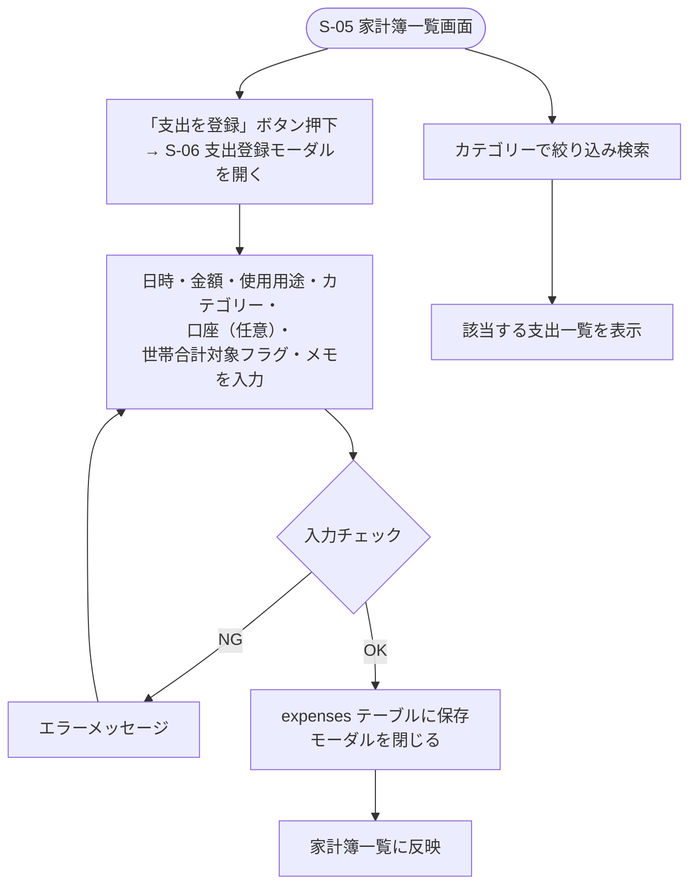

# F-03 個人支出管理

[← 要件定義書に戻る](../../requirements.md)

---

## 1. 概要

個人の日々の支出を記録し、カテゴリー別に検索できる（[common-notes.md](../common-notes.md) 2章：本人のみ編集可能）。

## 2. 対象画面

| 画面ID | 画面名 |
| --- | --- |
| S-05 | 家計簿一覧画面 |
| S-06 | 支出登録モーダル |
| S-23 | 家計簿カテゴリー管理画面 |
| S-30 | 支出・収入詳細モーダル（7-2章） |

## 3. 業務フロー

## 4. IPO

### 支出登録

| 項目 | 内容 |
| --- | --- |
| 入力 | 日時（必須）・金額（必須）・使用用途（任意）・カテゴリー（必須）・口座（任意）・世帯合計対象フラグ（必須、デフォルトは要検討）・メモ（任意） |
| 処理 | 入力チェック → expenses テーブルに保存 |
| 出力 | 登録した支出オブジェクト / エラーメッセージ |

### カテゴリー別検索

| 項目 | 内容 |
| --- | --- |
| 入力 | カテゴリーID |
| 処理 | expenses テーブルを category_id で検索 |
| 出力 | 該当する支出一覧 |

## 5. 入力チェック仕様

| 項目 | 必須 | 形式・制約 |
| --- | --- | --- |
| 日時 | ○ | 日付形式 |
| 金額 | ○ | 0より大きい整数 |
| 使用用途 | — | 0〜100文字（空欄可） |
| カテゴリー | ○ | kakeibo_categories から選択 |
| 口座 | — | accounts / cards から選択（[F11_kakeibo_account](F11_kakeibo_account.md)参照） |
| 世帯合計対象フラグ | ○ | true/false。デフォルトfalse（[common-notes.md](../common-notes.md) 11章参照） |
| メモ | — | 0〜255文字 |

「支払った人」に相当する項目（＝支出を払った人）は登録者本人固定とし、選択式にはしない（[F13_kakeibo_income](F13_kakeibo_income.md) 6章と同じ設計思想。他人を選択できてしまうと「本人のみ編集可能」という権限方針と矛盾するため）。

## 6. カテゴリーマスタ初期リスト

食費／日用品／交際費／光熱費／住居費／通信費／医療費／趣味・娯楽／固定費／その他（[common-notes.md](../common-notes.md) 11章参照）

## 6-2. カテゴリー管理（追加・編集・削除）

S-05（家計簿一覧画面）ツールバーの「カテゴリー管理」リンクからS-23（家計簿カテゴリー管理画面）に遷移し、支出カテゴリーを自分で追加・編集・削除できる。

- 6章の初期リストは**デフォルトカテゴリー**として世帯単位で初回アクセス時に冪等シードされ、編集・削除できない。
- ユーザーは**カスタムカテゴリー**を追加できる。名前は1〜50文字必須。
- カスタムカテゴリーは編集（名前変更）・削除ができるが、既に支出（`expenses`）に紐づいて使用中のカテゴリーは削除できない（先に付け替えが必要）。
- API：`GET/POST /api/kakeibo-categories`・`PATCH/DELETE /api/kakeibo-categories/:id`（[api-design.md](../api-design.md) 8章）。

## 7. データ設計（関連テーブル）

[data-model.md](../data-model.md) の `expenses`, `kakeibo_categories`, `accounts` テーブルを参照。

## 7-2. 一覧・詳細閲覧（Issue #214）

- S-05は「すべて／支出／収入」の絞り込みを持ち、全モードで日付・内容・金額の3列を表示する。金額は支出を「-1,000円」、収入を「+1,000円」とし、既存の支出・収入配色と符号で区別する。
- ネイティブbutton＋span/gridの行全体（日付・内容・金額・余白を含む）のタップ、または行ボタンのEnter／Spaceで本人の支出詳細を開く。空用途は「内容なし」と表示する。
- 詳細は日付・内容・金額・種別・カテゴリー・口座またはチャージ型カード・世帯合計対象・イベント・メモ・割り勘内訳（相手、割合／負担額、状態）を表示する。creditカードは保存済み親口座を表示し、元カード名を推測しない。
- 割り勘は同じ支出IDの支払者側内訳だけを表示し、取得中・取得失敗・取得成功後の0件を区別する。
- 閉じる・Escape・背景タップで閉じ、行ボタンへフォーカスを戻す。詳細下部に「編集」「閉じる」、既存の削除が可能な場合だけ対象名付き右上ゴミ箱を表示する（#277/#422 partial）。編集・削除の条件は下記を参照。

## 8. 今後の検討事項

- なし（支出・収入の編集・削除は#275・#277で実装済み。下記「支出・収入の編集・削除」参照）

## 支出・収入の編集・削除（#275）

支出・収入は登録した本人だけが編集・削除できる（他メンバー・他世帯・存在しないIDは404）。

- **画面（#277）**：詳細から登録モーダルを既存値入りの編集モードで開く。タイトルは「支出を編集」「収入を編集」とし、種別切り替えは表示しない。チャージ型カード払いはカードを初期選択する。保存後は一覧・口座残高・割り勘・集計を再取得し、更新後の詳細へ戻る。編集をキャンセルした場合も詳細へ戻る。
- **削除確認（#277）**：「この操作は取り消せません」を含む確認ダイアログを表示する。成功後は詳細を閉じ、一覧・口座残高・割り勘・集計を再取得し、トーストを表示する。400/409などのAPIエラーはAPIメッセージをモーダル内のアラートとして表示する。
- **操作制限（#277）**：支払者側の割り勘内訳に未請求以外があれば編集・削除を無効にし、「請求中・精算済みの割り勘がある支出は編集・削除できません」と表示する。支出は割り勘の取得中・取得失敗時も操作を無効にする。

- **API**：`PUT /api/expenses/:id`・`DELETE /api/expenses/:id`・`PUT /api/incomes/:id`・`DELETE /api/incomes/:id`。PUTは登録APIと同じ入力・検証の全置換（支出の`splits`省略/null/`[]`は割り勘解除）。PUTは200で登録時と同じ形、DELETEは204。
- **残高**：削除時は口座・チャージ型カードの残高を戻す。編集で金額・口座・カードが変わるときは旧先へ戻して新先から引き直す（収入は逆向き。同じ先なら差額のみ）。クレジットカードは親口座、チャージ型はカード残高を補正する。明細の変更と残高補正は同じD1 batchで原子的に行う。
- **割り勘**：内訳が全件「未請求（unpaid）」のときだけ編集・削除できる。編集時は内訳を作り直し（旧内訳のコメントも削除）、削除時は内訳ごと消す。請求中以降が1件でもあれば409。
- **固定費の自動計上分**：通常の支出と同じく編集・削除できる。削除した計上月は`fixed_cost_posting_suppressions`に記録し、同じ月には再計上しない（編集で日付を変えても元の計上月で判定）。
- **精算で自動作成された明細**：#275以降の精算で作られた収入・支出は`settlement_split_id`を持ち、編集・削除は409。それ以前の明細は区別できないため通常の明細として扱う。
- **削除済み口座**：補正先の口座・カードが論理削除済みまたは存在しない明細は409（例：削除済み口座に入金した収入）。`account_id`がNULLの過去の収入は削除可（補正なし）、編集時は有効な口座が必須。
- 409は`RESOURCE_CONFLICT`。判定順は認証→世帯→本人の対象→編集可否→本文検証。

## #422 家計簿UIと前回口座の記憶

- 本人情報の取得中もフォームは開けるが、登録/更新の送信開始は取得完了まで待つ。取得失敗など本人不明の既定状態では記憶を使わず従来の保存を行う。

- 履歴の既存全期間取得・新しい順を維持し、キーワード/収支/対象月と既存カテゴリーで絞り込む。当月サマリーは年月を明示し、当月収入・支出・差額を表示する。履歴のfilterで会計対象や当月合計を再定義しない。上部の開始操作は「収支を登録」とする。#473で、当月の集計は見出しを「YYYY年M月の集計」とした1枚のカード（収入・支出・差額の3列、金額は3桁区切り）、履歴は1件1枚のカードにした。登録フォームは見出しを「収支を登録」とし、支出／収入の切り替え、日時と金額の横並び、補足付きの「その他の設定」、同じ幅の「キャンセル／登録」に整えた（操作名と動作は変えない）。
- 基本の日時・金額・用途/内容・カテゴリー・支払元/入金先は常時表示し、支出の世帯合計/イベント/割り勘/メモ、収入のメモを「その他の設定」へまとめる。開閉で値や送信bodyを変えず、編集は元明細を優先する。新規登録の支払元/入金先は、同じbrowser内で利用者別・収入/支出別に記憶した前回の成功選択を初期候補にする。編集は元明細を優先する。
- 既存詳細の削除を右上へ移し、確認を省略しない。親詳細は編集/確認中hiddenで保持して最上位の子へキー操作を譲る。取消/終了後の起点focus、API失敗・保存/削除成功後GET失敗の区別、請求中/精算済の操作制限を維持する。登録・編集フォームへ新しい削除経路は追加しない。

- 前回口座の記憶は利用者ID・収支種別ごとに分け、口座/カードの種別とID、または明示未選択だけをbrowserに保存する。口座名・残高・明細・認証情報は保存しない。ログアウトで記憶は消さず、別利用者へ候補や未保存入力を引き継がない。
- 記憶は登録/更新APIの成功時だけ更新する。取消・入力エラー・API失敗では変えず、成功後の一覧再取得失敗は登録済みと区別し、記憶も成功選択を維持する。保存中に利用者が変わった場合の旧応答は、新利用者の記憶や画面に反映しない。
- 新規の初回・本人未確定・記憶破損・削除済みなど使用不能な候補は未選択とし、先頭口座を自動選択しない。収入はカードを選択できず、有効な口座が必須。支出の明示解除も保存成功時に記憶する。新規登録時に口座候補が取得中/失敗で自動的に未選択となった場合は、保存成功でも前回の記憶を上書きしない。記憶更新の要否は送信開始時の選択意図で確定し、編集中の元値や明示解除は保存対象とする。口座取得中/失敗を候補消失と扱わず、遅い候補取得で利用者の手動変更/解除を上書きしない。browserの記憶機能へのアクセス失敗は通常の登録/更新の成否を変えない。
