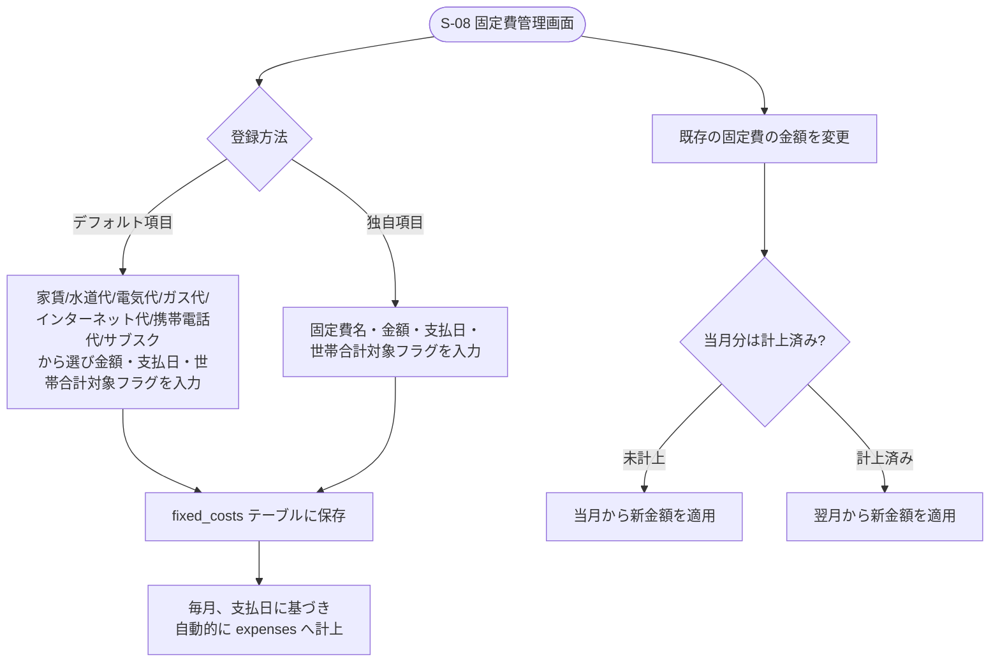

# F-05 固定費管理

[← 要件定義書に戻る](../../requirements.md)

---

## 1. 概要

家賃・水道代等の固定費を登録し、毎月自動的に支出として計上する。

> **実装状況**：固定費の登録・一覧・編集・削除、世帯合計対象フラグの保存、毎月の自動計上バッチ（7-2章）は
> 実装済み。割り勘設定（6-3章、`fixed_cost_splits`）はバックエンドAPI・自動計上時の `expense_splits` 生成を
> 実装済み。S-08 固定費登録・編集モーダルの割り勘入力UI（`SplitFields` を流用、世帯内・世帯外の混在に対応）と
> S-08 一覧は固定費名・金額・支払日・引き落とし元の4列。行全体から詳細を開き、割り勘設定と編集・削除を確認する。

### 一覧と詳細（S-08）

- 一覧の行全体をボタンとし、クリック・タップ・Enter/Spaceで詳細モーダルを開く。長い値は全文折り返し、320pxでもページ全体を横にはみ出させない。
- 詳細には固定費名・金額・支払日・公開範囲・世帯合計対象・引き落とし元・割り勘設定（入力方法、相手、割合、金額）を表示する。編集・削除は登録者のみ詳細下部から操作できる。
- 他者の引き落とし元・割り勘は「非公開」、本人未指定は「なし」。名前を取得できない場合は未確認として区別し、退出済み相手は名前を推測しない。APIの秘匿契約を変更しない。
- 編集保存・キャンセル、削除キャンセルで詳細へ戻る。保存レスポンスを一覧へ反映し、一覧の再取得に失敗しても保存を再送しない。削除成功後は登録ボタンへ、通常の詳細閉鎖では起点行へフォーカスを戻す。

## 2. 対象画面

| 画面ID | 画面名 |
| --- | --- |
| S-08 | 固定費管理画面 |
| S-05 | 家計簿一覧画面（サマリーカードに固定費予定額を表示。詳細な一覧・登録はS-08で行う） |

## 3. 業務フロー

## 4. IPO

### 固定費登録

| 項目 | 内容 |
| --- | --- |
| 入力 | 固定費名（デフォルト項目 or 独自入力）・金額・支払日・世帯合計対象フラグ・公開範囲（個人／世帯共有）・引き落とし元（口座/カード、任意）・割り勘設定（任意、％/金額入力） |
| 処理 | S-08の固定費登録モーダルから fixed_costs テーブルに保存。公開範囲が「個人」の場合は `owner_user_id` に登録者を設定、「世帯共有」の場合はNULL。引き落とし元は accounts / cards から選択（[F11_kakeibo_account](F11_kakeibo_account.md)参照。入力仕様は[F03_kakeibo_expense](F03_kakeibo_expense.md) 5章の「口座」項目と同一で、口座とカードは同時に指定できない）。割り勘設定は fixed_cost_splits テーブルに保存（入力仕様・バリデーションは[F04_kakeibo_warikan](F04_kakeibo_warikan.md) 7章と同一） |
| 出力 | 登録した固定費 |

### 毎月の自動計上

| 項目 | 内容 |
| --- | --- |
| 入力 | なし（バッチ/スケジューラによる自動実行） |
| 処理 | 支払日に基づき fixed_costs から expenses へ自動でレコードを作成。引き落とし元が指定されている場合、支出登録（[F03_kakeibo_expense](F03_kakeibo_expense.md)）と同様に口座・カードの残高へ反映する（カードがチャージ型ならカード残高、クレジット型なら紐づく口座残高から減算）。割り勘設定（fixed_cost_splits）がある固定費は、その設定を雛形として expense_splits も同時に `status=unpaid` で作成する |
| 出力 | 作成された支出レコード（および割り勘設定がある場合は精算レコード） |

### 金額変更

| 項目 | 内容 |
| --- | --- |
| 入力 | fixed_cost ID・新しい金額 |
| 処理 | 当月分が未計上なら当月から、計上済みなら翌月から新金額を適用 |
| 出力 | 更新後の固定費 |

## 5. デフォルト固定費項目

家賃、水道代、電気代、ガス代、インターネット代、携帯電話代、サブスクリプション（動画・音楽配信等）

## 6. 世帯合計対象フラグ

固定費は世帯で共有する費用（例：家賃、水道代）と個人的な費用（例：個人サブスク）が混在しうるため、支出と同様に`include_in_household_total`フラグを持ち、世帯合計支出（[F12_kakeibo_household_summary](F12_kakeibo_household_summary.md)）への算入可否を制御する。

## 6-2. 公開範囲（個人／世帯共有）

- 固定費は登録時に公開範囲を選択する（[common-notes.md](../common-notes.md) 2章）。
  - **世帯共有**（`owner_user_id` = NULL）：家賃・水道代など。世帯メンバー全員が閲覧可能。ただし**編集・削除は登録者（`created_by_user_id`）のみ**可能（誤って他人の家賃を削除・変更する事故を防ぐため）。
  - **個人**（`owner_user_id` = 登録者）：個人サブスクなど。本人のみ閲覧・編集可能で、他の世帯メンバーの一覧・固定費予定サマリーには表示されない。
- 公開範囲（明細の閲覧可否）と世帯合計対象フラグ（世帯合計金額への算入可否）は独立した設定であり、「個人所有だが世帯合計には含める」という組み合わせも可能。この場合、他の世帯メンバーには世帯合計支出（[F12_kakeibo_household_summary](F12_kakeibo_household_summary.md)）の**合計金額の一部としてのみ**反映され、固定費名・金額等の明細は開示されない。これは個人の支出（expenses）を`include_in_household_total=true`で登録した場合と同じ扱いである（[common-notes.md](../common-notes.md) 8章：世帯合計サマリーで開示するのは合計金額のみ）。
- **登録者（`created_by_user_id`）**：世帯共有の固定費は「誰か一人が実際に支払っている」という前提のもと、登録者を自動計上時の支払者（`expenses.payer_user_id`）として扱う。個人所有の場合は`owner_user_id`と同値になる。

## 6-3. 割り勘設定（実装済み）

- 家賃・水道代など、毎月同じ割合で割り勘する固定費のために、固定費自体に割り勘設定を持たせられる（`fixed_cost_splits`）。API・自動計上・登録・編集・詳細UIは世帯内メンバーと世帯外の相手の混在に対応する（#253、#254）。1人世帯でも世帯外の人を登録できる。
- 編集で既存の世帯外名を変更しなければ外部IDを維持する。名前を変更した場合はこの固定費の相手を新しい相手に差し替え、既存相手マスタ・過去の精算は更新しない。種別変更では以前の相手指定を引き継がない。
- 詳細ではAPIが返す外部名を表示し、欠落時は「相手の名前を確認できません」とする。世帯メンバーの取得待ち・失敗でも外部名は表示する。他者の割り勘設定は「非公開」。
- 入力UIは支出の割り勘（[F04_kakeibo_warikan](F04_kakeibo_warikan.md) 7章）と共用する。固定費の合計判定は、相手の割合合計100%以下（既存の0.01%許容を維持）・金額合計は固定費金額以下とする。登録者本人の負担分は残りとして暗黙に決まり、相手だけで100%・全額に一致させる必要はない。API・自動計上の計算には `src/lib/split-calc.ts` の `resolveSplits` を共用する。
- `POST/PATCH /api/fixed-costs` の `splits` は、各行で `debtorUserId` / `debtorExternalId` / `debtorExternalName` のいずれか一つと割合 or 金額を指定する。新規名はtrim・50文字以内、既存外部IDは自世帯のものに限る。自己指定・重複を拒否し、最大20行。排他はアプリ層で検証する（DB CHECKなし）。名前の自動名寄せはしない。
- 本人向け `GET/POST/PATCH` の内訳には `debtorUserId`（世帯外ならnull）、`debtorExternalId` / `debtorExternalName`（世帯内ならnull）、`splitRatio`、`amountDue` を返す。PATCH は毎回全置換（空配列・省略・nullで削除）。他メンバーには従来どおり `splitInputType:null` / `splits:[]` を返す。
- 自動計上は所属中の世帯内メンバーと自世帯の世帯外相手を対象にし、退出済みメンバーだけを除外する。両種別は別キーで計算し、支出内訳に対応するIDを転記する。退会snapshotは#253の対象外。
- 毎月の自動計上時に、この設定を雛形として expenses と expense_splits（`status=unpaid`）を同一トランザクションで生成する。負担額は**その時点の固定費金額**に対して `resolveSplits` で計算し直す（金額変更後もつじつまが合うように）。金額変更で割り勘の整合が取れなくなった場合は、支出だけ計上し expense_splits の生成はスキップしてログに記録する。以降の請求・承認フローは通常の割り勘と同じ。

## 6-4. 引き落とし元（口座・カード）

- 固定費は登録時に引き落とし元の口座・カードを任意で指定できる（未指定も可。未指定の場合、自動計上された支出は口座・カード残高に影響しない）。
- 口座・カードは登録者本人（`created_by_user_id`）が所有するものに限る。個人所有・世帯共有いずれの固定費でも、登録者自身の口座・カードを指定する（[F11_kakeibo_account](F11_kakeibo_account.md)参照）。
- 口座とカードは同時に指定できない（[F03_kakeibo_expense](F03_kakeibo_expense.md) 5章の「口座」項目と同一の制約）。
- 固定費で使用中（引き落とし元に指定されている）の口座・カードは削除できない（[F11_kakeibo_account](F11_kakeibo_account.md)の既存の削除制約と同様）。

## 6-5. 作成者の退会と世帯共有固定費の引き継ぎ

- アカウント削除を申請する作成者は、有効な世帯共有固定費を、残る世帯メンバーへ引き継ぐか、今後の自動計上を停止して削除する。
- 引き継ぐ場合は、新しい登録者（`created_by_user_id`）を設定し、引き落とし元口座/カードは新しい登録者が所有するものへ変更する。引き落とし元を設定しない場合はNULLにする。退会者の個人口座を継続参照しない。
- 個人所有の固定費は本人専用データとして削除する。引き継ぎ/停止前はアカウント削除を確定できない。
- 既に計上済みの世帯共有支出・精算履歴は、[data-model.md](../data-model.md)と[common-notes.md](../common-notes.md) 12章の退会者表示・識別情報解除ルールに従う。

## 7. データ設計（関連テーブル）

[data-model.md](../data-model.md) の `fixed_costs`（`created_by_user_id`、`account_id`、`card_id`含む）, `fixed_cost_splits`, `expenses.fixed_cost_id` を参照。

## 7-2. 自動計上バッチの実装方式（実装済み）

- `@Scheduled`（Spring Boot標準機能）により毎日1:00（Asia/Tokyo）に実行する。全世帯を対象に、`payment_day`が当日と一致する固定費、または当日がその月の末日かつ`payment_day`が当月の末日を超える固定費（例：`payment_day=31`の固定費を2月28日に計上）を抽出し、未計上（同一固定費・同月にまだexpensesが存在しない）であれば`expenses`へ計上する。1件の計上失敗は他の固定費の計上を妨げない（ログに記録し次の固定費の処理を継続する）。
- カテゴリーは、家計簿カテゴリーの初期リスト（[F03_kakeibo_expense](F03_kakeibo_expense.md)参照）に追加した「固定費」というデフォルトカテゴリーを使用する。世帯がまだ一度もカテゴリー一覧を取得しておらず「固定費」カテゴリーが存在しない場合、その世帯の計上はエラーとしてログに記録され、他世帯の計上には影響しない。

## 8. 今後の検討事項

- 金額変更時の「当月分未計上なら当月から／計上済みなら翌月から」の厳密な適用（現状は変更を即時反映）
- 割り勘設定を「金額入力」モードにした固定費の金額を後から変更した場合、負担額の合計が新しい金額と
  合わなくなる（自動計上時にスキップされる）。金額モードの固定費は金額変更時に割り勘設定の再入力を促す等
- 引き継ぎを行う画面・確認手順、作成者が所属世帯から先に退出してしまった場合の復旧運用

## 自動計上分の編集・削除（#275）

- 自動計上された支出は通常の支出と同じく編集・削除できる。固定費マスタや翌月以降の計上には影響しない。
- 削除した計上月（`fixed_cost_id`・`fixed_cost_year_month`）は`fixed_cost_posting_suppressions`に記録し、自動計上はその月をスキップする。
