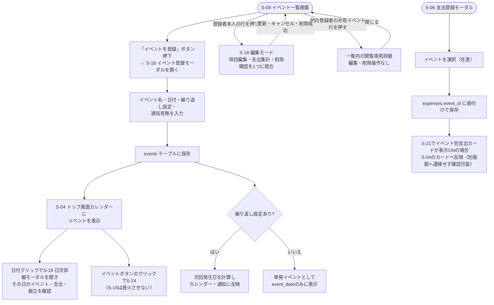

# F-06 イベント管理

[← 要件定義書に戻る](../../requirements.md)

---

## 1. 概要

イベント（例：父の日、推し活、旅行、学習などの習慣）を作成し、複数の支出を後から紐付けて集計できるようにする。イベントは日付を持ち、トップ画面の月間カレンダーに表示される。単発イベントだけでなく、毎日/毎週/毎月/毎年の繰り返し設定にも対応し、繰り返しイベントはアプリ内通知で知らせる。

## 2. 対象画面

| 画面ID | 画面名 |
| --- | --- |
| S-09 | イベント一覧・集計画面 |
| S-18 | イベント登録・編集モーダル（編集時は支出集計・削除確認を同じモーダル内に表示） |
| S-06 | 支出登録モーダル（イベント紐付け） |
| S-04 | トップ画面（生活ダッシュボード。月間カレンダーへのイベント表示・表示設定でONにしたイベント別支出カードを表示） |
| S-05 | 家計簿一覧画面（サマリーカードにイベント別支出サマリーを表示。詳細な一覧・登録はS-09で行う） |
| S-19 | 日次詳細モーダル（その日のイベント確認・追加） |
| S-24 | イベント詳細モーダル（閲覧専用。S-04のイベントボタンから開く） |

## 3. 業務フロー

## 4. IPO

### イベント作成

| 項目 | 内容 |
| --- | --- |
| 入力 | イベント名・日付（event_date）・終日フラグ（デフォルトON）・開始/終了時刻（終日OFF時）・繰り返し設定（`none`/`daily`/`weekly`/`monthly`/`yearly`）・通知有無・デフォルト金額（任意）・公開範囲（個人／世帯共有） |
| 処理 | events テーブルに保存。公開範囲が「個人」の場合は `owner_user_id` に登録者を設定、「世帯共有」の場合はNULL。終日OFFの場合は開始時刻必須（終了時刻のみの入力は不可）、終了時刻＜開始時刻はバリデーションエラー |
| 出力 | 作成したイベント |

### 支出とイベントの紐付け

| 項目 | 内容 |
| --- | --- |
| 入力 | 支出情報・イベントID（任意） |
| 処理 | S-06支出登録モーダルでイベントを選択すると、そのイベントの`default_amount`が設定されていれば支出の金額欄へ自動入力する（ユーザーは登録前に上書き可能）。保存時は expenses.event_id に設定して保存 |
| 出力 | イベントに紐付いた支出 |

### イベント別集計

トップ画面の独立したイベント別支出カードは、「そのイベントにいくら使ったか」を確認する目的のため、カード内の期間セレクトを**今日／今月／今年**から選択できるようにする（デフォルトは今年）。この選択はS-04の一時的な画面状態であり、ユーザー別表示設定には保存しない。「今年」は投資専用集計ではなく、JSTの暦年を意味する。

また、全イベントを一律に表示するのではなく、**表示対象として選択したイベント（`show_on_dashboard` = true）のみ**を表示する。ON/OFF は S-18 イベント登録モーダル（デフォルト ON）および S-09一覧から開く編集モーダル内のチェックボックス（登録者のみ、他の項目と一緒に保存）で切り替える。表示対象のイベントは、選択期間の支出が 0 円でも表示する（確認したいイベントであるため）。

| 項目 | 内容 |
| --- | --- |
| 入力 | イベントID・対象期間セレクト（`today`＝今日／`month`＝今月／`year`＝今年、デフォルト`year`） |
| 処理 | `show_on_dashboard` = true のイベントを対象に、`event_id` が一致し、ログインユーザー本人が支払った expenses の `expense_date` がJSTの対象期間に該当するものだけを集計し、SUM(amount)を計算。繰り返しイベントの発生日では集計しない |
| 出力 | イベント名：選択期間の合計金額（表示対象イベントのみ） |

### トップ画面カレンダーへの表示

| 項目 | 内容 |
| --- | --- |
| 入力 | 表示対象の年月 |
| 処理 | 対象月内の event_date を持つイベント、および繰り返し設定により対象月に発生日を持つイベントを抽出 |
| 出力 | 該当日にイベント名を表示するカレンダーデータ |

### S-09の一覧・編集・閲覧専用詳細

- 一覧はコンパクトな縦リスト（#426 A案）。左の日付ブロックに年と月日、右にイベント名を主情報として置き、その下へ時間帯（終日／開始〜終了／開始〜）と繰り返しを補助情報として表示する。従来の3列見出しは置かない。長い名称は省略せず折り返し、320pxでも横にはみ出させない。時刻は途中で折り返さず、補助項目の間で必要に応じて折り返す。原本の完全日付をtimeのdatetimeと行のアクセシブルな説明に保持し、異なる年の同月日を区別する。
- 一覧に金額列・期間選択は置かない。一覧行全体をネイティブbutton＋span/gridとし、イベント名・日時・繰り返し・余白のタップ／クリック、Enter／Spaceで登録者（editable=true）は編集モーダルを直接開く。他のメンバーは閲覧専用詳細を開く。編集モーダルに支出集計（今年／今月）と削除操作をまとめ、別の詳細・確認モーダルへ切り替えない。削除確認は同じモーダル内に表示し、取りやめても未保存入力を維持する。保存／キャンセル後は一覧へ戻る。閉じる際は起点行（消失時は登録）へフォーカスを戻す。
- S-18編集モードはイベント名・日付・時間帯・繰り返し・公開範囲・通知・デフォルト金額・ダッシュボード表示を既存値入りで表示し、「更新」でまとめて保存する。本人の支出合計と期間選択、削除確認も同じモーダル内に置く。削除を取りやめる「削除をやめる」は入力を保持し、削除ボタンへフォーカスを戻す。API失敗はモーダル内に表示して再試行できる。
- 他の登録者の共有イベントは、一覧内の閲覧専用詳細に上記の保存済み情報と本人の支出合計を表示し、編集・削除・表示切替は提供しない。
- 支出合計は既存summary APIを使う。期間の既定は今年、今月への切替は編集・閲覧専用の各モーダル内に置く。表示OFFによる404は「集計対象外」、その他の取得失敗は合計0円と区別する。
- モーダルは名前付きdialogとし、編集は「キャンセル」、閲覧専用は「閉じる」、いずれもEscape・背景クリックで閉じる。編集の初期フォーカスはイベント名、閲覧専用は閉じるボタンとする。送信中はキャンセル・Escape・背景クリックで閉じない。スマホで縦スクロール可能とし、320pxでも一覧・モーダルの内容や操作を横にはみ出させない。
- S-04のS-24は引き続き閲覧専用とする。

### S-18の共通フォーム（#426）

#481で見た目を整えた。一覧は1件1枚のカードにして公開範囲（世帯共有／個人）の印を添え、フォームは終日・通知・サマリー表示をチェックボックスのまま切り替えスイッチの見た目に、末尾を同じ幅の「キャンセル／登録（更新）」にした。項目・操作名・保存内容は変えない。

- 登録・編集とも、イベント名、日付、終日（初期ON）、終日OFF時の開始／終了時刻、繰り返し、直下の通知、公開範囲を基本欄に置く。開始／終了は320pxでも横2列、開始必須・終了任意と既存の時刻検証を維持する。公開範囲は世帯共有／個人の2択を常時表示する。
- デフォルト金額とトップ画面のイベント別支出サマリー表示だけを「その他の設定」にまとめる。開閉ボタンは現在の保存対象値の概要（金額未設定・サマリー表示、3,000円・サマリー非表示など）を表示し、aria-expandedと操作対象を関連付ける。閉じても入力値を保持し、隠れた入力はTab対象にしない。金額は空欄可、入力時は1以上の整数、サマリー表示の登録時既定はON。
- スマホは本文を独立スクロールとし、登録／更新とキャンセルをモーダル下部に保持する。末尾の設定・集計・エラーが操作欄に隠れない余白とsafe-areaを確保する。入力は16px以上、操作は44px程度以上とし、PCの保存→キャンセルの順と既存色を維持する。実機Safariのキーボード・ズームの最終確認はユーザー確認で行う。
- 削除は権限のある編集時だけタイトルバー右上にゴミ箱を置き、保存済みイベント名を含むアクセシブルな名前と44×44pxの領域を持たせる。登録／閲覧専用には出さず、下部保存欄には重複配置しない。同一モーダルで確認し、取りやめは入力・その他設定の開閉を保ちゴミ箱へ戻す。失敗は入力を保って再試行でき、送信中は多重操作と閉鎖を防ぐ。
- 一覧はGET成功0件と取得失敗を区別する。検索・絞り込みや並び順変更、繰り返し発生日への新たな展開は追加しない。黒い上部登録ボタンは既存PR #416の変更を維持する。

## 5. 繰り返し設定

| recurrence_type | 説明 |
| --- | --- |
| `none` | 単発イベント（event_dateの日のみ） |
| `daily` | 毎日繰り返す |
| `weekly` | event_dateと同じ曜日で毎週繰り返す |
| `monthly` | event_dateと同じ日で毎月繰り返す |
| `yearly` | event_dateと同じ月日で毎年繰り返す |

## 5-2. 時間帯（終日／開始・終了時刻）

- イベントは**終日**（`is_all_day` = true、デフォルト）か**時刻指定**（`is_all_day` = false）のいずれかで登録する。
- 時刻指定の場合、開始時刻（`start_time`）は必須、終了時刻（`end_time`）は任意（「9:00〜」のような終了未定の予定を許容する）。終了時刻のみの入力は不可、終了時刻＜開始時刻はエラーとする。
- 繰り返しイベントの場合、時間帯は毎回の発生日に同じ時間帯が適用される（例：毎日20:00〜21:00の学習）。
- 表示先：
  - S-09 イベント一覧：日付ブロックと名称・時間帯・繰り返しをまとめたコンパクト行。日時は登録された基準日を表示し、時間帯は「終日」「9:00〜12:00」「9:00〜」を区別する。
  - S-19 日次詳細モーダル：イベント名に時間帯を併記。
  - S-04 カレンダーセル：スペースが限られるため時間帯は表示しない（日次詳細モーダルで確認する）。

## 6. 通知（アプリ内通知）

- S-18では通知を繰り返しの直下に常時表示し、新規はOFF。単発はOFF・操作不可と理由を表示し、明示保存時にnotifyEnabled=falseを送る。繰り返しから単発へ切り替えた時点で通知の編集値をOFFにし、繰り返しへ戻しても過去のONを自動復元せず、必要なら手動でONにする。
- 旧単発notifyEnabled=trueの一括移行はしない。編集を開く／取り消すだけでは保存値を変更しない。閲覧専用詳細は保存済みの値を表示し、編集フォームのOFF表示とは区別する。既存の通知API・発生日計算・保存契約と認可を維持し、新通知経路は追加しない。

- 繰り返し設定・通知有無（`notify_enabled`）がtrueのイベントは、発生日にトップ画面上でバッジ等により通知する（メール・Push通知等のアプリ外通知は今回のスコープ外）。
- 通知はS-04のトップナビゲーションに通知アラームアイコンを配置し、当日の通知件数をバッジで表示する。通知が0件のときはアイコンだけを表示し、数字のバッジは表示しない（読み上げ用の名前には「0件」を残す。#483）。カレンダー内には通知件数を表示しない。取得中・取得失敗時は件数表示と区別できる状態を表示する。詳細な配置は[wireframes.md](../wireframes.md) S-04を参照。

## 7. データ設計（関連テーブル）

[data-model.md](../data-model.md) の `events`, `expenses.event_id` を参照。

## 7-2. 公開範囲（個人／世帯共有）

- イベントは登録時に公開範囲を選択する（[common-notes.md](../common-notes.md) 2章）。
  - **世帯共有**（`owner_user_id` = NULL）：家族の誕生日・旅行など。世帯メンバー全員のカレンダー・一覧に表示される。
  - **個人**（`owner_user_id` = 登録者）：推し活・個人の学習習慣など。本人のみ閲覧・編集可能で、他の世帯メンバーのカレンダー・一覧・集計には表示されない。
- イベント別支出の集計は、公開範囲に関わらず「本人が支払った支出」のみを対象とする（支出データ自体が本人のみ閲覧可能なため）。

## 7-3. S-24イベント詳細モーダル

- S-19日付詳細のイベント欄にある対象行から開く閲覧専用モーダルである（#431）。S-04「今日の状況」カードのイベント行は件数だけを表示し、押すと当日のS-19を開く（#462）。
- イベント名、日時、繰り返し、通知設定、関連支出の概要を表示する。編集・削除ボタンやS-18への編集遷移は提供しない。編集・削除はS-09/S-18で登録者だけが行う。
- 共有イベントは世帯メンバーが閲覧できる。個人イベントは登録者本人だけが閲覧できる。
- 関連支出はログインユーザー本人が支払った当該イベント紐付き支出の合計だけを表示し、他人の支出は表示しない。必要な場合は関連支出を表示しない。

## 8. デフォルト金額について

- イベントの`default_amount`はあくまで「支出登録時の初期値」であり、予算管理・実績との比較機能ではない（今回のスコープ外、9章参照）。
- 未設定の場合、支出登録モーダルの金額欄はイベント選択の影響を受けない（空のまま）。

## 9. 今後の検討事項

- 繰り返しイベントの終了日・除外日（特定の回だけスキップする等）の指定機能
- メール・Push通知等、アプリ外通知への対応
- 時刻指定イベントの開始時刻前リマインド通知の要否
- トップ画面（S-04）のイベント別支出サマリーカードで、表示対象イベント数が多い場合の表示方法（上位N件＋「もっと見る」等）
- 世帯共有イベントの`show_on_dashboard`はイベント単位（世帯内共通）の設定とする。ユーザーごとに表示対象を選べるようにするか（別テーブル化）は今後の検討事項
- イベントのデフォルト金額と実績（紐づいた支出合計）を比較表示する予算管理機能の要否
