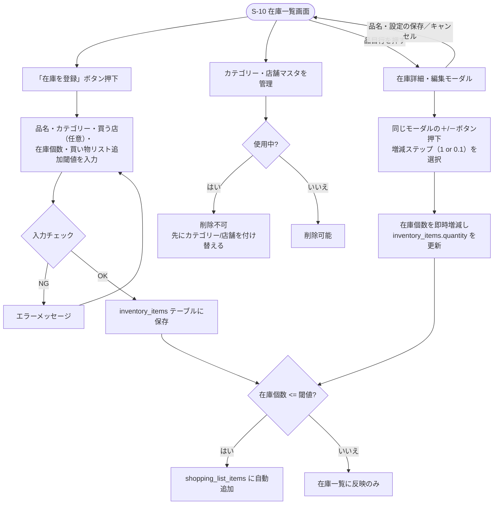

# F-07 在庫管理

[← 要件定義書に戻る](../../requirements.md)

---

## 1. 概要

世帯内の食材等の在庫を一元管理する。在庫が閾値以下（在庫 ≦ 閾値、#314）になると自動的に買い物リストへ連携される（[F08_zaiko_shoppinglist](F08_zaiko_shoppinglist.md)参照）。

## 2. 対象画面

| 画面ID | 画面名 |
| --- | --- |
| S-10 | 在庫・買い物リスト画面（在庫一覧パネル。画面幅にかかわらず上部タブで買い物リストと切り替える（#197）、[common-notes.md](../common-notes.md) 9章参照） |

## 3. 業務フロー

## 4. IPO

### 在庫アイテム登録

| 項目 | 内容 |
| --- | --- |
| 入力 | 品名（必須）・カテゴリー（必須）・買う店（任意）・在庫個数（必須）・買い物リスト追加閾値（必須）・値段（円・任意） |
| 処理 | S-10の在庫登録モーダルから入力チェック → inventory_items テーブルに保存 → 閾値判定 → 該当すれば shopping_list_items へ自動追加 |
| 出力 | 登録した在庫アイテム |

※ 買う店の選択肢に目的の店がない場合、在庫登録モーダル内の「＋店を登録」ボタンからその場で店舗マスタに追加できる（追加した店は選択状態になる）。

### カテゴリー/店舗マスタ管理

| 項目 | 内容 |
| --- | --- |
| 入力 | カテゴリー名 or 店舗名 |
| 処理 | 追加・編集・削除（使用中のものは削除不可） |
| 出力 | 更新後のマスタ一覧 |

### 在庫カテゴリー名の重複防止（#337 / 親 #320）

POST/PATCHの名前は前後空白を除去して1〜50文字で保存する。同じ世帯のデフォルト・カスタムカテゴリーについて、前後空白除去後の完全一致を同名とする。大文字小文字・全半角・かな表記は追加正規化しない。名前の比較は他世帯を含めず、PATCHでは対象自身を除く。

重複時は409と共通形式のDUPLICATE_ZAIKO_CATEGORY_NAME（message:「同じ名前のカテゴリーが既に登録されています」、details: []）を返し、登録・変更を行わない。デフォルト10件の名前は初回GETによる生成前も予約する。INSERT/UPDATEの重複判定と保存はそれぞれ1つのSQL文で行い、並行要求でも新たな同名を作らない。既存の名前や重複レコードを一括変更・削除する移行は行わない。

未認証401、世帯未所属404、他世帯のID指定404、デフォルトの編集・削除400、使用中カテゴリーの削除400という制約は維持する。追加UIは後続#338で実装する。

### 在庫個数の増減（＋/－ボタン）

詳細編集モーダルの在庫数欄は在庫個数を左に、その右隣に＋ボタンを上、－ボタンを下に配置する。右側の同じ行に増減幅1／0.1の選択ボタンを配置し、aria-pressedで選択状態を伝える。個数表示は他の入力欄と同じ14pxの文字と通常の枠線に揃え、＋／－は個数の表示枠の外側へ配置する。増減ボタンは32×26pxとし、個数表示・入力欄とサイズ感を揃える。一覧は品名・在庫数・閾値の3列の行ボタンとし、狭幅でも全文を折り返して横スクロールせず表示する（#241）。

| 項目 | 内容 |
| --- | --- |
| 入力 | 在庫アイテムID・増減方向（＋/－）・増減ステップ（1個単位 or 0.1単位、都度切り替え可能） |
| 処理 | inventory_items.quantity を即時更新（0未満にはならないよう制限） → 閾値判定 → 該当すれば shopping_list_items へ自動追加/除外 |
| 出力 | 更新後の在庫個数 |

## 5. 入力チェック仕様

### 品名の重複防止（#318）

POST・PATCHでは品名をNFKC正規化 → 小文字化 → 前後空白除去 → カタカナをひらがなに変換（#325）して同一世帯内で比較する。
編集対象自身を除いて一致すれば409（`DUPLICATE_INVENTORY_ITEM_NAME`、message: 「同じ品名の在庫が既に登録されています」）を返し、保存・買い物リスト同期は行わない。
画面では登録・編集の409応答のmessageをモーダル内のエラー（role="alert"）に表示し、モーダルを閉じず入力内容を保持して修正・再試行できる（#319）。
別世帯の同名登録は許可する。既存重複データは維持し、UNIQUE制約は追加しない。

### 値段と在庫編集（#212 / API #235）

在庫IDごとに最後に登録した参考値段を1件保持する。整数円0〜9,999,999,999またはnull。
在庫POSTで省略した場合はNULL、PATCHで省略した場合は維持、明示nullはクリアする。
在庫GET/POST/PATCHは常にpriceを返す。数量・閾値・購入数量とは独立し、履歴や比較は設けない。
世帯メンバー全員が閲覧・編集可能。同名の別在庫IDに値段を伝播させない。
登録モーダルに「値段（円・任意）」を設ける。空欄はnullとして登録する。
一覧行を押すと「在庫詳細・編集」を直接開き、品名・カテゴリー・店・閾値・値段・自動消費設定を編集できる。値段の空欄はnullでクリアし、0は0円として保持する。
同じモーダルに在庫個数の＋/－と増減幅1/0.1の選択ボタンを配置し、既存数量APIで即時反映する。数量以外は「保存」で確定し、保存成功後は一覧の再取得が終わってから閉じて一覧へ戻る。再取得だけ失敗した場合は保存済みである旨を通知して閉じ、保存を再送しない。キャンセル時も一覧へ戻る。キャンセルしても確定済みの数量変更は戻らない旨を画面に表示する。
数量更新後も入力途中の品名などは保持する。数量通信中は増減・ステップ・保存・閉じるを無効にし、保存中は数量操作を止める。失敗時は値と入力を保持して再試行できる。削除操作は設けない。閉じ方・フォーカスはcommon-notes 9章に従う。

| 項目 | 必須 | 形式・制約 |
| --- | --- | --- |
| 品名 | ○ | 1〜50文字 |
| カテゴリー | ○ | zaiko_categories から選択 |
| 買う店 | — | stores から選択 |
| 値段（円・任意） | — | 整数0〜9,999,999,999円。空欄はnull |
| 在庫個数 | ○ | 0以上、小数点第一位まで |
| 買い物リスト追加閾値 | ○ | 0以上、小数点第一位まで |

## 6. デフォルトカテゴリー

野菜、肉、魚介、乳製品、卵、調味料、飲料、冷凍食品、乾物、その他

## 7. データ設計（関連テーブル）

[data-model.md](../data-model.md) の `inventory_items`, `zaiko_categories`, `stores` テーブルを参照。

## 8. 日次自動消費（#329）

在庫ごとに任意の「1日の消費量」と自動消費のオン／オフを設定する。消費量は0.1〜99999.9、小数第一位まで。空欄は未設定（NULL）でオフ。既存在庫は未設定・オフのままとし、数量・閾値・リストを変更しない。設定は世帯共有で、献立からの材料消費とは独立する。

登録・編集モーダル内に消費量入力と「自動消費」スイッチを縦配置し、保存で確定する。登録時の初回入力でオンになり、その後の利用者のオン／オフ選択を保持する。空欄化はオフ、オフでも設定済みの消費量を保持する。詳細編集では保存済みの消費量とオン／オフを入力欄・スイッチの初期値として表示する。一覧の3列と行ボタンは維持する。

毎日JST 1:00のCronで、予定時刻のJST日付までの未処理日数×消費量を現在数量から引く。登録・再開当日は減らさず翌日の1:00から開始し、数量は0で止める。0でも基準日を進め、補充後に過去の消費を持ち越さない。停止したCronは次回に複数日分を精算し、同日再実行・同時実行・古い対象日では二重消費や基準日の後退を起こさない。

| 設定変更 | 未処理分と開始日 |
| --- | --- |
| オン→オフ／消費量クリア | 直近到来済みのJST 1:00までを旧設定で精算して停止。クリア時はNULL |
| オフ→オン | 停止期間は消費せず操作日のJST日付を基準に翌日開始 |
| オンのまま消費量変更 | 到来済み分を旧消費量で精算し、新消費量は翌日から適用 |
| オフ中の消費量変更 | 減算せずオフを維持 |
| 同値保存・名前等のみ変更・数量増減・購入 | 設定と消費基準日を維持 |

JST 0:00〜0:59の精算対象日は前日。画面にも「停止・消費量変更時は到来済みの未処理分を旧設定で精算する」と説明する。

精算と設定変更、数量変更とリスト同期はそれぞれ同じD1 batchで確定する。Cronは事前に在庫を読み出さず、DB内の現在のオン／オフ・消費量・基準日を条件に相対減算する。設定変更の実変更時だけrevisionを増やし、設定変更APIはrevision・基準日を条件に更新する。オン→オフ→オン後も新しい基準日以前のCronでは消費しない。競合する設定変更は再読取して再試行する。数量の古いスナップショットを書き戻さず、手動増減・購入・CronがDBで確定した順に直列実行した結果を保証する。0で止める操作は順序により最終値が異なる場合がある。

数量が閾値以下なら自動リスト項目を追加し、超えたら自動項目だけ除外する。既存の手動項目・購入入力は上書きしない。Cron更新0件では削除済み項目を復活させない。日次処理は全世帯を対象にセットベースSQLで実行し、対象件数に依存しない固定2文を1つのD1 batchにまとめる。先に未処理在庫の消費後数量をSQLの日付計算で判定して INSERT ... SELECT（在庫IDのUNIQUE競合時は何もしない）でリストへ追加し、次に条件付きUPDATEで数量・処理日を一括更新する。同じbatch内で確定するため手動操作は途中に割り込まず、同期失敗時は全件のリスト・数量・処理日をロールバックして呼び出し元へ失敗を伝える。在庫件数に比例するクエリを発行せず、無料プランの実行あたりD1クエリ数を抑える。

保存中は連打を防ぎ、保存失敗は入力を保持してrole="alert"で通知する。保存成功後の一覧取得失敗は保存APIを再送しない。1280/390/320pxで横はみ出しを防ぎ、モーダル内スクロールで保存へ到達できる。Tab巡回・Spaceでのスイッチ操作・Escape・背景クリック・起点へのフォーカス復帰を維持する。

## 9. 今後の検討事項

- デフォルトカテゴリー（編集不可）について、ユーザーからの改称要望が出た場合の対応方針
