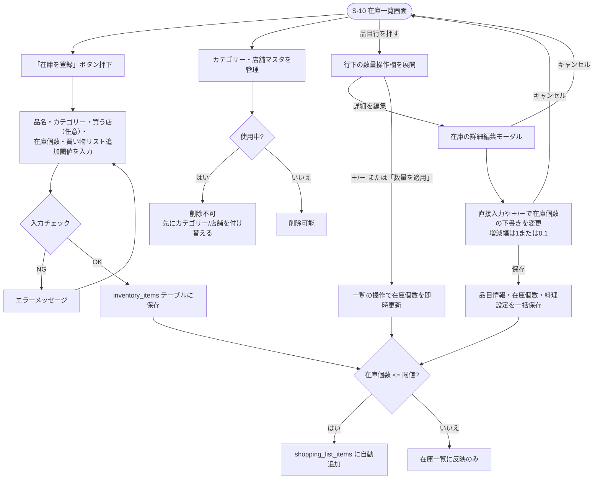

# F-07 在庫管理

[← 要件定義書に戻る](../../requirements.md)

---

## 使い方の概要

世帯で食材などの在庫を共有します。在庫数が補充基準（閾値）以下になると、買い物リストに自動で追加されます。

| やりたいこと | 操作と反映のタイミング |
| --- | --- |
| 品目を登録する | 「在庫を登録」で品名・カテゴリー・在庫個数・補充基準を入力して登録する。 |
| 一覧で数を増減する | 品目を開き、＋／−を押すと即時反映する。「増減量」に入力した分は「数量を適用」で反映する。 |
| 品目や料理設定も変える | 「詳細を編集」で在庫個数や料理設定を編集し、「保存」でまとめて反映する。 |

数量操作は[在庫管理の処理仕様（4章）](#4-ipo)、料理への割り当ては[在庫の予定回数・一括保存（10章）](#10-在庫の予定回数一括保存バックエンド-554画面-555)を参照。

## 1. 概要

世帯内の食材等の在庫を一元管理する。在庫が閾値以下（在庫 ≦ 閾値、#314）になると自動的に買い物リストへ連携される（[F08_zaiko_shoppinglist](F08_zaiko_shoppinglist.md)参照）。

## 2. 対象画面

| 画面ID | 画面名 |
| --- | --- |
| S-10 | 在庫・買い物リスト画面（在庫一覧パネル。画面幅にかかわらず上部タブで買い物リストと切り替える（#197）、[common-notes.md](../common-notes.md) 9章参照） |

## 3. 業務フロー

## 4. IPO

### 在庫一覧のカテゴリー絞り込み（#369）

検索欄（ラベルは「商品を探す」）の下に「カテゴリーで絞り込み」の選択肢（すべて／各カテゴリー）を横に並べて表示する（#469で選択式から変更）。既定は「すべて」で、世帯のカテゴリーを1つ選ぶとそのカテゴリーの在庫だけを表示する。検索語との併用はAND条件とし、該当0件は「該当する品目がありません」と表示する。在庫が未登録の場合の案内は維持する。

取得済みの在庫・カテゴリーを使い、絞り込み操作でデータを変更したり追加取得したりしない。登録・編集後は選択中の条件を維持して最新データを絞り込む。選択カテゴリーがなくなれば「すべて」に戻す。スマホでは選択肢の枠だけを1行で横に流し、ページの横スクロールを発生させない。長いカテゴリー名は選択肢の中で省略表示する。買い物リストにはこの絞り込みを追加しない。

### 在庫アイテム登録

| 項目 | 内容 |
| --- | --- |
| 入力 | 品名（必須）・カテゴリー（必須）・買う店（任意）・在庫個数（必須）・買い物リスト追加閾値（必須）・値段（円・任意） |
| 処理 | S-10の在庫登録モーダルから入力チェック → inventory_items テーブルに保存 → 閾値判定 → 該当すれば shopping_list_items へ自動追加 |
| 出力 | 登録した在庫アイテム |

※ 買う店の選択肢に目的の店がない場合、在庫登録モーダル内の「＋店を登録」ボタンからその場で店舗マスタに追加できる（追加した店は選択状態になる）。

### カテゴリー/店舗マスタ管理

| 項目 | 内容 |
| --- | --- |
| 入力 | カテゴリー名 or 店舗名 |
| 処理 | 追加・編集・削除（使用中のものは削除不可） |
| 出力 | 更新後のマスタ一覧 |

### 在庫カテゴリー名の重複防止（#337 / 親 #320）

POST/PATCHの名前は前後空白を除去して1〜50文字で保存する。同じ世帯のデフォルト・カスタムカテゴリーについて、前後空白除去後の完全一致を同名とする。大文字小文字・全半角・かな表記は追加正規化しない。名前の比較は他世帯を含めず、PATCHでは対象自身を除く。

重複時は409と共通形式のDUPLICATE_ZAIKO_CATEGORY_NAME（message:「同じ名前のカテゴリーが既に登録されています」、details: []）を返し、登録・変更を行わない。デフォルト10件の名前は初回GETによる生成前も予約する。INSERT/UPDATEの重複判定と保存はそれぞれ1つのSQL文で行い、並行要求でも新たな同名を作らない。既存の名前や重複レコードを一括変更・削除する移行は行わない。

未認証401、世帯未所属404、他世帯のID指定404、デフォルトの編集・削除400、使用中カテゴリーの削除400という制約は維持する。追加UIは次の#338に従う。

### 在庫モーダル内でのカテゴリー追加（#338 / 親 #320）

在庫登録と「在庫の詳細編集」のカテゴリー欄に「＋カテゴリーを登録」を置く。別のモーダルや設定画面を開かず、その場にカテゴリー名の入力欄・「カテゴリーを追加」・「追加をやめる」を表示する。入力欄を開くとカテゴリー名へフォーカスし、取りやめると追加ボタンへ戻す。

名前は前後空白を除去して1〜50文字。通常のEnterでもカテゴリーを追加できるが、日本語変換中の確定Enterでは送信せず、在庫登録も送信しない。成功後は選択肢へ追加して自動選択し、カテゴリー選択欄へフォーカスを戻す。品名・個数・値段・自動消費など入力途中の在庫情報を保持する。カテゴリーは世帯で共有され、再読込後も選べる。

追加は在庫の保存とは別に即時確定し、在庫をキャンセルしてもカテゴリーは残る旨を表示する。重複409や通信失敗は追加欄内のrole="alert"で通知し、カテゴリー名と在庫入力を保持して再試行できる。カテゴリー追加中は連打・追加の取りやめ・在庫保存・数量変更・閉じる（キャンセル／Escape／背景クリック）を無効にする。在庫の保存中もカテゴリーを追加しない。

カテゴリー自体の名前変更・削除のUIや新たな設定画面は追加しない。既存APIの編集・削除機能とは区別する。

### 在庫個数の増減（＋/－ボタン）

一覧は品名と在庫数を優先し、在庫が閾値以下の場合だけ「！」を表示する（#420）。1品目を1枚のカードにし、品名の下にカテゴリー名を表示する（#469）。閾値の常時数値列、補充文言・件数強調は設けない。行ボタンは全文を折り返し、在庫数と警告の意味を読み上げにも関連付ける。

行を押すと直下に数量操作欄を展開するB方式。＋/－と増減幅1／0.1（aria-pressed）、「－／現在の数量／＋」の横並び、手入力の「増減量」と全幅の「数量を適用」、末尾に補充基準（閾値）の表示と既存フォームへの「詳細を編集」を配置する。全行の＋/－を常時表示せず、一覧右端の削除×は維持する。一覧の＋/－は押すたびに反映し、手入力の増減量は「数量を適用」で確定する。詳細編集の＋/－は下書きの数量を変える。主要操作は44px以上、入力は実効16px以上、320/390/1280pxで横はみ出しを防ぐ。

| 項目 | 内容 |
| --- | --- |
| 入力 | 在庫アイテムID・増減方向（＋/－）・増減ステップ（1個単位または0.1単位）、もしくは手入力の増減量 |
| 処理 | 一覧からの確定操作で在庫個数を相対更新する。更新後は0〜99999.9かつ予定合計以上とする。閾値に応じて買い物リストの自動追加・除外を行う |
| 出力 | 更新後の在庫個数 |

### 手入力の増減量と送信安全性（#420）

手入力は絶対在庫数ではなく増減量。正数を加算、負数を減算し、「数量を適用」で既存数量PATCHへdeltaを送る。入力中は保存せず、±ボタンは従来どおり即時反映。deltaは-99999.9〜99999.9・小数第一位まで（0を含む）。在庫残量の0〜99999.9は既存APIの条件付き相対更新で検証し、古い表示値から絶対量を書き戻さない。

一覧の±/適用は同じ通信中ガードを共用し多重送信を防ぐ。詳細編集内の数量は下書きに保持し、在庫・全レシピ予定と一括保存する。成功応答を受けた手入力draftは一覧取得前に消費し、後続GET失敗でも同じdeltaを再送しない。数量更新成功と一覧再取得失敗を区別して通知する。

| 数量更新の応答 | 画面の対応 |
| --- | --- |
| 400/401（未加算が確実） | ユーザーが明示的に再試行できる。 |
| 404・5xx・通信切断等（結果不明） | 同品目の数量操作を停止し、停止理由と下書きを保持する。 |

404には書込み後の行消失経路も含む。認証処理で応答statusが失われた場合も結果不明側で扱う。停止理由と下書きは行収納/詳細閉鎖・再開後も保持する。結果不明でも一覧の再取得を試みるが、他の操作と区別できないためGET成功だけで停止解除しない。画面再読込を案内し、自動再送しない。新API/CASやCron・閾値同期の意味変更は行わない。

## 5. 入力チェック仕様

### 品名の重複防止（#318）

POST・PUT・PATCHでは品名をNFKC正規化 → 小文字化 → 前後空白除去 → カタカナをひらがなに変換（#325）して同一世帯内で比較する。
編集対象自身を除いて一致すれば409（`DUPLICATE_INVENTORY_ITEM_NAME`、message: 「同じ品名の在庫が既に登録されています」）を返し、保存・買い物リスト同期は行わない。
画面では登録・編集の409応答のmessageをモーダル内のエラー（role="alert"）に表示し、モーダルを閉じず入力内容を保持して修正・再試行できる（#319）。
別世帯の同名登録は許可する。既存重複データは維持し、UNIQUE制約は追加しない。

### 値段と在庫編集（#212 / API #235）

在庫IDごとに最後に登録した参考値段を1件保持する。整数円0〜9,999,999,999またはnull。
在庫POSTで省略した場合はNULL、PUT/PATCHで省略した場合は維持、明示nullはクリアする。
在庫GET/POST/PUT/PATCHは常にpriceを返す。数量・閾値・購入数量とは独立し、履歴や比較は設けない。
世帯メンバー全員が閲覧・編集可能。同名の別在庫IDに値段を伝播させない。
登録モーダルに「値段（円・任意）」を設ける。空欄はnullとして登録する。
一覧行の展開欄から「詳細を編集」を押すと「在庫の詳細編集」を開く。品名・カテゴリー・店・閾値・値段・日次自動消費・在庫個数・料理設定を編集できる。値段の空欄はnullでクリアし、0は0円として保持する。
在庫個数は直接入力または増減幅1／0.1の＋/－で下書きを変更する。「保存」で品目情報・数量・すべての料理設定をまとめて確定し、キャンセルで下書きを破棄する。選択肢から別操作で追加したカテゴリーや店舗は、その時点で保存される。
保存成功後は一覧を再取得して閉じる。再取得だけ失敗した場合は保存済みである旨を通知して閉じる。再試行は一覧の取得だけを行う。保存中は数量操作を止め、保存失敗時は入力を保持する。詳細モーダルに削除操作は設けない。閉じ方・フォーカスはcommon-notes 9章に従う。

### 在庫の削除（#380）

一覧の各行の右端に×ボタン（`aria-label`は「{品名}を削除」）を置く。押しても詳細モーダルは開かず、確認ダイアログ（role="dialog"、「削除する」「キャンセル」）を開く。ダイアログには、買い物リストの該当項目も一緒に削除されること、取り消せないことを表示する。
「削除する」で既存の `DELETE /inventory-items/:id` を呼び、成功したら一覧を再取得して「在庫を削除しました」と通知する。削除に失敗した場合はダイアログ内にエラーを表示して再試行できる。削除は成功して再取得だけ失敗した場合は「削除しました。一覧の再取得に失敗しました」と通知し、削除を再送しない。通信中は二重送信・キャンセル・Escapeによる閉じを無効にする。閉じた後は×ボタンへフォーカスを戻す（×が消えた場合は「在庫を登録」ボタン）。

| 項目 | 必須 | 形式・制約 |
| --- | --- | --- |
| 品名 | ○ | 1〜50文字 |
| カテゴリー | ○ | zaiko_categories から選択 |
| 買う店 | — | stores から選択 |
| 値段（円・任意） | — | 整数0〜9,999,999,999円。空欄はnull |
| 在庫個数 | ○ | 0以上、小数点第一位まで |
| 買い物リスト追加閾値 | ○ | 0以上、小数点第一位まで |

## 6. デフォルトカテゴリー

野菜、肉、魚介、乳製品、卵、調味料、飲料、冷凍食品、乾物、その他

## 7. データ設計（関連テーブル）

[data-model.md](../data-model.md) の `inventory_items`, `zaiko_categories`, `stores` テーブルを参照。

## 8. 日次自動消費（#329）

在庫ごとに任意の「1日の消費量」と自動消費のオン／オフを設定する。消費量は0.1〜99999.9、小数第一位まで。空欄は未設定（NULL）でオフ。既存在庫は未設定・オフのままとし、数量・閾値・リストを変更しない。設定は世帯共有。plannedの残予定>0なら品目の連携OFF中も日次ON不可。旧dailyONへ割当を追加するには同じ一括保存で利用者が明示OFFにする。未精算分は旧設定で精算し、設定を勝手に無効化・消去しない。legacy連携の既存排他も維持する。

登録・編集モーダルでは「毎日の自動消費」のカードに切り替えスイッチを表示し（オン／オフは位置と色に加えて文字でも示す。#469）、通常はオン時だけ消費量入力を表示する（#420）。未設定のオフからもオンで入力を開ける。オンで保存する場合は有効な消費量を必須とし、空欄のまま保存しない。オフにすると入力を隠すがdraft値は保持し、再オンで復元する。ただし、オフで空欄以外の不正なdraft値の保存を拒否した場合は、オフと入力値を維持し、修正入力と近傍のエラーを表示する。修正中は有効値になっても入力を表示し続け、検証条件・送信内容は変更しない。有効値をオフで保存すると消費量とオフを送信する。オフ・空欄で保存する場合はNULL/オフ、オフでも設定済みの量は保持する。保存前の取消では設定を更新しない。編集の初期状態は保存済みの量とオン／オフに従う。

毎日JST 1:00のCronで、予定時刻のJST日付までの未処理日数×消費量を現在数量から引く。登録・再開当日は減らさず翌日の1:00から開始し、数量は0で止める。0でも基準日を進め、補充後に過去の消費を持ち越さない。停止したCronは次回に複数日分を精算し、同日再実行・同時実行・古い対象日では二重消費や基準日の後退を起こさない。

| 設定変更 | 未処理分と開始日 |
| --- | --- |
| オン→オフ／消費量クリア | 直近到来済みのJST 1:00までを旧設定で精算して停止。クリア時はNULL |
| オフ→オン | 停止期間は消費せず操作日のJST日付を基準に翌日開始 |
| オンのまま消費量変更 | 到来済み分を旧消費量で精算し、新消費量は翌日から適用 |
| オフ中の消費量変更 | 減算せずオフを維持 |
| 従来の個別PATCHでの同値保存・名前等のみの変更、一覧からの数量PATCH・購入 | 設定と消費基準日を維持 |
| 現行の詳細編集からの一括保存PUT | 旧設定がオンなら同値保存でも到来済み分を旧設定で精算する。精算後に元の在庫数と入力値との差分を反映し、実効在庫数と予定合計を検証する |

JST 0:00〜0:59の精算対象日は前日。一括保存でオフだけを指定した場合は設定済み消費量を保持し、`dailyConsumption: null` を明示すると消費量をクリアしてオフにする。APIの詳細は[一括保存契約](../api-design.md#在庫の予定回数一括保存apiバックエンド-554--画面-555)を参照。

精算と設定変更、数量変更とリスト同期はそれぞれ同じD1 batchで確定する。Cronは事前に在庫を読み出さず、DB内の現在のオン／オフ・消費量・基準日を条件に相対減算する。設定変更の実変更時だけrevisionを増やし、設定変更APIはrevision・基準日を条件に更新する。オン→オフ→オン後も新しい基準日以前のCronでは消費しない。競合する設定変更は再読取して再試行する。数量の古いスナップショットを書き戻さず、手動増減・購入・CronがDBで確定した順に直列実行した結果を保証する。0で止める操作は順序により最終値が異なる場合がある。

数量が閾値以下なら予定1の自動リスト項目を追加し、超えたら未保護の自動項目だけ除外する（#455）。予定保存・部分購入の残数で保護された項目は、閾値を超えても保持する。既存の手動項目・予定・保護フラグ・購入revision・購入入力は上書きしない。Cron更新0件では削除済み項目を復活させない。日次処理は全世帯を対象にセットベースSQLで実行し、対象件数に依存しない固定2文を1つのD1 batchにまとめる。先に未処理在庫の消費後数量をSQLの日付計算で判定して INSERT ... SELECT（在庫IDのUNIQUE競合時は何もしない）でリストへ追加し、次に条件付きUPDATEで数量・処理日を一括更新する。同じbatch内で確定するため手動操作は途中に割り込まず、同期失敗時は全件のリスト・数量・処理日をロールバックして呼び出し元へ失敗を伝える。在庫件数に比例するクエリを発行せず、無料プランの実行あたりD1クエリ数を抑える。

保存中は連打を防ぎ、保存失敗は入力を保持してrole="alert"で通知する。保存成功後の一覧取得失敗は保存APIを再送しない。1280/390/320pxで横はみ出しを防ぎ、モーダル内スクロールで保存へ到達できる。Tab巡回・Spaceでのスイッチ操作・Escape・背景クリック・起点へのフォーカス復帰を維持する。

## 9. 今後の検討事項

- デフォルトカテゴリー（編集不可）について、ユーザーからの改称要望が出た場合の対応方針

## 10. 在庫の予定回数・一括保存（バックエンド #554・画面 #555）

バックエンドと画面#555を実装済み。[承認仕様](../../superpowers/specs/2026-11-15-inventory-menu-plan-design.md)・[API設計](../api-design.md)を正とする。在庫5からカレー2回/親子丼3回を割り当て、食事1回で当該残数とstockを1ずつ減らす。usageQuantity入力を新plannedには使わず、整数remainingCount/memoとrecipe別carryを扱う。連携ON/OFFは品目全体の一つ。

常時合計予定≦stock、未割当可。品目OFFでも計画を保持し、下方数量変更で割当割れが起きる場合は全未反映で拒否し、先に予定を減らす。品目OFFは料理ごとの持ち越し設定も保持し、新規の食事記録・持ち越しを止める。ほかの取消条件を満たせば食事取消は可能。unlinkは残割当を解放しstock/原本を保持、再追加は新ID。旧イベントを新関連へ移さない。

在庫の登録・詳細編集では品目情報・数量・全関連の追加／解除・回数・メモを下書きにまとめ、1回の保存でPOST/PUTへ送る。キャンセル時は在庫・関連・新規レシピの下書きを破棄する。レシピ検索とカテゴリー／店舗の独立追加は別操作。

### legacy APIと旧画面の参考（#547 / #548）

以下はremainingCount=NULLの旧関連APIと旧画面の参考。現行画面は回数を明示入力するか関連を解除して新計画へ保存し、小数使用数を整数へ丸めない。明示保存までは旧小数使用数・旧OFF・履歴を保持する。新plannedでは個別設定PATCHを使わない。

旧版の連携操作は在庫登録・詳細編集と献立表から利用できた。詳細契約は[承認仕様](../../superpowers/specs/2026-11-15-inventory-menu-link-design.md)と[API設計](../api-design.md)を参照。

- 在庫登録APIで1〜20メニューを追加できる。新規名は個別manualレシピを作成し、登録済みレシピは同世帯の原本を複製せず参照する。今週の週献立へ追加し、登録時に在庫は減らさない。
- 連携週行の原本名は各行の生成時に保存し、改名・削除後も保持する。在庫一覧のmenuLinks名は現在の原本名（削除後は関連作成時snapshot）を返す別契約とする。
- 使用数は初期1、0.1〜99999.9・小数第1位まで。予定合計が現在在庫を超えても予約扱いで減算しない。同じ原本を別在庫から参照しても別の関連・週献立とし、実食では操作対象の在庫だけを消費する。
- 日次自動消費ONなら連携を拒否し、有効な関連がある間は日次消費ONへの変更を拒否する。既存設定を保持し、連携OFF後に利用者が日次消費をONにできる。
- 「食べた」は週行の設定使用数を相対減算し、取消は消費イベントの量を現在在庫へ相対加算する。不足・上限超過・同時競合は全未反映エラー。買い物リスト同期は同じD1 batchに含め、既存の手動項目・購入予定の保護規約を維持する。
- 0到達で該当関連の持ち越しをOFFにし、補充・食済取消では自動再開しない。再ONは利用者の明示操作。連携OFF・在庫削除・原本削除も将来の持ち越しを停止する。
- 連携登録・実食・取消の同一要求ID/bodyは保存した成功応答を再現する。異なるbodyで同じIDは409。現在の認証・所属を先に検証し、他世帯へ結果を返さない。

### 旧画面の登録・設定（#548、現行は上記#555へ置換）

- 新規登録の「レシピも登録する」で、新しい料理名または登録済みレシピを1〜20件選ぶ。各使用数は初期1、持ち越しは初期OFF。登録では在庫を予約・減算しない。トグルOFF中は料理の下書きを保持し、通常登録の送信対象から除く。
- 日次自動消費ON中は連携登録を無効にし、連携ON中は日次自動消費のON操作をできなくする。保存済みの日次設定や下書きは勝手に消さない。
- 詳細編集では既存の関連ごとに使用数・連携・持ち越しを「連携設定を保存」で確定する。通常の在庫保存とは別操作で、既存在庫へ新しい関連を追加する画面は設けない。409では再取得して利用者が再確認し、自動上書きしない。
- 在庫0の明示再ONは不可とし、補充後も自動再開しない。既に有効な在庫0の使用数編集やOFF操作を、この再ON条件で一律禁止しない。
- 登録結果が未確認なら元の内容を保持して「同じ内容で確認」または「前回の結果を確認」だけを行う。成功後の一覧取得失敗は保存済みとしてGETだけ再試行し、重複登録しない。本人・世帯・ログイン状態が変わった場合は旧下書きと画面を隔離し、未解決要求は元の本人・世帯での明示確認に保持する。
