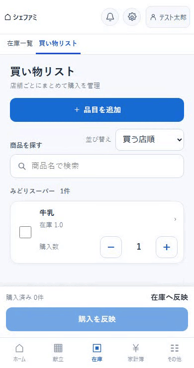
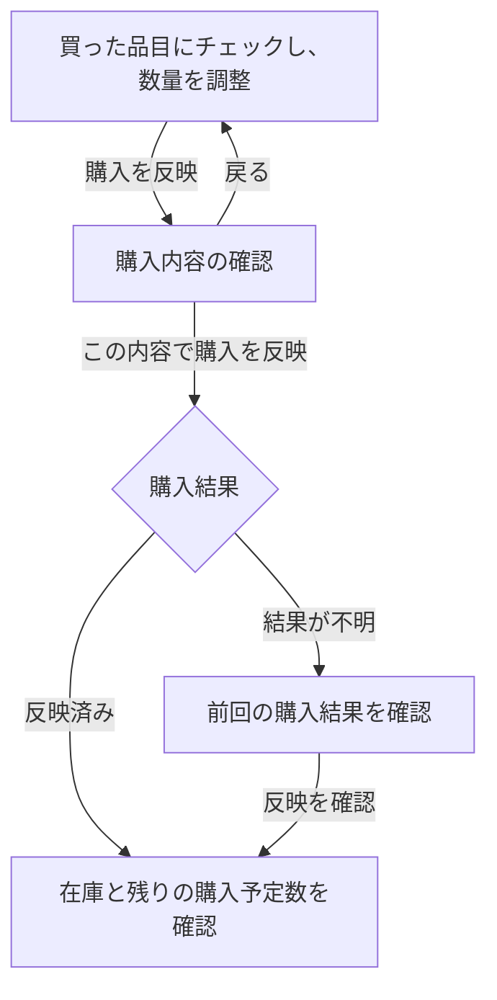

# F-08 買い物リスト

[← 要件定義書に戻る](../../requirements.md)

---

## 使い方

1. 在庫画面の「買い物リスト」タブを開きます。
2. 買った品目にチェックを入れ、「購入数」を「－」「＋」で調整します。
3. 「購入を反映」を押すと、「購入内容の確認」に品目と数量が表示されます。
4. 「この内容で購入を反映」を押すと、「在庫一覧」に買った数が加わります。

[購入予定数が残る条件](#購入予定数が残る条件) ｜ [技術詳細](#技術詳細)

## 実画面

牛乳を2個購入し、在庫が1個から3個に増える様子です（ローカル環境・架空データ）。

## 操作フローチャート

### 購入予定数が残る条件

予定より少なく買った場合は、残りの予定数が買い物リストに残ります。たとえば3個買う予定で2個買った場合は、在庫に2個が加わり、リストに残り1個が表示されます。

## 注意点

- 未チェックの品目と購入数0は反映しません。
- 「前回の購入結果を確認」を押すと、未反映だった場合は購入を実行します。反映済みで一覧の取得に失敗した場合は「一覧を再取得」を押します。
- 買い物リストから家計簿への支出の自動登録はありません。

## 機能仕様

### できること

- 在庫数が設定した基準以下になると、品目が買い物リストに自動で追加される。
- 世帯メンバー全員が品目の追加・削除、予定数の保存、購入の反映を行える。

### できないこと・条件

- 予定数の保存と購入の確定は別操作。別のメンバーによる変更がある場合は最新の予定を確認し直す。
- 同じ本人・世帯の前回結果が未確認の間は新しい購入を確定できない。

権限の共通方針は[共通事項](../common-notes.md#2-権限方針)を参照。

## 設計判断・理由

- 品目と数量を見直せるよう、購入を確定する前に確認画面を表示します。
- 通信が途切れたときに二重に在庫へ加算しないよう、同じ購入の結果を確認します。

技術詳細を開く（動作条件・データ保存・API）

## 2. 対象画面

| 画面ID | 画面名 |
| --- | --- |
| S-10 | 在庫・買い物リスト画面（買い物リストパネル。画面幅にかかわらず上部タブで在庫一覧と切り替える（#197）、[common-notes.md](../common-notes.md) 9章参照） |

[画面仕様](../wireframes.md#s-10-在庫買い物リスト画面) ｜ [購入API仕様](../api-design.md#post-apishopping-list-itemspurchases455) ｜ [買い物リストのテーブル定義](../data-model.md#shopping_list_items買い物リスト)

## 4. IPO

### 自動追加

| 項目 | 内容 |
| --- | --- |
| 入力 | inventory_items の在庫個数更新イベント |
| 処理 | quantity <= threshold を判定 → shopping_list_items へ `is_manual=false` で追加 |
| 出力 | 追加された買い物リスト項目 |

### 手動追加・削除

バックエンドAPIは任意のprice（整数円0〜9,999,999,999またはnull）を受け付ける（#235）。
省略は在庫の保存値維持、nullはクリア、数値は上書き。リスト追加と値段更新は単一D1 batchで原子的に実行し、
重複・競合・INSERT失敗時は値段を変更しない。買い物GET/POSTは在庫に保持した現在のpriceを常に返す。
自動追加では値段をコピーしない。購入・削除・再追加によって在庫の値段は失われず、数量との乗算も行わない。
手動追加フォームでは選択品目の保存済み値段を初期表示し、選択変更時にその品目の値段へ切り替える（#212）。
「値段（円・任意）」は整数0〜9,999,999,999。空欄はpriceを省略して保存値を維持する。
値段のクリアは在庫一覧から開く「在庫の詳細編集」で行う。在庫側は「値段（円・任意）」の入力欄に保存済み値を数値で初期表示し、nullは空欄とする。買い物詳細では現在値を桁区切りの円表示で示し、nullは「未設定」と表示する。

| 項目 | 内容 |
| --- | --- |
| 入力 | inventory_item ID・値段（円・任意） |
| 処理 | shopping_list_items への追加（`is_manual=true`）または削除 |
| 出力 | 更新後の買い物リスト |

## 5. 並び替え

あいうえお順／カテゴリー順／買う店順

## 6. データ設計（関連テーブル）

[data-model.md](../data-model.md) の `shopping_list_items`, `inventory_items` テーブルを参照。

## 7. 日次自動消費からの同期（#329）

日次消費による在庫減算と閾値判定は単一D1 batchで実行する。現在のDB数量が閾値以下なら自動追加、超えたら未保護の自動項目だけ除外する。手動項目が存在する場合は重複追加せず、購入入力も上書きしない。冪等な再実行では手動削除済みの項目を復活させない。

購入とCronは現在数量に加減算し、確定順の直列実行と同じ結果を保証する。購入後のリスト同期は更新成否と更新後のDB数量を参照し、事前読取数量から計算した期待値との一致には依存しない。購入は消費設定・基準日を変更しない。

日次消費後も、予定数を保存した品目や部分購入で予定数が残った品目は、保護された行として扱う。購入後の残数と除外の条件は[予定と在庫同期](#予定と在庫同期)を参照。

## 8. 予定残数・要求ID付き購入API（#455、画面#421）

### 予定と在庫同期

手動・自動で新しく追加した行の予定数は1。GET/POSTはplannedQuantityとpurchaseRevisionを返す。予定の編集はPATCH /shopping-list-items/:idへplannedQuantityとexpectedPurchaseRevisionを送り、同値保存でも保護1/revision+1にする。在庫は変えない。purchase_revisionを購入と予定保存の共通CASに使い、別revisionを増やさない。数量0・再送・在庫増減・Cronはこのrevisionを増やさない。

|実購入後の状態|買い物行|
|---|---|
|実購入0|全列不変、応答結果にも含めない|
|予定残数>0|手動/自動とも残数を保持、保護1、revision+1。閾値超過より残数を優先|
|予定を買切り/超過、手動|削除|
|予定を買切り/超過、自動かつ更新後在庫が閾値以下|次予定1、保護0、revision+1|
|予定を買切り/超過、自動かつ更新後在庫が閾値超|削除|

実購入全量を加算し予定数で上限を切らない。未購入・未対象は保持。予定は0.1〜99999.9、購入は0〜99999.9、小数第一位、在庫の加算後上限99999.9。10倍整数で計算する。安全にrevision+1できない要求は全未反映409。

保護行は後続の在庫数量/閾値編集で自動除外しない。既存行への同期INSERTはON CONFLICT DO NOTHINGで予定/保護/revision/入力を上書きしない。Cronの基準日/設定/消費revisionと参考価格は購入では変更しない。手動削除・在庫削除FKは明示削除として有効。削除後の新行は新ID/予定1であり旧要求の対象に置換しない。

### 購入確定・再送

POST /shopping-list-items/purchasesは必須UUID requestIdとitems:[{id,purchasedQuantity,expectedPurchaseRevision}]を受け付ける。空配列/重複は400、全0は空の確定200。応答はrequestId、updatedInventoryItems（在庫ID/数量）、removedShoppingListItemIds（行ID）、remainingShoppingListItems（行ID/予定残数/revision）。正数量だけを要求順に含め、購入確定時点のsnapshotを保存する。最新一覧の意味ではない。

認証・現在所属を確認し、actor/世帯/requestId単位で要求とHTTP/JSONを保存する。同key同bodyは対象削除やrevision検証より先に成功200または確定拒否400/404/409を再現する。同key異bodyは専用409 SHOPPING_PURCHASE_REQUEST_MISMATCH（requestId/PAYLOAD_MISMATCH）であり元購入が未反映とは限らない。範囲/精度の不正値を丸めて元bodyと同一化せず、配列順も比較する。

単一D1 batch先頭の成功候補INSERTと、業務上既知の拒否候補INSERTが同じ複合PKを競争する。勝者だけを不変保存し、敗者も勝者の結果を返す。後から条件が改善しても、拒否済みkeyを成功へ反転させない。商品全件guard・相対在庫更新・削除/残数・台帳成功snapshot/末尾SQLassertは全成功か全rollback。guard rollback後に拒否を保存できるまでは未反映確定を返さない。

400 VALIDATION_ERROR / 404 RESOURCE_NOT_FOUND / 409 RESOURCE_CONFLICTにdetails:[{field:'purchase',reason:'PURCHASE_NOT_APPLIED'}]がある場合だけ、同key/bodyの永続未反映を保証する。不正JSON/UUID/型等の正規化不能400、認証/未所属、markerなし400/404、MISMATCH、未知500/通信断/解析失敗/不完全台帳は結果不明として元pendingを保持する。台帳は期限削除せず、本人/世帯物理削除時だけFK cascade。未知障害を確定拒否へ変換しない。

### 現行画面と購入API

現行画面は `/purchases` を使用する。チェック時の実数初期値は予定数で、予定数と実数の編集、確認、下部固定の「購入を反映」を提供する。元key/bodyをactor/世帯別pendingへ送信前保存し、logoutでも未解決記録は保持。同user同世帯に戻った後の利用者操作で回復し、別user/世帯へ表示・送信しない。200またはmarker付き保存拒否だけで一致pendingを解決し、再取得・再確認後に別購入へ進む。MISMATCH/未知応答では新keyを作らず元bodyだけを回収する。200後GET失敗は購入反映済みと区別する。現行の操作は9章に記載する。

### 現行画面の保存・再取得・操作制御（第9章の技術詳細）

買い物詳細のタイトル横に44pxの「買い物詳細を閉じる」（×）を置き、ここへ初期フォーカスを移す。末尾の「閉じる」も維持する。長名でも冒頭の閉じるを画面内に保ち、Tab/Shift+Tabで末尾操作へスクロールし、どちらで閉じても元の行へ戻る。削除の位置と権限は変更せず、削除へ初期フォーカスを置かない。

一覧上部の「品目を追加」（全幅の主ボタン、#471）で品目と任意の参考値段を入力する。一覧は店舗見出しに件数を添え、1品目を1枚のカード（チェックボックス・品名・在庫・購入数の－／＋）で表示する。検索欄のラベルは「商品を探す」。商品名の正規化キーワード検索、店舗別グループ（未指定は「店舗未指定」）、既存の並び替えを利用できる。行には商品名、現在庫（小数第一位、不明は「－」）、購入数を示す（購入数は下記#485）。長名は全文折り返し。購入済みチェックは行ボタンと独立した下書き操作。

行の購入数（#485）は「予定」「実購入」を1つにまとめた表示で、すべての行に「購入数 － 数 ＋」を置く。チェック前は予定数、チェック後は実購入数を表示する。－／＋は1ずつ増減し（下限0、上限99999.9）、チェック前の行で押すと予定数から増減した数を実購入数にして購入済みチェックを付ける。押しても通信せず、数を変えて「購入を反映」を押せば購入になる。チェックを外すと表示は予定数に戻る。0の行は購入に含めない。実購入数が空・不正のときは「未入力」と表示し、＋で1から入れ直せる。チェックを無効にする状態（通信中・結果未確認など）では－／＋も無効にする。－／＋とチェックは行buttonの外に置き、44px以上とする。

チェックfalse→trueで表示中の予定数を実購入数の初期値にする。行から「買い物詳細」を開き、予定数と実購入数を文字列入力で編集する。予定数0.1〜99999.9・実数0〜99999.9、小数第一位まで。空欄・負値・小数第二位を許可しない。予定だけは「予定数を保存」でCAS保存する。自身の予定保存は最新revisionを反映するが実数入力は変えない。外部の予定revision変更では自動rebaseせず、最新の予定を確認してチェックを付け直す。予定の未保存入力・実数・チェック・追加入力は閉じる/検索/並替/在庫タブ往復で保持する。詳細画面の末尾から品目を削除でき、失敗は詳細と入力を保持、成功は対象だけを破棄して有効な追加操作へフォーカスを戻す。

「購入を反映」は主要ナビの実測高の上へ固定し、同じ欄に「購入済み N件」（反映対象の件数）を表示する。「購入内容の確認」は品名と数量を「反映前の確認」の一覧にまとめ、「戻る／この内容で購入を反映」を同じ幅で並べる（#471）。visualViewportの高さ/offset変更に合わせキーボードとの重なりを避け、ナビのsafe-areaを二重加算しない。最下行の余白に反映欄の実測高を確保する。購入チェック0件、正数量0件、不正数量、外部revision変更、未解決pendingでは新規確定不可。「購入内容の確認」で対象名と正数量を確認し、「この内容で購入を反映」で確定する。確認の「戻る」は下書きと起点フォーカスを保持。未チェックと0は送信しない。未購入を残し、部分購入の残数と超過全量加算は8章に従う。

送信前にactor/世帯別の不変pending（UUIDと順序付きID/数量/期待revision、scope、作成時刻だけ）をlocalStorageへ保存して読み戻す。同scopeのnative Web Locksは読取→保存/readbackと一致pending削除の短い排他だけに使い、通信中は保持しない。secure context・locks・保存/readbackが利用できなければ購入を送信しない。破損記録を現在の下書きから作り直したり上書きしない。

購入と本人/世帯の確認GETだけは明示Bearerを固定し、自動refresh・自動再POSTを禁止する。通常APIの認証は維持する。各await前後と送信直前/応答処理にcredential pairと局所世代を再確認し、別tabでのlogout/loginでも旧bodyを新tokenへ付替えない。本人/世帯不一致では旧表示を切り離し、古い操作からlogout/clearTokens/失効callbackを呼ばない。logoutや再読込でもpendingは保持する。同本人・同世帯のfresh確認後、「前回の購入結果を確認」の明示操作だけが元UUID/元bodyで回復する。未反映ならこの操作が購入を実行することを表示する。別scopeの保存記録を列挙・表示・送信しない。 確認済み世帯から切り離した後の再確認では、在庫・買い物と関連候補の新規取得が全て成功するまで旧世帯の行や入力を表示・操作させない。取得失敗中も隔離を維持して明示的な一覧再取得で復帰し、後着した旧世帯の取得結果は破棄する。初回から購入本人情報が未確認の場合と、確認済み世帯の失効は区別する。

正しいrequestId/数量/対象集合/revisionの200、または8章の保存terminal拒否だけで一致pendingを条件付き削除する。MISMATCH/marker無し400404/未知409/401/5xx/通信断/解析不整合は結果不明のまま保持し新keyを発行しない。旧応答は別keyのpendingや新セッションを消さない。 別タブが同じ要求を先に解決してpendingが空でも、後着した正当な成功または確定未反映の応答はその画面自身の一覧同期を完了してから次の操作へ戻す。別の新しいkeyや破損・読取不能の記録には旧結果を適用しない。 自画面が結果未確認の要求を観測していた場合、その要求の消失をstorage通知・明示回復・再確認で見つけても、一覧の再取得成功まで新規購入を再開しない。要求が消えた事実だけから購入成功や未反映を断定せず、取得失敗時はGETだけを再試行する。初回から空の保存領域では不要な同期を始めない。成功時は今回対象のチェック/実数と保存済み予定入力だけを消費し、未対象・0の入力を保持する。残存行の予定/revisionと除外IDは提出時revisionが現在行と一致するときだけ既存metadataへ反映し、GET失敗でも保存済み残数と除外結果を表示する。古いreplayは新revisionの行を上書き/再生成しない。200後のGET失敗は「購入は反映済み。一覧を再取得してください」と表示しGETだけを再試行する。保存terminal拒否は入力を保持して再取得・再確認後に新しい購入へ進む。再取得中や再取得失敗の間は新規購入を止め、GET再取得が完了してから確認を再開する。遅い購入前GETや古snapshotを新しい一覧へ上書きしない。

初回取得中・取得失敗・成功0件を区別し、失敗は再取得できる。在庫タブでは買い物の固定欄と詳細/確認を隠し、下書きは保持する。主要操作44px、入力16px、320/390/1280pxの横はみ出し・末尾スクロール・Tabとフォーカス復帰を検証する。

