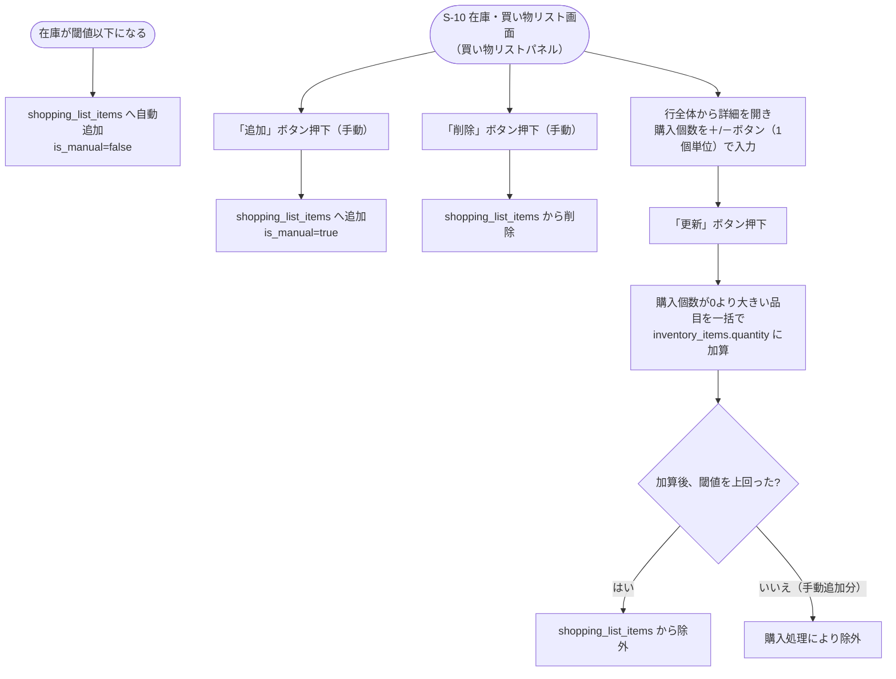

# F-08 買い物リスト

[← 要件定義書に戻る](../../requirements.md)

---

## 1. 概要

在庫管理と密連携する買い物リスト。在庫が閾値以下になった品目の自動追加、手動追加・削除、購入処理による在庫への一括反映を行う。

## 2. 対象画面

| 画面ID | 画面名 |
| --- | --- |
| S-10 | 在庫・買い物リスト画面（買い物リストパネル。画面幅にかかわらず上部タブで在庫一覧と切り替える（#197）、[common-notes.md](../common-notes.md) 9章参照） |

## 3. 既存画面・旧APIの業務フロー

以下は旧画面・旧/updateの互換説明。現行画面（#421）は9章、予定・再送防止API（#455）は8章を正とする。

## 4. IPO

### 自動追加

| 項目 | 内容 |
| --- | --- |
| 入力 | inventory_items の在庫個数更新イベント |
| 処理 | quantity <= threshold を判定 → shopping_list_items へ `is_manual=false` で追加 |
| 出力 | 追加された買い物リスト項目 |

### 手動追加・削除

バックエンドAPIは任意のprice（整数円0〜9,999,999,999またはnull）を受け付ける（#235）。
省略は在庫の保存値維持、nullはクリア、数値は上書き。リスト追加と値段更新は単一D1 batchで原子的に実行し、
重複・競合・INSERT失敗時は値段を変更しない。買い物GET/POSTは在庫に保持した現在のpriceを常に返す。
自動追加では値段をコピーしない。購入・削除・再追加によって在庫の値段は失われず、数量との乗算も行わない。
手動追加フォームでは選択品目の保存済み値段を初期表示し、選択変更時にその品目の値段へ切り替える（#212）。
「値段（円・任意）」は整数0〜9,999,999,999。空欄はpriceを省略して保存値を維持する。
値段のクリアは在庫一覧から直接開く「在庫詳細・編集」で行う。在庫側は「値段（円・任意）」の入力欄に保存済み値を数値で初期表示し、nullは空欄とする。買い物詳細では現在値を桁区切りの円表示で示し、nullは「未設定」と表示する。
買い物一覧は「品名／買う店／在庫／購入個数」の4列とし、行全体をボタンにする。行内の数値・余白からも同じ詳細を開く。「在庫」はその品目の現在の在庫数で、在庫一覧と同じく小数点第一位まで表示し、在庫情報が見つからない場合は「－」を表示する。購入の反映や在庫の増減で在庫数が変わったときは、一覧の再取得後に最新の値を表示する（#411）。
詳細には品名・カテゴリー・買う店（未指定は「なし」）・参考値段・現在の在庫・購入個数・削除・閉じるを表示する。
購入個数は詳細の＋/－で入力する。閉じる操作は取り消しではなく、未確定の入力を保持する。購入済みチェックは新設しない。
購入個数・手動追加の入力途中状態はタブ往復で保持する。並び替えや別品目の詳細へ移動しても購入個数を保持する。
一覧は長い品名・店名を全文折り返し、320pxでも横スクロール不要とする。フォームは折り返し、詳細は画面内の幅・高さに収め縦スクロールで操作へ到達できる。閉じ方・フォーカスはcommon-notes 9章参照。
削除失敗時は詳細と入力を保持し、成功時は対象の入力だけ破棄して「品目を手動追加」へフォーカスを戻す。

| 項目 | 内容 |
| --- | --- |
| 入力 | inventory_item ID・値段（円・任意） |
| 処理 | shopping_list_items への追加（`is_manual=true`）または削除 |
| 出力 | 更新後の買い物リスト |

### 購入処理（一括更新）

| 項目 | 内容 |
| --- | --- |
| 入力 | 詳細で入力した購入個数（品目ごと、＋/－ボタンで1個単位に増減、下限0） |
| 処理 | 一覧下の既存「更新」で購入個数が0より大きい品目だけを一括で inventory_items.quantity に加算 → 閾値判定 → 条件を満たさなくなった品目を shopping_list_items から除外 |
| 出力 | 更新後の在庫・買い物リスト |

詳細を開く・増減・閉じるだけでは購入APIを呼ばない。通信中は購入確定・削除・数量変更を無効にし、閉じるは利用可能とする。
購入失敗は入力を保持する。購入成功時は入力をクリアし、その後の一覧再取得失敗は購入失敗と区別して通知する。

一括購入は全品目成功または全品目未反映とする。在庫加算・購入入力リセット・リスト削除を同じD1バッチで確定し、SQL例外時は全体をロールバックする。事前確認後の品目削除・在庫削除・数量上限超過・別の購入による更新があれば、全品目を変更せず409 `RESOURCE_CONFLICT`（「買い物リストまたは在庫が変更されました。再取得してください」）を返す。最初から対象が無い場合の404や数量範囲外の400は維持する（#394）。

旧/updateの並行購入の検出には買い物リストの`purchase_revision`を使用し、成功した購入でのみ増加させる。Cronや手動調整による数量変化だけでは競合にせず、更新時の実数量と上限を検証する。応答数量と削除IDは同じバッチの確定結果を要求順で返す。完了後に改めて送られた新しい購入要求まで同一要求と見なす冪等性は追加しない。

## 5. 並び替え

あいうえお順／カテゴリー順／買う店順

## 6. データ設計（関連テーブル）

[data-model.md](../data-model.md) の `shopping_list_items`, `inventory_items` テーブルを参照。

## 7. 日次自動消費からの同期（#329）

日次消費による在庫減算と閾値判定は単一D1 batchで実行する。現在のDB数量が閾値以下なら自動追加、超えたら未保護の自動項目だけ除外する。手動項目が存在する場合は重複追加せず、購入入力も上書きしない。冪等な再実行では手動削除済みの項目を復活させない。

購入とCronは現在数量に加減算し、確定順の直列実行と同じ結果を保証する。購入後のリスト同期は更新成否と更新後のDB数量を参照し、事前読取数量から計算した期待値との一致には依存しない。手動追加分は購入後に除外、自動追加分は不足なら残して購入入力をリセット、閾値超過なら除外する。購入は消費設定・基準日を変更しない。

## 8. 予定残数・要求ID付き購入API（#455、後続画面#421）

### 予定と在庫同期

新規手動・自動・既存移行行の予定数は1。GET/POSTはplannedQuantityとpurchaseRevisionを返す。予定の編集はPATCH /shopping-list-items/:idへplannedQuantityとexpectedPurchaseRevisionを送り、同値保存でも保護1/revision+1にする。在庫は変えない。purchase_revisionを購入と予定保存の共通CASに使い、別revisionを増やさない。数量0・再送・在庫増減・Cronはこのrevisionを増やさない。

|実購入後の状態|買い物行|
|---|---|
|実購入0|全列不変、応答結果にも含めない|
|予定残数>0|手動/自動とも残数を保持、保護1、revision+1。閾値超過より残数を優先|
|予定を買切り/超過、手動|削除|
|予定を買切り/超過、自動かつ更新後在庫が閾値以下|次予定1、保護0、revision+1|
|予定を買切り/超過、自動かつ更新後在庫が閾値超|削除|

実購入全量を加算し予定数で上限を切らない。未購入・未対象は保持。予定は0.1〜99999.9、購入は0〜99999.9、小数第一位、在庫の加算後上限99999.9。10倍整数で計算する。安全にrevision+1できない要求は全未反映409。

保護行は後続の在庫数量/閾値編集で自動除外しない。既存行への同期INSERTはON CONFLICT DO NOTHINGで予定/保護/revision/入力を上書きしない。Cronの基準日/設定/消費revisionと参考価格は購入では変更しない。手動削除・在庫削除FKは明示削除として有効。削除後の新行は新ID/予定1であり旧要求の対象に置換しない。

### 購入確定・再送

POST /shopping-list-items/purchasesは必須UUID requestIdとitems:[{id,purchasedQuantity,expectedPurchaseRevision}]を受け付ける。空配列/重複は400、全0は空の確定200。応答はrequestId、updatedInventoryItems（在庫ID/数量）、removedShoppingListItemIds（行ID）、remainingShoppingListItems（行ID/予定残数/revision）。正数量だけを要求順に含め、購入確定時点のsnapshotを保存する。最新一覧の意味ではない。

認証・現在所属を確認し、actor/世帯/requestId単位で要求とHTTP/JSONを保存する。同key同bodyは対象削除やrevision検証より先に成功200または確定拒否400/404/409を再現する。同key異bodyは専用409 SHOPPING_PURCHASE_REQUEST_MISMATCH（requestId/PAYLOAD_MISMATCH）であり元購入が未反映とは限らない。範囲/精度の不正値を丸めて元bodyと同一化せず、配列順も比較する。

単一D1 batch先頭の成功候補INSERTと、業務上既知の拒否候補INSERTが同じ複合PKを競争する。勝者だけを不変保存し、敗者も勝者の結果を返す。後から条件が改善しても、拒否済みkeyを成功へ反転させない。商品全件guard・相対在庫更新・削除/残数・台帳成功snapshot/末尾SQLassertは全成功か全rollback。guard rollback後に拒否を保存できるまでは未反映確定を返さない。

400 VALIDATION_ERROR / 404 RESOURCE_NOT_FOUND / 409 RESOURCE_CONFLICTにdetails:[{field:'purchase',reason:'PURCHASE_NOT_APPLIED'}]がある場合だけ、同key/bodyの永続未反映を保証する。不正JSON/UUID/型等の正規化不能400、認証/未所属、markerなし400/404、MISMATCH、未知500/通信断/解析失敗/不完全台帳は結果不明として元pendingを保持する。台帳は期限削除せず、本人/世帯物理削除時だけFK cascade。未知障害を確定拒否へ変換しない。

### 旧APIと後続画面の境界

旧/updateは未保護の移行行・初期行について従来の全手動行除外（数量0を含む）を維持し、新APIの予定残数保証は適用しない。保護1を含む要求は事前検証・batch内条件の両方で全件409とする。旧APIへ逐次再送の冪等保証を後付けしない。

新画面は新APIを使用し、チェック時の実数初期値を予定数とし、予定/実数編集、確認、下部固定「購入を反映」を#421で実装する。元key/bodyをactor/世帯別pendingへ送信前保存し、logoutでも未解決記録は保持。同user同世帯に戻った後の利用者操作で回復し、別user/世帯へ表示・送信しない。200またはmarker付き保存拒否だけで一致pendingを解決し、再取得・再確認後に別購入へ進む。MISMATCH/未知応答では新keyを作らず元bodyだけを回収する。200後GET失敗は購入反映済みと区別する。FE/画面の完成は#421の検証完了後とする。

## 9. 店舗別一覧・予定と実購入・結果確認（#421）

買い物詳細のタイトル横に44pxの「買い物詳細を閉じる」（×）を置き、ここへ初期フォーカスを移す。末尾の「閉じる」も維持する。長名でも冒頭の閉じるを画面内に保ち、Tab/Shift+Tabで末尾操作へスクロールし、どちらで閉じても元の行へ戻る。削除の位置と権限は変更せず、削除へ初期フォーカスを置かない。

一覧上部の「品目を追加」（全幅の主ボタン、#471）で品目と任意の参考値段を入力する。一覧は店舗見出しに件数を添え、1品目を1枚のカード（チェックボックス・品名・予定／在庫／実購入）で表示する。検索欄のラベルは「商品を探す」。商品名の正規化キーワード検索、店舗別グループ（未指定は「店舗未指定」）、既存の並び替えを利用できる。行には商品名、予定数、現在庫（小数第一位、不明は「－」）、チェック済みなら実購入数を示す。長名は全文折り返し。購入済みチェックは行buttonの外の独立操作で、BEの旧purchased列には保存しない。

チェックfalse→trueで表示中の予定数を実購入数の初期値にする。行から「買い物詳細」を開き、予定数と実購入数を文字列入力で編集する。予定数0.1〜99999.9・実数0〜99999.9、小数第一位まで。空欄・負値・小数第二位を許可しない。予定だけは「予定数を保存」でCAS保存する。自身の予定保存は最新revisionを反映するが実数入力は変えない。外部の予定revision変更では自動rebaseせず、最新の予定を確認してチェックを付け直す。予定の未保存入力・実数・チェック・追加入力は閉じる/検索/並替/在庫タブ往復で保持する。詳細削除は従来の末尾導線を維持し、失敗は詳細と入力を保持、成功は対象だけを破棄して有効な追加操作へフォーカスを戻す。

「購入を反映」は主要ナビの実測高の上へ固定し、同じ欄に「購入済み N件」（反映対象の件数）を表示する。「購入内容の確認」は品名と数量を「反映前の確認」の一覧にまとめ、「戻る／この内容で購入を反映」を同じ幅で並べる（#471）。visualViewportの高さ/offset変更に合わせキーボードとの重なりを避け、ナビのsafe-areaを二重加算しない。最下行の余白に反映欄の実測高を確保する。購入チェック0件、正数量0件、不正数量、外部revision変更、未解決pendingでは新規確定不可。「購入内容の確認」で対象名と正数量を確認し、「この内容で購入を反映」で確定する。確認の「戻る」は下書きと起点フォーカスを保持。未チェックと0は送信しない。未購入を残し、部分購入の残数と超過全量加算は8章に従う。

送信前にactor/世帯別の不変pending（UUIDと順序付きID/数量/期待revision、scope、作成時刻だけ）をlocalStorageへ保存して読み戻す。同scopeのnative Web Locksは読取→保存/readbackと一致pending削除の短い排他だけに使い、通信中は保持しない。secure context・locks・保存/readbackが利用できなければ購入を送信しない。破損記録を現在の下書きから作り直したり上書きしない。

購入と本人/世帯の確認GETだけは明示Bearerを固定し、自動refresh・自動再POSTを禁止する。通常APIの認証は維持する。各await前後と送信直前/応答処理にcredential pairと局所世代を再確認し、別tabでのlogout/loginでも旧bodyを新tokenへ付替えない。本人/世帯不一致では旧表示を切り離し、古い操作からlogout/clearTokens/失効callbackを呼ばない。logoutや再読込でもpendingは保持する。同本人・同世帯のfresh確認後、「前回の購入結果を確認」の明示操作だけが元UUID/元bodyで回復する。未反映ならこの操作が購入を実行することを表示する。別scopeの保存記録を列挙・表示・送信しない。 確認済み世帯から切り離した後の再確認では、在庫・買い物と関連候補の新規取得が全て成功するまで旧世帯の行や入力を表示・操作させない。取得失敗中も隔離を維持して明示的な一覧再取得で復帰し、後着した旧世帯の取得結果は破棄する。初回から購入本人情報が未確認の場合と、確認済み世帯の失効は区別する。

正しいrequestId/数量/対象集合/revisionの200、または8章の保存terminal拒否だけで一致pendingを条件付き削除する。MISMATCH/marker無し400404/未知409/401/5xx/通信断/解析不整合は結果不明のまま保持し新keyを発行しない。旧応答は別keyのpendingや新セッションを消さない。 別タブが同じ要求を先に解決してpendingが空でも、後着した正当な成功または確定未反映の応答はその画面自身の一覧同期を完了してから次の操作へ戻す。別の新しいkeyや破損・読取不能の記録には旧結果を適用しない。 自画面が結果未確認の要求を観測していた場合、その要求の消失をstorage通知・明示回復・再確認で見つけても、一覧の再取得成功まで新規購入を再開しない。要求が消えた事実だけから購入成功や未反映を断定せず、取得失敗時はGETだけを再試行する。初回から空の保存領域では不要な同期を始めない。成功時は今回対象のチェック/実数と保存済み予定入力だけを消費し、未対象・0の入力を保持する。残存行の予定/revisionと除外IDは提出時revisionが現在行と一致するときだけ既存metadataへ反映し、GET失敗でも保存済み残数と除外結果を表示する。古いreplayは新revisionの行を上書き/再生成しない。200後のGET失敗は「購入は反映済み。一覧を再取得してください」と表示しGETだけを再試行する。保存terminal拒否は入力を保持して再取得・再確認後に新しい購入へ進む。再取得中や再取得失敗の間は新規購入を止め、GET再取得が完了してから確認を再開する。遅い購入前GETや古snapshotを新しい一覧へ上書きしない。

初回取得中・取得失敗・成功0件を区別し、失敗は再取得できる。在庫タブでは買い物の固定欄と詳細/確認を隠し、下書きは保持する。主要操作44px、入力16px、320/390/1280pxの横はみ出し・末尾スクロール・Tabとフォーカス復帰を検証する。iPhone実機の最終画面確認はユーザーが行う。
