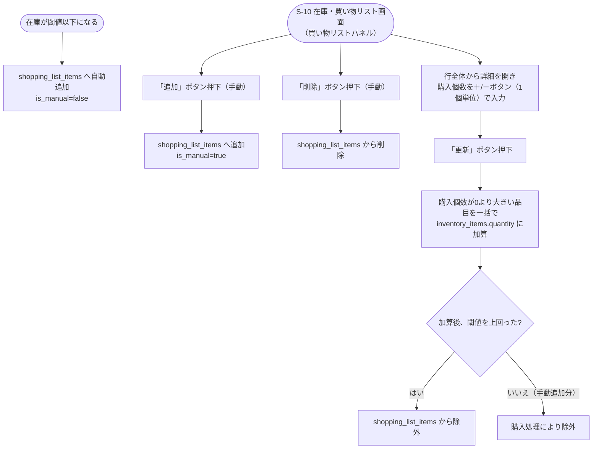

# F-08 買い物リスト

[← 要件定義書に戻る](../../requirements.md)

---

## 1. 概要

在庫管理と密連携する買い物リスト。在庫が閾値以下になった品目の自動追加、手動追加・削除、購入処理による在庫への一括反映を行う。

## 2. 対象画面

| 画面ID | 画面名 |
| --- | --- |
| S-10 | 在庫・買い物リスト画面（買い物リストパネル。画面幅にかかわらず上部タブで在庫一覧と切り替える（#197）、[common-notes.md](../common-notes.md) 9章参照） |

## 3. 業務フロー

## 4. IPO

### 自動追加

| 項目 | 内容 |
| --- | --- |
| 入力 | inventory_items の在庫個数更新イベント |
| 処理 | quantity <= threshold を判定 → shopping_list_items へ `is_manual=false` で追加 |
| 出力 | 追加された買い物リスト項目 |

### 手動追加・削除

バックエンドAPIは任意のprice（整数円0〜9,999,999,999またはnull）を受け付ける（#235）。
省略は在庫の保存値維持、nullはクリア、数値は上書き。リスト追加と値段更新は単一D1 batchで原子的に実行し、
重複・競合・INSERT失敗時は値段を変更しない。買い物GET/POSTは在庫に保持した現在のpriceを常に返す。
自動追加では値段をコピーしない。購入・削除・再追加によって在庫の値段は失われず、数量との乗算も行わない。
手動追加フォームでは選択品目の保存済み値段を初期表示し、選択変更時にその品目の値段へ切り替える（#212）。
「値段（円・任意）」は整数0〜9,999,999,999。空欄はpriceを省略して保存値を維持する。
値段のクリアは在庫一覧から直接開く「在庫詳細・編集」で行う。在庫側は「値段（円・任意）」の入力欄に保存済み値を数値で初期表示し、nullは空欄とする。買い物詳細では現在値を桁区切りの円表示で示し、nullは「未設定」と表示する。
買い物一覧は「品名／買う店／購入個数」の3列とし、行全体をボタンにする。行内の数値・余白からも同じ詳細を開く。
詳細には品名・カテゴリー・買う店（未指定は「なし」）・参考値段・購入個数・削除・閉じるを表示する。
購入個数は詳細の＋/－で入力する。閉じる操作は取り消しではなく、未確定の入力を保持する。購入済みチェックは新設しない。
購入個数・手動追加の入力途中状態はタブ往復で保持する。並び替えや別品目の詳細へ移動しても購入個数を保持する。
一覧は長い品名・店名を全文折り返し、320pxでも横スクロール不要とする。フォームは折り返し、詳細は画面内の幅・高さに収め縦スクロールで操作へ到達できる。閉じ方・フォーカスはcommon-notes 9章参照。
削除失敗時は詳細と入力を保持し、成功時は対象の入力だけ破棄して「品目を手動追加」へフォーカスを戻す。

| 項目 | 内容 |
| --- | --- |
| 入力 | inventory_item ID・値段（円・任意） |
| 処理 | shopping_list_items への追加（`is_manual=true`）または削除 |
| 出力 | 更新後の買い物リスト |

### 購入処理（一括更新）

| 項目 | 内容 |
| --- | --- |
| 入力 | 詳細で入力した購入個数（品目ごと、＋/－ボタンで1個単位に増減、下限0） |
| 処理 | 一覧下の既存「更新」で購入個数が0より大きい品目だけを一括で inventory_items.quantity に加算 → 閾値判定 → 条件を満たさなくなった品目を shopping_list_items から除外 |
| 出力 | 更新後の在庫・買い物リスト |

詳細を開く・増減・閉じるだけでは購入APIを呼ばない。通信中は購入確定・削除・数量変更を無効にし、閉じるは利用可能とする。
購入失敗は入力を保持する。購入成功時は入力をクリアし、その後の一覧再取得失敗は購入失敗と区別して通知する。

## 5. 並び替え

あいうえお順／カテゴリー順／買う店順

## 6. データ設計（関連テーブル）

[data-model.md](../data-model.md) の `shopping_list_items`, `inventory_items` テーブルを参照。

## 7. 日次自動消費からの同期（#329）

日次消費による在庫減算と閾値判定は単一D1 batchで実行する。現在のDB数量が閾値以下なら自動追加、超えたら自動項目だけ除外する。手動項目が存在する場合は重複追加せず、購入入力も上書きしない。冪等な再実行では手動削除済みの項目を復活させない。

購入とCronは現在数量に加減算し、確定順の直列実行と同じ結果を保証する。購入後のリスト同期は更新成否と更新後のDB数量を参照し、事前読取数量から計算した期待値との一致には依存しない。手動追加分は購入後に除外、自動追加分は不足なら残して購入入力をリセット、閾値超過なら除外する。購入は消費設定・基準日を変更しない。
