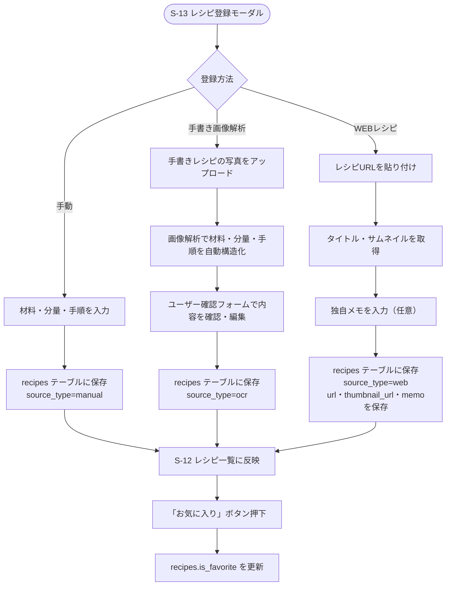

# F-09 レシピ登録・管理

[← 要件定義書に戻る](../../requirements.md)

---

## 1. 概要

レシピの手動登録・手書きレシピの画像解析登録・WEBレシピの引用登録・お気に入り管理を行う。

### PCの閲覧ページから登録（#222）

- S-12に「PCからレシピを登録」の案内と、ドラッグ可能な「HomeLogに登録」リンクを表示する。
- ブックマークバーを表示し、リンクをドラッグして設置する。レシピの閲覧ページで設置したブックマークを押すと、設置時のHomeLogのorigin（HTTP/HTTPS・ポートを含む）の `/recipes/share?url=...` を別タブで開く。元ページは保持し、URL以外の本文・認証情報は送らない。
- S-13のWEBタブに閲覧URLを入力した状態で開き、ユーザーが「登録」を押して初めて既存APIへ保存する。案内内のリンクを通常クリックした場合は遷移せず設置方法を表示する。
- 世帯所属済みユーザーは、未ログインならログイン後（失敗後の再試行を含む）に共有URLへ復帰する。世帯未所属ユーザーの世帯作成・参加後の復帰は対象外。
- 通常のHTTP(S)ページを対象とする。ブラウザ内部ページやCSP等により使えないページでは、既存のWEBタブへのURL貼り付けを案内する。
- 案内はモバイルでも折り返して表示する。既存のURL長制限・API・データモデルは変更しない。

### iPhoneの共有から登録（#223）

- S-12のPC案内の下に「iPhoneからレシピを登録」と「ショートカットを追加する」の入口を表示する。端末を問わず閲覧可能。
- `/recipes/iphone-shortcut` は既存の認証・世帯ガードとAppLayoutを使う案内ページとし、レシピ一覧へ戻れる。
- ページ先頭の「ショートカットを追加」ボタンで、ユーザーが作成した「HomeLogに登録」ショートカットのiCloud共有リンクを新しいタブで開く（本番URL向け、#271）。追加後の使い方（共有メニューから選ぶ・初回は許可・登録画面で確認して登録）と、使えない場合のWEBタブへのURL貼り付けを案内する。自作手順は画面に表示しない（#273）。
- Safariやアプリの共有から実行すると既存のWEB登録画面がURL入力済みで開く。内容確認後の登録操作で初めて保存する。未ログインからの復帰も既存の共有契約を使う。
- 新API・DB変更は含めない。

#### 配布ショートカットの構成（作り直す場合の記録）

- 共有シートでURL／Safari Webページ／テキスト（アプリ内の共有用）を受け取り、入力がなければ停止する。
- 入力からURLを取得し、URLだけをクエリ値として1回エンコードする。
- 「テキスト」で `https://<本番ホスト>/recipes/share?url=` の直後にエンコード結果の変数を連結し、「URLを開く」へ渡す。
- 作り直したらiCloudリンクを再発行し、`RecipeIphoneShortcutPage.tsx` のリンクを差し替える（古いリンクは古い内容のまま配布される）。

## 2. 対象画面

| 画面ID | 画面名 |
| --- | --- |
| S-12 | レシピ一覧画面 |
| S-13 | レシピ登録モーダル（手動/OCR/WEB） |
| S-28 | iPhoneショートカット案内画面 |
| S-31 | レシピ詳細モーダル（材料・手順、WEBレシピは元ページへのリンク） |

## 3. 業務フロー

## 4. IPO

### 手動登録

| 項目 | 内容 |
| --- | --- |
| 入力 | タイトル・材料・手順 |
| 処理 | recipes テーブルに `source_type=manual` で保存 |
| 出力 | 登録したレシピ |

### 手書き画像解析登録

| 項目 | 内容 |
| --- | --- |
| 入力 | 手書きレシピの画像ファイル |
| 処理 | 画像解析APIで材料・分量・手順を構造化 → ユーザー確認フォームに一時反映 → ユーザーが確認・編集 → recipes テーブルに `source_type=ocr` で保存 |
| 出力 | 登録したレシピ |

### WEBレシピ登録

| 項目 | 内容 |
| --- | --- |
| 入力 | レシピURL・独自メモ（任意） |
| 処理 | URLからタイトル・サムネイルを取得 → recipes テーブルに `source_type=web` で保存（材料・手順は保持しない） |
| 出力 | 登録したレシピ |

### URLの重複防止（#318）

`POST /api/recipes/from-url` は入力URLを `new URL()` で解析し、正規化した文字列（`parsedUrl.toString()`）と同一世帯の保存済みURLとの一致で比較する。
一致すれば外部ページの取得・保存を行わず409を返す（`DUPLICATE_RECIPE_URL`、message: 「このURLのレシピは既に登録されています」）。
画面ではWEBタブのURL登録で409応答のmessageをモーダル内のエラー（role="alert"）に表示し、モーダルを閉じずURL・メモを保持して修正・再試行できる（#319）。
保存も従来どおり `parsedUrl.toString()` の形式とする。ホスト名の大小文字やルートの末尾スラッシュの有無（`https://EXAMPLE.com` と `https://example.com/`）はURL正規化により同一になる。パスの大小文字など、正規化後も異なる文字列は別URLとして扱う。
別世帯の同一URLとURLなし（null・空文字）のレシピの複数登録は許可する。既存重複は維持し、UNIQUE制約は追加しない。

### お気に入り登録

| 項目 | 内容 |
| --- | --- |
| 入力 | recipe ID |
| 処理 | recipes.is_favorite を true/false に更新 |
| 出力 | 更新後のレシピ |

## 5. データ設計（関連テーブル）

[data-model.md](../data-model.md) の `recipes` テーブルを参照。

### WEBレシピのタイトル・サムネイル自動取得方式（実装済み）

`POST /api/recipes/from-url` に登録先URLを渡すと、サーバー側でそのURLをfetchし、
`HTMLRewriter` で `<meta property="og:title">` / `<meta property="og:image">` / `<title>` を
ストリーミング抽出する（レスポンスボディを丸ごとメモリに読み込まない）。

- YouTube（youtube.com・youtu.be・m.youtube.com・music.youtube.com）のURLは、Workersからページを取得すると同意画面などが返りタイトルが「YouTube」になるため、YouTubeの oEmbed API から動画タイトルとサムネイルを取得する。失敗したときは下記のHTML解析に戻る（#285）
- タイトルは `og:title` → `<title>` → URL文字列 の優先順で必ず何か確定する。HTMLRewriter は文字参照を戻さないため、取り出した値の数値文字参照（`&#x30ec;` など）と主な名前付き文字参照（`&amp;` `&quot;` など）は元の文字に戻してから保存する（Instagram の文字化け対策、#312）
- サムネイルは `og:image` が無ければ保存しない（NULL）
- `http:`/`https:` 以外のスキーム、`localhost`/ループバック/プライベートIP帯を指定したURL、
  非HTMLレスポンス、fetch失敗（タイムアウト・DNS失敗・非2xx）は400エラーとする（SSRF対策）
- 取得したタイトル・サムネイル・元URL・任意メモを `source_type='web'` で保存する
  （材料・手順は保持しない）。以降の編集はメモのみ可能

### 共有ボタン連携（PWA、実装済み）

インストール済みPWA（主にAndroid Chrome）から、他アプリの共有メニュー経由でレシピURLを
HomeLogへ渡せる（Web Share Target）。共有すると `/recipes/share?url=...` に遷移し、
WEBタブが選択された状態でレシピ登録モーダルが自動的に開く。`url`パラメータが無い場合は
`text`パラメータからURLらしき文字列を正規表現で抽出してフォールバックする。
iOS SafariはWeb Share Target非対応のため、iOSはショートカット案内 または URL貼り付けで登録する。

### 手書きレシピの画像解析（実装済み）

- `POST /api/recipes/ocr/upload` で画像を R2 に一時保存し、`POST /api/recipes/ocr/analyze` で解析する。
- 文字認識は Google Cloud Vision、認識した文字の「タイトル・材料・手順」への整理は Workers AI（LLM）で行う。結果は S-13 の確認フォームに入れ、ユーザーが確認・編集してから `source_type=ocr` で保存する。
- 一時保存した画像は日次処理で削除する。

## 6. 今後の検討事項

- なし（外部AI/OCRサービスは上記のとおり選定・実装済み）
