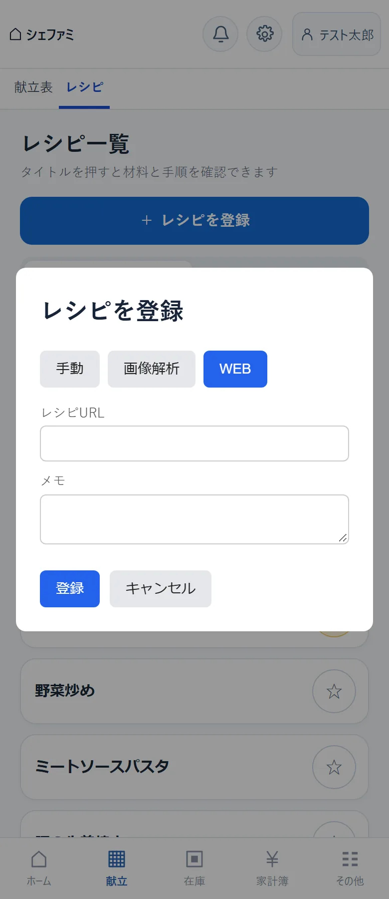
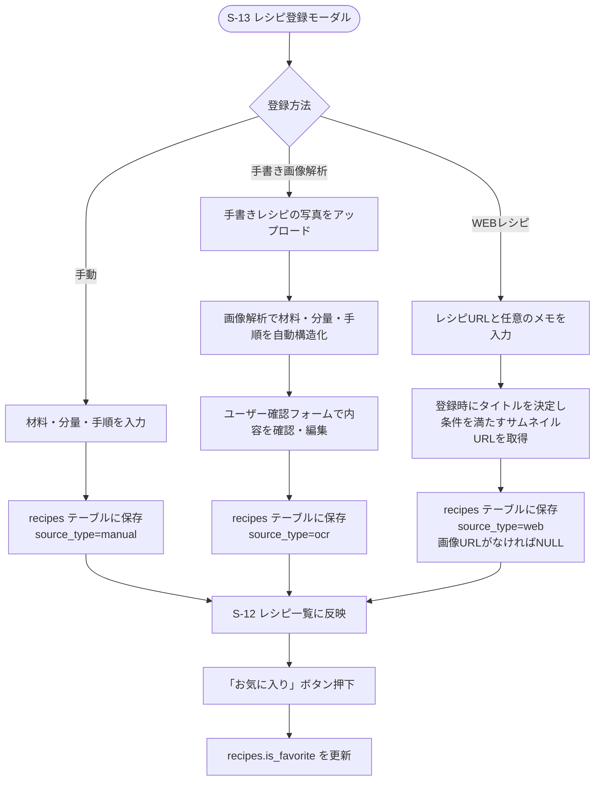

# F-09 レシピ登録・管理

[← 要件定義書に戻る](../../requirements.md)

---

## 使い方

レシピ一覧の「レシピを登録」で、手元のレシピやWEBで見つけた料理を保存できます。

| 登録方法 | 使い方と条件 |
| --- | --- |
| 手動 | タイトル・材料・手順を入力する。 |
| 画像解析 | 手書きレシピの画像を選び、解析された材料や手順を確認・編集して登録する。 |
| WEB | 「WEB」タブにレシピURLを貼り付ける。メモは任意。 |
| PCから取り込む | ブラウザのブックマークバーに設置した「シェファミに登録」をレシピのページで押す。 |
| iPhoneから共有 | 追加済みの「シェファミに登録」ショートカットを共有メニューから選ぶ。 |
| Androidから共有 | Chromeでシェファミをインストールし、共有メニューで選ぶ。 |

PC・iPhone・Androidの準備は、レシピ一覧の「ほかの登録方法」で確認できます。端末からレシピのURLを取り込むと、「WEB」タブに入力されます。内容を確認して「登録」を押します。共有が使えないときは「WEB」タブにURLを貼り付けます。

[PCの準備](#pcの閲覧ページから登録) ｜ [iPhoneの準備](#iphoneの共有から登録) ｜ [Androidの準備](#共有ボタン連携pwa実装済み) ｜ [技術詳細](#技術詳細)

## 実画面

「レシピを登録」で「WEB」タブを開いた画面です（架空データ）。

## 登録後にできること

- 一覧でタイトルを押すと詳細が開きます。有効な元URLがあるWEBレシピは、詳細から元のページを開けます。
- 星を付けると、「すべて／お気に入り」で絞り込めます。献立にレシピを追加するときも、お気に入りが候補の先頭に並びます。

## 登録時の注意

- 同じ世帯に登録済みのURLは再登録できません。登録画面にURLとメモが残るので、入力を確認できます。
- WEBで登録したレシピで編集できるのはメモです。サムネイルが取得できなくても、タイトル・元URL・メモは保存されます。
- 手書きレシピの画像は5MBまでです。アップロードと解析はそれぞれ1人1日20回まで利用できます。

技術詳細を開く（画面・動作条件・データ）

## 1. 概要

レシピの手動登録・手書きレシピの画像解析登録・WEBレシピの引用登録・お気に入り管理を行う。

同じ世帯に同じタイトルのレシピがある場合は、新規登録やタイトルの変更時にその理由を表示する。タイトルの前後の空白は比較から除く。

### PCの閲覧ページから登録

レシピ一覧の案内からブックマークを準備します。登録済みの世帯メンバーはログイン後も取り込み画面へ戻れます。

実装・検証の詳細

- S-12に「PCからレシピを登録」の案内と、ドラッグ可能な「シェファミに登録」リンクを表示する。
- ブックマークバーを表示し、リンクをドラッグして設置する。レシピの閲覧ページで設置したブックマークを押すと、設置時のシェファミのorigin（HTTP/HTTPS・ポートを含む）の `/recipes/share?url=...` を別タブで開く。元ページは保持し、URL以外の本文・認証情報は送らない。旧名のブックマークも転送先と処理が同じため継続利用できる。
- S-13のWEBタブに閲覧URLを入力した状態で開き、ユーザーが「登録」を押して初めて既存APIへ保存する。案内内のリンクを通常クリックした場合は遷移せず設置方法を表示する。
- 世帯所属済みユーザーは、未ログインならログイン後（失敗後の再試行を含む）に共有URLへ復帰する。世帯未所属ユーザーの世帯作成・参加後の復帰は対象外。
- 通常のHTTP(S)ページを対象とする。ブラウザ内部ページやCSP等により使えないページでは、既存のWEBタブへのURL貼り付けを案内する。
- 案内はモバイルでも折り返して表示する。既存のURL長制限・API・データモデルは変更しない。

### iPhoneの共有から登録

レシピ一覧の「ショートカットを追加する」から配布版を開きます。配布版は本番のシェファミを開きます。

実装・検証の詳細

- S-12のPC案内の下に「iPhoneからレシピを登録」と「ショートカットを追加する」の入口を表示する。端末を問わず閲覧可能。
- `/recipes/iphone-shortcut` は既存の認証・世帯ガードとAppLayoutを使う案内ページとし、レシピ一覧へ戻れる。
- ページ先頭の「ショートカットを追加」ボタンで、ユーザーが作成した「シェファミに登録」ショートカットのiCloud共有リンクを新しいタブで開く（本番URL向け）。2026-10-29にユーザーから受領した配布URLは `https://www.icloud.com/shortcuts/5e2b4881fda540b481cf0b61efd2bb35`。配布物の実名を確認し、本番のシェファミを開くことを説明する。追加後の使い方（共有メニューから選ぶ・初回は許可・登録画面で確認して登録）と、使えない場合のWEBタブへのURL貼り付けを案内する。自作手順は画面に表示しない。
- Safariやアプリの共有から実行すると既存のWEB登録画面がURL入力済みで開く。内容確認後の登録操作で初めて保存する。未ログインからの復帰も既存の共有契約を使う。
- 新API・DB変更は含めない。

#### 配布ショートカットの構成（作り直す場合の記録）

- 共有シートでURL／Safari Webページ／テキスト（アプリ内の共有用）を受け取り、入力がなければ停止する。
- 入力からURLを取得し、URLだけをクエリ値として1回エンコードする。
- 「テキスト」で `https://<本番ホスト>/recipes/share?url=` の直後にエンコード結果の変数を連結し、「URLを開く」へ渡す。
- 作り直しや名称変更を配布版に反映する場合は、ショートカットの編集画面から共有ボタン →「iCloudリンクをコピー」→「リンクをコピー」で新しいリンクを取得する。新リンクの名前と内容を確認してから、`RecipeIphoneShortcutPage.tsx` のリンク、案内文、関連テストとこの要件書を更新する（古いリンクは古い内容のまま配布される）。端末内の名称変更だけでは、既存の配布URLの内容も変更されたとは扱わない。

## 2. 対象画面

| 画面ID | 画面名 |
| --- | --- |
| S-12 | レシピ一覧画面 |
| S-13 | レシピ登録モーダル（手動/OCR/WEB） |
| S-28 | iPhoneショートカット案内画面 |
| S-31 | レシピ詳細モーダル（材料・手順、WEBレシピは有効な元URLがある場合に元ページへのリンク） |

## 3. 業務フロー

## 4. IPO

### 手動登録

| 項目 | 内容 |
| --- | --- |
| 入力 | タイトル（100文字まで）・材料・手順（それぞれ10,000文字まで） |
| 処理 | recipes テーブルに `source_type=manual` で保存 |
| 出力 | 登録したレシピ |

### 手書き画像解析登録

| 項目 | 内容 |
| --- | --- |
| 入力 | 手書きレシピの画像ファイル |
| 処理 | 画像解析APIで材料・分量・手順を構造化 → ユーザー確認フォームに一時反映 → ユーザーが確認・編集 → recipes テーブルに `source_type=ocr` で保存 |
| 出力 | 登録したレシピ |

### WEBレシピ登録

| 項目 | 内容 |
| --- | --- |
| 入力 | レシピURL（2048文字まで）・独自メモ（任意） |
| 処理 | 元URLからタイトルを決定し、条件を満たす画像URLがあれば採用する。画像URLがなくても `source_type=web` で保存し、サムネイルはNULLとする |
| 出力 | 登録したレシピ |

### URLの重複防止

`POST /api/recipes/from-url` は入力URLを `new URL()` で解析し、正規化した文字列（`parsedUrl.toString()`）と同一世帯の保存済みURLとの一致で比較する。
一致すれば外部ページの取得・保存を行わず409を返す（`DUPLICATE_RECIPE_URL`、message: 「このURLのレシピは既に登録されています」）。
画面ではWEBタブのURL登録で409応答のmessageをモーダル内のエラー（role="alert"）に表示し、モーダルを閉じずURL・メモを保持して修正・再試行できる。
保存も従来どおり `parsedUrl.toString()` の形式とする。ホスト名の大小文字やルートの末尾スラッシュの有無（`https://EXAMPLE.com` と `https://example.com/`）はURL正規化により同一になる。パスの大小文字など、正規化後も異なる文字列は別URLとして扱う。
同一URLの確認は世帯ごとに行う。URLなしのレシピはタイトルが異なれば複数登録できる。

### タイトルの重複防止

手入力・手書き画像の解析結果・WEBレシピの引用と共有・在庫からの献立連携では、前後の空白を除いたタイトルが同じ世帯の既存レシピと一致した場合に保存を拒否する。タイトル変更時も同じ条件で確認する。既存の同名レシピは保存したまま、タイトルを維持した編集を受け付ける。別世帯では同じタイトルを登録できる。

### お気に入り登録

| 項目 | 内容 |
| --- | --- |
| 入力 | recipe ID |
| 処理 | recipes.is_favorite を true/false に更新 |
| 出力 | 更新後のレシピ |

S-12のレシピ一覧では、「すべて／お気に入り」の切り替えで、星を付けたレシピだけに絞り込める。絞り込みは取得済みの一覧に対して画面側で行い、APIは変えない。選択は記憶しない。配置と0件時の表示は [wireframes.md](../wireframes.md) S-12 を参照。献立表のレシピ追加（S-14）では、従来どおりお気に入りを候補の先頭に並べる。

## 5. データ設計（関連テーブル）

[data-model.md](../data-model.md) の `recipes` テーブルを参照。

### WEBレシピのタイトル・サムネイル自動取得方式（実装済み）

`POST /api/recipes/from-url` に登録先URLを渡すと、サーバー側でそのURLをfetchし、
`HTMLRewriter` で `<meta property="og:title">` / `<meta property="og:image">` / `<title>` を
ストリーミング抽出する（レスポンスボディを丸ごとメモリに読み込まない）。

- YouTube（youtube.com・youtu.be・m.youtube.com・music.youtube.com）のURLは、Workersからページを取得すると同意画面などが返りタイトルが「YouTube」になるため、YouTubeの oEmbed API から動画タイトルとサムネイルを取得する。失敗したときは下記のHTML解析に戻る
- タイトルは `og:title` → `<title>` → URL文字列 の優先順で必ず何か確定する。HTMLRewriter は文字参照を戻さないため、取り出した値の数値文字参照（`&#x30ec;` など）と主な名前付き文字参照（`&amp;` `&quot;` など）は元の文字に戻してから保存する（Instagram の文字化け対策）
- `og:image` はHTMLの最終レスポンスURL（有効なHTTP/HTTPS）を基準に相対パス・`//` を解決し、HTTPSの画像URLだけを保存する。最終レスポンスURLが空または無効なら登録URLを基準にする。HTMLの `base` タグは使わず、保存する元URLは登録URLの正規化値のままとする。
- YouTubeの oEmbed サムネイルは絶対HTTPSのみ採用する。画像が欠落・不正でも有効な oEmbed タイトルを保持し、画像を理由にHTMLの追加取得はしない。
- サムネイルが空白・欠落・不正、または解決後HTTPS以外なら保存しない（NULL）。画像異常だけで登録を失敗させず、タイトル・元URL・メモを保持する。画像には元レシピURLの2048文字制限を流用せず、長い署名付きクエリも切り捨てない。画像自体の事前GET/HEAD・ダウンロードや既存DBの一括書換えは行わない。
- `http:`/`https:` 以外のスキーム、`localhost`/ループバック/プライベートIP帯を指定したURL、
  非HTMLレスポンス、fetch失敗（タイムアウト・DNS失敗・非2xx）は400エラーとする（SSRF対策）
- 取得したタイトル・サムネイル・元URL・任意メモを `source_type='web'` で保存する
  （材料・手順は保持しない）。以降の編集はメモのみ可能

### 保存済みWEBレシピの表示

| 表示項目 | 条件 |
| --- | --- |
| 元ページへのリンク | 有効なHTTP・HTTPSの元URLがあるときに表示する。 |
| サムネイル | 有効なHTTPS画像を表示する。欠落や読込失敗では画像だけを隠す。 |
| 献立から閲覧 | 元URLが有効なら新しいタブで開き、欠落・不正ならレシピ詳細を開く。 |

実装・検証の詳細

- 元ページへのリンクは保存済みURLを共通処理で解析し、有効な絶対HTTP/HTTPSだけを正規化して使う。クエリ・percent encoding・fragmentを保持し、別タブで開くリンクの `rel="noopener noreferrer"` を維持する。不正・欠落・非HTTP(S)の保存値はリンクにせず、タイトル・メモ・編集等の操作を残す。出典ホスト名も同じ解析条件を使い、APIとは別のhost制限や元URLの変更は加えない。
- 一覧・詳細・WEB編集の画像はHTTPSだけを描画する。保存済み相対画像・`//` は有効なHTTP(S)元レシピURLを基準に解決する。HTTPをHTTPSへ置換せず、画像の長い署名クエリも切り捨てない。
- 画像の欠落・不正・読込失敗時は画像だけを非表示にし、タイトル・メモ・元ページ導線を保つ。追加のplaceholder・通知・再試行UIは設けず、解決後の画像URLが変われば再表示する。ユーザー入力は通常のReactテキスト描画を続ける。
- 献立の「レシピを見る」は、有効な元URLがあるWEBレシピでは元ページを新しいタブで開く。元URLが欠落・不正なWEBレシピではアプリ内詳細（S-31）を開く。週の献立と日付詳細の表示は[F-10](F10_kondate_menu.md)を参照。
- 既存相対画像の最終redirect先は不明なため推測しない。HTTPS条件は外部配信先の内容や追跡を保証しない。CSPは [api-design.md](../api-design.md) と `frontend/public/_headers` の既存設定を維持し、画像proxy・事前GET/HEAD・DB一括修正は追加しない。

### 共有ボタン連携（PWA、実装済み）

インストールしたシェファミをAndroidの共有メニューから選びます。共有した本文に含まれるURLにも対応します。

実装・検証の詳細

インストール済みPWA（主にAndroid Chrome）から、他アプリの共有メニュー経由でレシピURLを
シェファミへ渡せる（Web Share Target）。共有すると `/recipes/share?url=...` に遷移し、
WEBタブが選択された状態でレシピ登録モーダルが自動的に開く。`url`パラメータが無い場合、または空
（空白だけを含む）の場合は、`text`パラメータからURLらしき文字列を正規表現で抽出してフォールバックする。
Androidの共有ではURLが`text`に入り、`url`が空で届くことがあるためです。`url`に値があるときは`url`を優先する。
`url`・`text`のどちらからもURLが得られないときは、登録モーダルを開かない。
iOS SafariはWeb Share Target非対応のため、iOSはショートカット案内 または URL貼り付けで登録する。

レシピ一覧の「ほかの登録方法」には、PC・iPhoneの案内の下に「Androidからレシピを登録」の案内カードを置く。
Chromeのメニュー（︙）の「アプリをインストール」または「ホーム画面に追加」でインストールする →
共有ボタンから「シェファミ」を選ぶ → 登録画面で確認して「登録」の3手順と、共有の一覧に出ないときの
再インストール・WEBタブへのURL貼り付けを案内する。

Android Studioのエミュレーター（Android 15・Google APIs、Chrome 124）で、
`/recipes/share` を `url` あり／`url` 空＋`text` にURL／`url` 無し／`url` 空＋`text` に文章とURL／`url` 空白だけ の5通りで開き、
修正前は `url` 空の2通りで登録画面が開かず、空白だけではURL欄が空になることを再現した。修正後は5通りともURL入力済みで開く。
なお、Play ストアの無いエミュレーターではChromeのインストールが簡易ショートカットになり、共有メニューへの登録（WebAPK）は確認できない。

### 手書きレシピの画像解析（実装済み）

- `POST /api/recipes/ocr/upload` で画像を R2 に一時保存し、`POST /api/recipes/ocr/analyze` で解析する。
- 文字認識は Google Cloud Vision、認識した文字の「タイトル・材料・手順」への整理は Workers AI（LLM）で行う。結果は S-13 の確認フォームに入れ、ユーザーが確認・編集してから `source_type=ocr` で保存する。
- アップロードできる画像は5MBまで。multipartのヘッダーなどを含むリクエスト本文は5MB＋64KBまで。
- 解析処理に入った画像は、成功・失敗を問わずその処理の終了時に削除する。未解析の画像や解析の回数制限で保留した画像は、アップロードから24時間を超えたものを日次処理で削除する。
- 外部サービスの利用料がかかるため、アップロードと解析はそれぞれ利用者ごとに1日20回までとする。上限を超えると 429 を返し、画面には「画像解析の利用回数が1日の上限に達しました。時間をおいて再度お試しください」と表示する。

## 6. 今後の検討事項

- なし（外部AI/OCRサービスは上記のとおり選定・実装済み）

### 関連する変更

- [WEBレシピURLの重複防止](https://github.com/yamamotonaoki3/HomeLog/issues/318)
- [画像解析の回数制限](https://github.com/yamamotonaoki3/HomeLog/issues/510)
- [WEBレシピの画像取得](https://github.com/yamamotonaoki3/HomeLog/issues/569)

