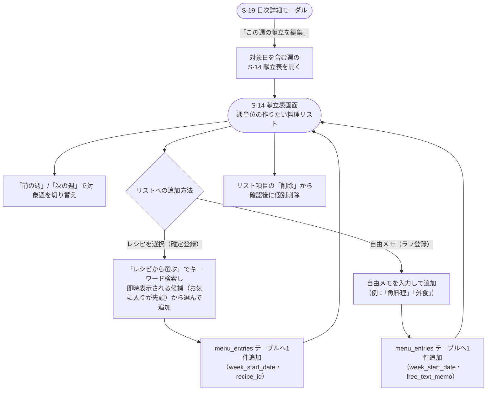

# F-10 献立表

[← 要件定義書に戻る](../../requirements.md)

---

## 1. 概要

献立は**週単位の「作りたい料理リスト」**として登録する。曜日への割り当ては行わない。献立表画面（S-14）でレシピを選択する（`recipe_id`を設定）か自由メモを入力する（`free_text_memo`を設定）と、その週のリストに追加されていく。レシピは複数選択して1回の操作で追加でき、保存データは引き続き1品1行とする。リストの項目は対象と影響を確認して個別に削除できる。日別・曜日別の登録画面は持たない。

データは週単位（`menu_entries`、`week_start_date`＝その週の月曜日、1行＝リストの1品）で保持する。トップ画面（S-04）・日次詳細モーダル（S-19）では「その週の献立リスト」として表示する（カレンダーの日付セルには献立を表示しない）。

### 保存期間・自動削除（#362）

- 日本時間で今週（月曜日0時開始）と未来の献立を保持する。先週以前（`week_start_date` が今週の月曜日より前）の登録は、全世帯について物理削除する。
- 毎日JST 0時と1時の定期処理で実行時点のJSTの週へ持ち越しを補完し、成功した回に限り先週以前を削除する。持ち越しに失敗した場合は削除を見送り、次回に再試行する（#547）。
- Cronの実行は遅れる場合があるため、月曜日0時ちょうどの削除は保証しない。失敗・停止後は次回実行で過去週をまとめて削除する。初回実行では既存の過去週も対象になる。
- 削除するのは献立への登録のみ。元のレシピ、在庫、家計簿は削除・変更しない。削除した献立の復元・履歴表示は提供しない。
- 先週・次週への移動と過去週への登録は維持する。削除後の過去週は空リストになり、過去週へ再登録した内容は次回の自動削除で削除される。
- 本番への適用は本番反映指示を受けてから行う。実装やmainへのマージだけでは本番データを削除しない。

## 2. 対象画面

| 画面ID | 画面名 |
| --- | --- |
| S-14 | 献立表画面（週単位の作りたい料理リスト） |

## 3. 業務フロー

## 4. IPO

### 献立リストへの追加

| 項目 | 内容 |
| --- | --- |
| 入力 | 対象週（week_start_date＝その週の月曜日）・レシピID（確定登録）または自由メモ（ラフ登録） |
| 処理 | menu_entries テーブルに1件追加。recipe_id と free_text_memo はどちらか一方のみ設定する。同じ週に複数件登録できる（リスト形式）。曜日への割り当ては行わない |
| 出力 | 追加後のその週の献立リスト |

### 献立リストからの削除

| 項目 | 内容 |
| --- | --- |
| 入力 | menu_entry ID |
| 処理 | 該当週行を削除する。在庫との関連が残る行では、同じバッチでその関連の持ち越しをオフにする。消費済みの在庫数は戻さない |
| 出力 | 削除後のその週の献立リスト |

### 週の表示・切り替え

| 項目 | 内容 |
| --- | --- |
| 入力 | 基準日（デフォルトは今日を含む週。「前の週」/「次の週」ボタンで移動。読み上げ名は表示と同じで、矢印は読み上げ対象外） |
| 処理 | 基準日から week_start_date（月曜日）を算出し、menu_entries を week_start_date で検索 |
| 出力 | 該当週の献立リスト。通常のレシピ行は現在の原本名、在庫連携行は生成時の原本名、自由メモ行はメモ本文を表示する。原本削除時の表示は5章を参照 |

## 5. ラフ登録と確定登録の使い分け

- リストの1品ごとに「確定登録（レシピ選択）」と「ラフ登録（自由メモ）」を使い分けられる。
- **ラフ登録**：自由メモ（例：「魚料理」「外食」）を素早く追加し、大枠の献立イメージを埋める。
- **確定登録（#419・#467）**：一覧上部の「レシピを追加」から追加画面（見出しは「献立に追加する」）を開く。スマホではボトムシート、PCではモーダルを使う。「レシピから選ぶ」と「自由メモ」を切り替える。正規化検索（全角・半角、大文字・小文字、カタカナ・ひらがなを区別しない）は入力直後に候補を更新する。お気に入り先頭の候補からチェックボックスで複数選択し、「選択したN件を追加」（未選択と自由メモでは「追加」）で確定する。この週に登録済みのレシピは候補に「登録済み」の印を付けるが、もう一度追加することは妨げない。選択やタイトル展開だけでは登録しない。空欄は全件、0件は「該当するレシピがありません」。検索外の選択も保持して選択件数に含め、解除できる。閉じる・追加方法の切替でも未送信の選択と自由メモを保持する。
- 複数追加は選択順に既存の単件APIで保存する。途中失敗時は追加済みを再送せず、失敗・未送信項目を保持する。送信中は多重送信と閉じる操作を防ぐ。追加成功と一覧再取得失敗は区別する。ネットワーク切断・全5xx・408等の未書込保証のない応答は結果不明として再送を停止し、一覧確認と画面再読み込みを案内する。現行POSTで書込前に拒否する400/401/403/404のみ、失敗・未送信選択を保持して再試行できる。
- 追加候補と通常の献立行は、長いタイトルを既定2行で省略し、タイトルを押すと全文を展開する。再度押すと閉じる。WEBレシピは有効な元URLのホスト名を出典として別行に表示する。多数候補は候補領域内でスクロールする。
- 在庫連携行で残り予定回数が返る場合は「カレー×2｜辛口」のように、料理名・回数・入力済みのメモを一行に表示する。長い場合は省略し、詳細の展開で全文と食事操作を表示する。
- 追加画面は明示閉じる・Esc・背景タップ・キーボード操作・フォーカス復帰に対応。320px/390pxで入力16px以上、safe-areaとスクロールを考慮し、手動ズームを許可する。

- ラフ登録の項目を確定に変えたい場合は、メモを削除してレシピを追加し直す。
- S-14で原本が削除された場合、在庫連携行は生成時の料理名を表示する。通常のレシピ行は原本名が空になり、画面では補助ラベルの「自由メモ」を表示する。いずれも原本閲覧リンクは表示しない。
- S-19日付詳細の「今週の献立」は、選んだ日を含む週のレシピ名または自由メモ本文を表示する。原本削除後は、在庫連携行も含めて「(削除されたレシピ)」と表示する。日付詳細APIは在庫連携行の生成時名を保持する（[API設計](../api-design.md#get-apidashboardday-detailworkers446)参照）。S-04の「今日の状況」カードは今週の献立の件数だけを表示し、押すと当日のS-19を開く（#462）。献立は週単位のため、カレンダーの日付セルには表示しない。

### リストからレシピを開く（#289・#419）

- 原本がある行では、タイトルを展開した領域の「レシピを見る」から原本を開く。有効な絶対HTTP(S)の元URLを持つWEBレシピ（YouTubeを含む）は元ページを新しいタブで開く。
- 有効な元URLがないWEBレシピと、手動・手書き画像で登録したレシピでは、アプリ内のレシピ詳細（S-31）を開く。
- 自由メモと削除済みのレシピに原本閲覧リンクは付けない。タイトル全文の展開は可能。
- 献立行の「削除」は確認を表示し、レシピ原本を保持する。関連が残る連携週行を削除すると、消費で減った在庫を戻さず、今後の持ち越しを停止する。キャンセルで元の操作へフォーカスを戻し、削除失敗時は再試行できる。
- 割り当てを解放するには在庫詳細の「関連を外す」で保存する。既存の在庫数とレシピ原本は保持する。関連解除後に取り消し可能な食事を取り消した場合は在庫数だけを戻す。

## 6. データ設計（関連テーブル）

[data-model.md](../data-model.md) の `menu_entries`, `recipes` テーブルを参照。

## 7. 今後の検討事項

- 週単位での献立コピー機能（前週のリストを次週へ複製する等）の要否
- 在庫と連携していない献立行での「作った／まだ」チェックの要否
- 献立リストから買い物リストへの材料連携の要否（現時点では連携なし、[common-notes.md](../common-notes.md) 6章）

## 予定回数の食事・取消・持越し（バックエンド #554・画面 #555）

バックエンドと画面#555を実装済み。[承認仕様](../../superpowers/specs/2026-11-15-inventory-menu-plan-design.md)を正とする。planned食事は1回で当該remainingCount/stockを1ずつ減らし、旧mealState=eatenでも残数>0なら反復できる。取消は当週のtop eventだけをLIFOで一度返し、前eventが残ればeatenのまま。確認量はGET undoQuantity（実event量）を使い、旧週行usageで推定しない。

品目OFFは計画保持・新食事/持越し停止、取消可。解除後の旧取消は在庫だけ返し、再追加linkの予定は戻さない。予定0後dailyONで、元planned linkに予定を戻す取消は不可（自動OFFせず、先にdailyOFFを案内）。能力はcanConsume/canUndoを正とする。過去・未来週に現在残数/memoを過去実績として表示せずnull、操作不可。

レシピ別の持ち越しと品目連携がオンで、残数が正かつ原本がある関連を当週へ持ち越す。残数0や品目OFFでは新行の生成を止める。残数・メモ・持ち越し設定は保持する。関連解除や原本の改名・削除後も、残った週行は生成時の原本名を保持する。画面ごとの表示は5章を参照。

予定回数、メモ、持ち越し設定を変更するには、在庫詳細の一括保存を使う。

## legacy APIと旧画面の参考（バックエンド #547・旧画面 #548）

以下の旧使用数・週一回食済・個別carry設定はremainingCount=NULLのlegacy APIと旧画面の参考。現行のplanned画面#555では、予定回数・メモと在庫の一括保存を使う。

在庫登録からの連携は今週に限定する。通常のレシピ・自由メモの手動追加や過去・未来週の操作は維持する。連携行の食事・取消・持ち越しは#548の画面から操作する。APIと状態の正本は[承認仕様](../../superpowers/specs/2026-11-15-inventory-menu-link-design.md)。

- 在庫関連の週行だけに、使用数・原本名の生成時snapshot・未食/食済・食事revision・消費イベントIDを保持する。登録・再ON・持ち越しで新行を生成する時の原本名を保存し、改名・削除や同値/使用数編集では変更しない。通常行の`inventoryLinkage`はnullで、名前は原本改名に追随し削除後nullとなる。同じ原本の通常手動再追加を禁止しない。
- 新しい「食べた」要求はJST当週の未食行のみ。量はクライアントの自由入力を受けず週行の設定値を使い、その週は食済として残す。同じ食済行の再消費は409。取消するとイベント量を戻して未食へ戻し、条件を満たせば新しい要求IDで再消費できる。
- 新規取消も当週のみ。遅延削除で残った前週行・未来週行は409、削除済み行は404。連携OFF・原本削除後も関連在庫と世帯権限があれば取消可能。在庫削除後は409で在庫を再作成しない。
- 同じ要求ID/bodyの保存済み成功は、認証・所属の確認後、当週検査や行存在検査より先に再現する。週跨ぎ・行削除後も二重消費や二重返却を行わない。
- 持ち越しON・有効関連・在庫>0・日次消費OFF・原本あり・開始週以降を条件に、実行時のJST現在週へ未食の新行を一度だけ生成する。前週の食済状態・消費イベントは引き継がず、在庫は減らさない。
- 継続設定は週行と独立して保持する。0時・1時とも持ち越し成功後に旧週を削除し、持ち越し失敗時は削除を飛ばして次回再試行する。数週遅延しても過去週の行を大量補完せず現在週だけ生成する。デモの毎時Cronは期限切れデモ削除のみを維持する。
- 明示的な連携献立の削除はその関連の持ち越しもOFFにし、消費量は戻さない（食済取消と区別）。過去週の定期削除は継続設定・操作台帳・食事イベントを消さない。

### 旧連携行の操作画面（#548、現行plannedは上記#555）

連携行は週行の名前snapshot・元在庫名・現在量・週行使用数・未食/食事済みを示す。「食べた」で「食事を記録」ダイアログを開き、「食べたことを記録」で設定使用数だけ減らす。「取り消す」で「食事を取り消す」ダイアログを開き、「食事を取り消して戻す」で同量を返す。`canConsume`/`canUndo`を操作可否の正とし、原本削除や連携OFF後の取消も能力が有効なら使える。原本を改名・削除しても週表示名をlive名で置き換えない。

「来週へ持ち越す」は最新の在庫GETから関連の使用数/revisionを確認してPATCHし、週行の古い使用数で現在設定を巻き戻さない。在庫GETだけが失敗した場合は持ち越しの設定操作を無効にして「連携設定を再取得」を示し、取得済み献立の食事/取消能力とは分ける。0で停止した持ち越しは補充・取消で自動再開しない。

送信中・結果未確認中は別操作を止める。結果不明は再読込・ログアウト後も元の要求を保持し、同じ本人/世帯の「前回の結果を確認」で同じ内容を再送する。保存成功後に献立取得が失敗した場合は「献立の一覧を再取得」でGETだけを再試行する。本人/世帯不一致が確定した場合は追加通信を待たず旧一覧・ダイアログ・下書きを隔離し、別世帯へ表示・送信しない。
