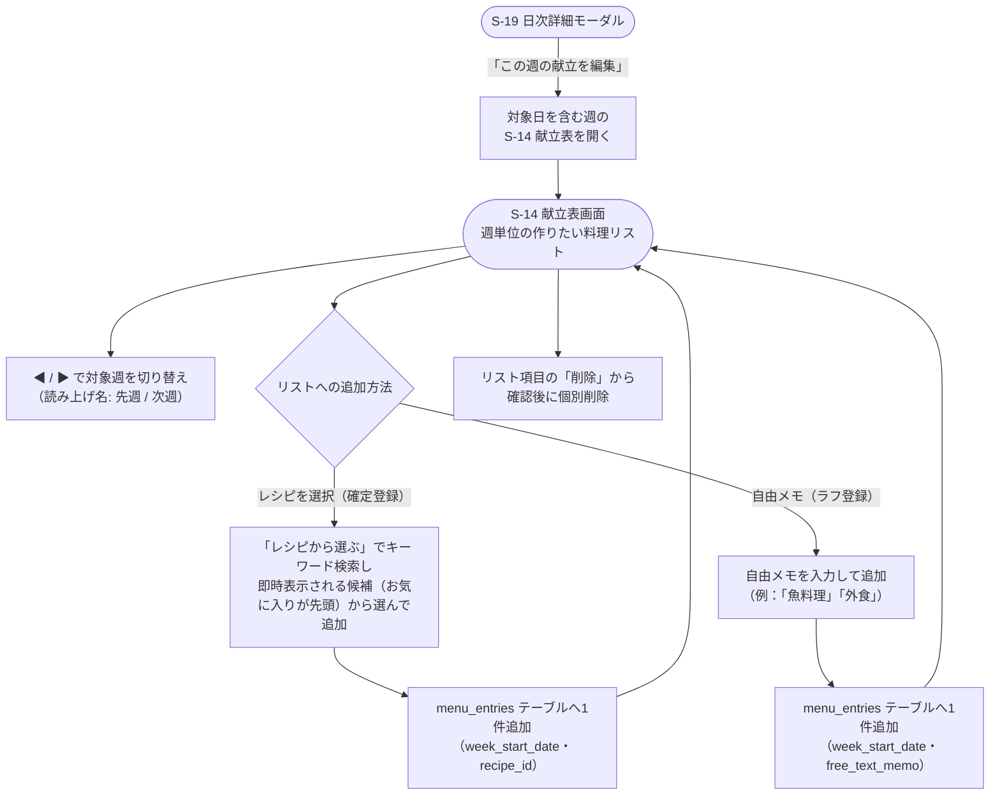

# F-10 献立表

[← 要件定義書に戻る](../../requirements.md)

---

## 1. 概要

献立は**週単位の「作りたい料理リスト」**として登録する。曜日への割り当ては行わない。献立表画面（S-14）でレシピを選択する（`recipe_id`を設定）か自由メモを入力する（`free_text_memo`を設定）と、その週のリストに追加されていく。レシピは複数選択して1回の操作で追加でき、保存データは引き続き1品1行とする。リストの項目は対象と影響を確認して個別に削除できる。日別・曜日別の登録画面は持たない。

データは週単位（`menu_entries`、`week_start_date`＝その週の月曜日、1行＝リストの1品）で保持する。トップ画面（S-04）・日次詳細モーダル（S-19）では「その週の献立リスト」として表示する（カレンダーの日付セルには献立を表示しない）。

### 保存期間・自動削除（#362）

- 日本時間で今週（月曜日0時開始）と未来の献立を保持する。先週以前（`week_start_date` が今週の月曜日より前）の登録は、全世帯について物理削除する。
- 毎日JST 0時の献立専用Cronで削除し、既存の毎日JST 1時の日次処理でも再試行する。削除基準は処理が実際に動いた時刻のJSTの週とする。
- Cronの実行は遅れる場合があるため、月曜日0時ちょうどの削除は保証しない。失敗・停止後は次回実行で過去週をまとめて削除する。初回実行では既存の過去週も対象になる。
- 削除するのは献立への登録のみ。元のレシピ、在庫、家計簿は削除・変更しない。削除した献立の復元・履歴表示は提供しない。
- 先週・次週への移動と過去週への登録は維持する。削除後の過去週は空リストになり、過去週へ再登録した内容は次回の自動削除で削除される。
- 本番への適用は本番反映指示を受けてから行う。実装やmainへのマージだけでは本番データを削除しない。

## 2. 対象画面

| 画面ID | 画面名 |
| --- | --- |
| S-14 | 献立表画面（週単位の作りたい料理リスト） |

## 3. 業務フロー

## 4. IPO

### 献立リストへの追加

| 項目 | 内容 |
| --- | --- |
| 入力 | 対象週（week_start_date＝その週の月曜日）・レシピID（確定登録）または自由メモ（ラフ登録） |
| 処理 | menu_entries テーブルに1件追加。recipe_id と free_text_memo はどちらか一方のみ設定する。同じ週に複数件登録できる（リスト形式）。曜日への割り当ては行わない |
| 出力 | 追加後のその週の献立リスト |

### 献立リストからの削除

| 項目 | 内容 |
| --- | --- |
| 入力 | menu_entry ID |
| 処理 | 該当レコードを削除 |
| 出力 | 削除後のその週の献立リスト |

### 週の表示・切り替え

| 項目 | 内容 |
| --- | --- |
| 入力 | 基準日（デフォルトは今日を含む週。矢印のみの◀/▶ボタンで移動。読み上げ名は「先週」/「次週」、矢印は読み上げ対象外） |
| 処理 | 基準日から week_start_date（月曜日）を算出し、menu_entries を week_start_date で検索 |
| 出力 | 該当週の献立リスト（recipe_idがあればレシピ名、なければfree_text_memoを表示） |

## 5. ラフ登録と確定登録の使い分け

- リストの1品ごとに「確定登録（レシピ選択）」と「ラフ登録（自由メモ）」を使い分けられる。
- **ラフ登録**：自由メモ（例：「魚料理」「外食」）を素早く追加し、大枠の献立イメージを埋める。
- **確定登録（#419）**：一覧上部の「レシピを追加」から追加画面を開く。スマホではボトムシート、PCではモーダルを使う。「レシピから選ぶ」と「自由メモ」を切り替える。正規化検索（全角・半角、大文字・小文字、カタカナ・ひらがなを区別しない）は入力直後に候補を更新する。お気に入り先頭の候補からチェックボックスで複数選択し「追加」で確定する。選択やタイトル展開だけでは登録しない。空欄は全件、0件は「該当するレシピがありません」。検索外の選択も保持して選択件数に含め、解除できる。閉じる・追加方法の切替でも未送信の選択と自由メモを保持する。
- 複数追加は選択順に既存の単件APIで保存する。途中失敗時は追加済みを再送せず、失敗・未送信項目を保持する。送信中は多重送信と閉じる操作を防ぐ。追加成功と一覧再取得失敗は区別する。ネットワーク切断・全5xx・408等の未書込保証のない応答は結果不明として再送を停止し、一覧確認と画面再読み込みを案内する。現行POSTで書込前に拒否する400/401/403/404のみ、失敗・未送信選択を保持して再試行できる。
- 候補と登録済み一覧はコンパクトな行。長いタイトルは既定2行で省略し、タイトルタップで全文展開・再タップで閉じる。保存文字列を切り詰めない。WEBレシピはURLホスト名をサイト名としてタイトルとは別行に表示し、サイト名取得の外部通信は行わない。多数候補は候補領域内でスクロールする。
- 追加画面は明示閉じる・Esc・背景タップ・キーボード操作・フォーカス復帰に対応。320px/390pxで入力16px以上、safe-areaとスクロールを考慮し、手動ズームを許可する。

- ラフ登録の項目を確定に変えたい場合は、メモを削除してレシピを追加し直す。
- S-19日次詳細モーダルでは「今週の献立」としてその週のリストを表示する。S-04「今日の状況」カードは今週の献立の件数だけを表示し、押すと当日のS-19を開く（#462）。recipe_idが設定されていればレシピ名を、free_text_memoのみ設定されていればそのメモ文言を表示する、という共通ロジックで扱う。カレンダーの日付セルには献立を表示しない（曜日と紐付かないため）。

### リストからレシピを開く（#289・#419）

- WEBから登録したレシピ（YouTubeを含む）は、タイトルを展開した領域の「レシピを見る」で元のページを新しいタブで開く。
- 手動・手書き画像から登録したレシピは、タイトルを展開した領域の「レシピを見る」でアプリ内のレシピ詳細（S-31）を開く。
- 自由メモと削除済みのレシピに原本閲覧リンクは付けない。タイトル全文の展開は可能。
- 献立行の「削除」は確認を表示し、レシピ原本は削除されない旨を示す。取消で元の操作へフォーカスを戻し、削除失敗時は再試行できる。

## 6. データ設計（関連テーブル）

[data-model.md](../data-model.md) の `menu_entries`, `recipes` テーブルを参照。

## 7. 今後の検討事項

- 週単位での献立コピー機能（前週のリストを次週へ複製する等）の要否
- 献立リストの「作った/まだ」のチェック（消し込み）機能の要否
- 献立リストから買い物リストへの材料連携の要否（現時点では連携なし、[common-notes.md](../common-notes.md) 6章）
