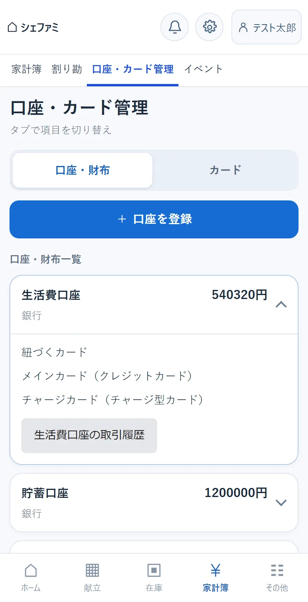
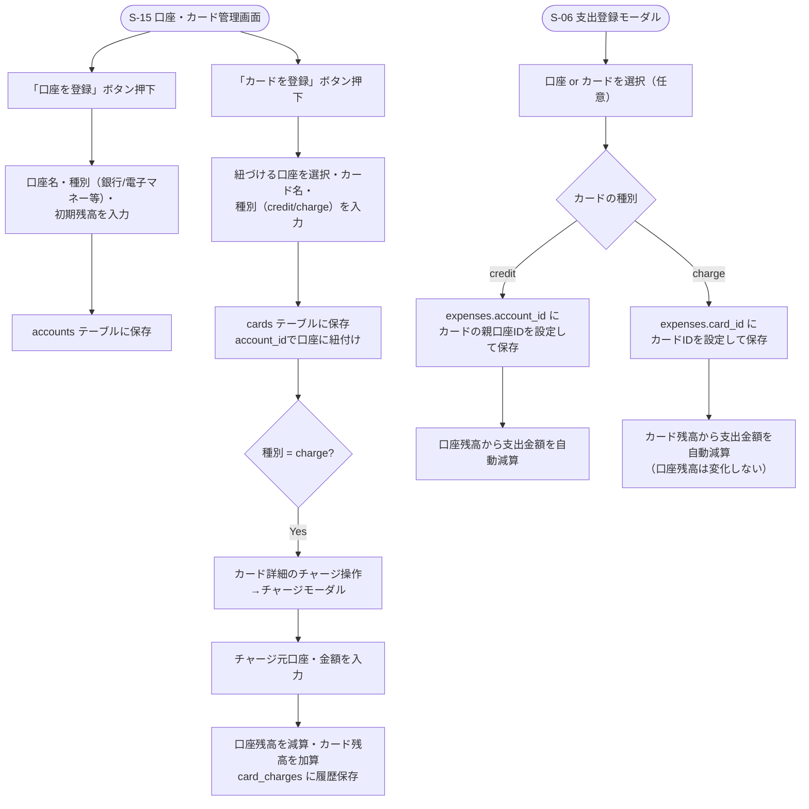

# F-11 口座・カード管理

[← 要件定義書に戻る](../../requirements.md)

---

## 使い方

1. 家計簿の「口座・カード管理」を開き、「口座・財布」の「口座を登録」で、口座名・種別・初期残高を入力します。
2. カードを使う場合は「カード」タブの「カードを登録」で、紐づける口座・カード名・種別を指定します。
3. 履歴を見るときは「口座・財布」で口座の行を開き、「〇〇の取引履歴」を押します。

[支払元と残高](#支払元と残高) ｜ [技術詳細](#技術詳細)

## 実画面

生活費口座の行を開いた状態です（架空データ）。

## 支払元と残高

| 選んだ操作・支払元 | 残高の動き |
| --- | --- |
| 口座を指定して支出を登録する | 選んだ口座から支出額を引く。 |
| クレジットカードを指定して支出を登録する | カードが紐づく口座から支出額を引く。 |
| チャージ型カードを指定して支出を登録する | カード自身の残高から支出額を引く。 |
| チャージ型カードにチャージする | チャージ元の口座から引き、同じ額をカードに足す。 |

## 口座の管理に関する条件

- 口座・カードの登録と残高の確認は本人が行います。残高は支出やチャージ元の指定によってマイナスになることがあります。
- 口座を削除すると、一覧・残高合計・新規入力の選択肢から外れます。過去の取引明細は保持します。
- 口座や紐づくカードを固定費の支払元に使っている場合や、紐づくカードに残高がある場合は、口座を削除できません。

技術詳細を開く（画面・動作条件・データ）

## 1. 概要

銀行口座・PayPay等の電子マネーを「口座」として手動登録し、支出登録時にどの口座から出費したかを選択できるようにする。カードは口座に紐づく子エンティティとして扱い、以下2種別を持つ。

- **クレジットカード（`credit`）**：カード自体は残高を持たず、支払いは常に紐づく親口座から引き落とされる（従来仕様）。
- **チャージ型カード（`charge`）**：Suica等の電子マネーカードのように、カード自体が**独立した残高**を持つ。口座からチャージ（資金移動）することで残高が増え、支払いはカード自身の残高から減算される。

今回のスコープは手動登録のみとし、外部API連携（銀行・カード会社・Money Forward ME・PayPay等）は対象外とする（[common-notes.md](../common-notes.md) 7章参照）。

口座は**残高**を持ち、個人の財政管理に用いる。残高は所有者本人のみ閲覧可能（[common-notes.md](../common-notes.md) 2章：個人データの権限方針）で、当該口座を指定した支出を登録するたびに自動的に減算される。チャージ型カードの残高も同様に所有者本人のみ閲覧可能な個人財政情報として扱う。

## 2. 対象画面

| 画面ID | 画面名 |
| --- | --- |
| S-15 | 口座・カード管理画面 |
| S-06 | 支出登録モーダル（口座・カードの選択） |
| S-04 | トップ画面（「個人の財政」カードに自分の口座残高合計を表示） |

## 3. 業務フロー

## 4. IPO

### 口座登録

| 項目 | 内容 |
| --- | --- |
| 入力 | 口座名・種別（`bank`/`e_money`等）・初期残高 |
| 処理 | accounts テーブルに保存（owner_user_idはログインユーザー、balanceに初期残高を設定） |
| 出力 | 登録した口座 |

### カード登録

| 項目 | 内容 |
| --- | --- |
| 入力 | 紐づける口座ID・カード名・種別（`credit`/`charge`、既定は`credit`） |
| 処理 | cards テーブルに `account_id`・`card_type` を設定して保存（`charge`型は`balance`を0で初期化） |
| 出力 | 登録したカード |

種別は登録後に変更不可（`charge`型に残高が積まれた状態で`credit`型へ変更すると資金の扱いが不定になるため）。

### チャージ実行（charge型カードのみ）

| 項目 | 内容 |
| --- | --- |
| 入力 | 対象カードID・チャージ元口座ID・金額 |
| 処理 | `card_charges` への履歴INSERT、口座残高の相対減算、カード残高の相対加算を1つのD1 batchで確定する。各SQLの `RETURNING` からこの取引の確定結果を取得する。履歴は家計簿の支出・収入一覧と別に管理する |
| 出力 | 更新後の口座残高・カード残高、チャージ履歴 |

残高不足時の制御は設けない（5章の口座残高マイナス許容方針と同様）。

### 支出登録時の口座/カード選択

| 項目 | 内容 |
| --- | --- |
| 入力 | 支出情報・口座ID または カードID（任意） |
| 処理 | credit型カード or 口座直接指定の場合：expenses.account_id に設定して保存 → 選択された口座（カード選択時はカードの親口座）のbalanceから支出金額を自動減算。charge型カードの場合：expenses.card_id に設定して保存 → カード自身のbalanceから支出金額を自動減算（口座残高は変化しない） |
| 出力 | 口座/カードが紐付いた支出（残高はレスポンスに含めない。画面は登録後に口座一覧を取得し直して最新残高を表示する） |

### 口座の取引履歴表示（S-15）

| 項目 | 仕様 |
| --- | --- |
| 取引の種類 | 本人の口座に紐づく支出・収入・チャージを表示。 |
| 表示順 | 取引の日付が新しい順。同じ日なら作成時刻が新しい順。 |
| 取引後残高 | 現在残高を基に、作成時刻の新しい順から逆算。日付を遡って登録すると、表示順と計算順が異なる場合がある。 |

実装・検証の詳細

S-15は「口座・財布」「カード」の2タブとし、各タブの上部に対応する登録ボタンを配置する。口座は名称・種別・残高、カードは名称・種別・親口座のコンパクト行から詳細を展開する。口座詳細で紐づくカードを確認し、既存「取引履歴」から履歴モーダルを開く。カード詳細は既存情報とchargeの残高・チャージ操作に限り、口座/カード編集やカード削除は新設しない。口座0件ではカード登録不可の理由と口座登録導線を示す。

履歴の計算・認可・データ契約は以下のとおり維持する。

| 項目 | 内容 |
| --- | --- |
| 入力 | 口座ID |
| 処理 | 本人が所有する口座の支出（`expenses.account_id`）、通常収入・精算収入（`incomes.account_id`）、チャージ（`card_charges.from_account_id`）を1つの一覧にまとめる。他人の口座は404。表示順と取引後残高の計算順は下記のとおり |
| 出力 | 現在残高、取引一覧（日付・内容・種別（支出/収入/チャージ）・金額（±）・取引後残高） |

| 用途 | 並び順 |
| --- | --- |
| 履歴の表示 | 業務日付（支出日、収入日、チャージの日付）の降順。同日は作成時刻の降順。 |
| 取引後残高の計算 | 作成時刻の降順に、現在残高から逆算する。 |

どちらも同じ秒ではチャージ・支出・収入の順、同種別ではID降順とする。遡及登録や日付編集では、表示順と残高の計算順が異なる場合がある。別種別の取引が同じ秒にある場合、その秒の途中の残高は実際の変動順と異なる場合がある。現在残高とその秒の前後の残高は一致する。

現在残高と支出・収入・チャージ明細は、本人・世帯・未削除の口座という同じ認可条件で、単一のD1バッチ内から取得する。取得途中の入出金による新旧データの混在を防ぎ、取引後残高は同じバッチで得た現在残高から逆算する。バッチ実行前に削除された口座は404とする。応答形式と既存の並び順は変更しない。

## 5. 口座残高と個人財政管理

### 口座への収入入金と削除

通常収入では有効な本人の口座を指定します。既存の取引がある口座は取引の参照を保持したまま論理削除し、新規取引や残高合計から外します。

実装・検証の詳細

- 新規の通常収入は同世帯・本人所有の有効口座が必須。収入INSERTと残高の相対加算を単一D1 batchで確定する（F-13参照）。取引履歴の入金は通常収入と精算収入の両方を含む。
- 固定費が口座または子カードを参照する場合、引き落とし先として利用中のため削除不可。残高が0でない子カードがある場合も削除不可。
- 上記の禁止対象がなければ、過去の支出・収入（通常/割り勘精算）・チャージ・割り勘支払元の参照があっても削除できる。子カード経由の履歴も含め、参照があれば`accounts.deleted_at`を設定して204を返す。口座のID・名前・残高、子カード、履歴・精算状態を保持する。これらの参照がなければ従来どおり物理削除する。
- 論理削除済み口座とその子カードは一覧・選択肢・残高合計から除外し、新規の収入・支出・カード登録・チャージ・固定費・精算先には指定できない。口座の編集・再削除・取引履歴取得は404。支払報告後に論理削除された支払元口座は、従来の物理削除時と同様に精算確定時には口座なしとして扱う。
- S-15の一覧は、口座・カードを1件ずつカードで表示し、行を押すと同じカードの中に詳細を開く。
- 口座の削除操作は、S-15の取引履歴モーダル内のタイトル右上ゴミ箱（対象名付きaria-label）から行う。同じモーダル内の二段階確認で「取引履歴は残るが、口座一覧・残高合計・新規入力の選択肢には表示されなくなる」ことを説明し、「削除する」で確定する。APIが拒否した場合（固定費の参照など）はメッセージを表示し、口座は一覧に残す。削除中はボタンを無効にして二重送信と閉じる操作を防ぐ。削除成功後に一覧の再取得が失敗した場合は削除済みとして扱い、再削除はさせない。
- 収入GETは論理削除された口座も含めて`accountName`を解決する。画面での表示は[収入の口座連携](F13_kakeibo_income.md#8-3-口座連携)を参照。既存の収入・精算収入・残高は遡及変更しない。
- 世帯外の精算済み割り勘を取り消す場合は、紐付く自動精算明細の削除を許可するが、削除済み口座の残高・削除状態は固定する。有効口座のみ残高を補正し、明細・内訳の削除と同じバッチで行う（[割り勘・精算の仕様](F04_kakeibo_warikan.md)参照）。口座削除そのものは引き続き履歴を保持する。
- 削除と取引登録の競合でもこの方針を維持する。削除batch内で固定費参照・子カード残高・履歴の有無を再確認し、取引書き込み時にはDBトリガーで削除済み口座への新規参照・残高更新を拒否する。先に確定した過去取引は保持して論理削除し、先に削除された口座への取引は400とし、同一batchの履歴・残高・精算状態をすべて取り消す。

- 残高は口座の所有者（owner_user_id）本人のみが閲覧・登録・編集できる（他の世帯メンバーには表示しない）。在庫管理・献立表と異なり、口座・残高は世帯共有ではなく個人管理の情報として扱う。
- 支出登録時に口座/カードを選択すると、当該口座（またはchargeカード）の残高が支出金額分だけ自動的に減算される。残高が支出金額を下回りマイナスになる場合の制御は設けない（今後の検討事項）。
- 個人全体の財政状況を一目で確認できるよう、トップ画面（S-04）の「個人の財政」カードに自分が所有する口座の残高合計を表示する（[wireframes.md](../wireframes.md) S-04参照）。チャージ型カードの残高も口座からチャージされただけで個人資産であることに変わりないため、この合計に含める。

## 6. データ設計（関連テーブル）

[data-model.md](../data-model.md) の `accounts`, `cards`（`card_type`, `balance`列を含む）, `card_charges`, `expenses.account_id` / `expenses.card_id` を参照。

## 7. 今後の検討事項

- 外部API連携（Money Forward ME等の家計簿連携サービス経由でのカード・PayPay利用明細の自動取得）
  - 銀行・カード会社の公式APIは提携審査・契約が必要なケースが多く、個人開発では実現のハードルが高いため、まずは家計簿連携サービスのAPI活用を軸に検討する
- 口座の所有者（owner_user_id）以外の世帯メンバーが、その口座を使った支出を登録できるかどうかの権限整理
- 残高がマイナスになる場合の入力制御・警告表示の要否
- 口座残高の手動修正（実際の残高とのズレを補正する機能）の要否
- カード単位の取引履歴（カードでの支出・チャージ入金）の一覧表示。現在は4章の口座取引履歴にチャージ元口座の出金を表示する
- 口座間の直接振替（チャージ以外の資金移動）への拡張

### 関連する変更

- [取引履歴と残高を同じ時点で取得](https://github.com/yamamotonaoki3/HomeLog/issues/393)
- [過去の明細を保持した口座削除](https://github.com/yamamotonaoki3/HomeLog/issues/368)
- [収入口座と論理削除のAPI](https://github.com/yamamotonaoki3/HomeLog/issues/244)

