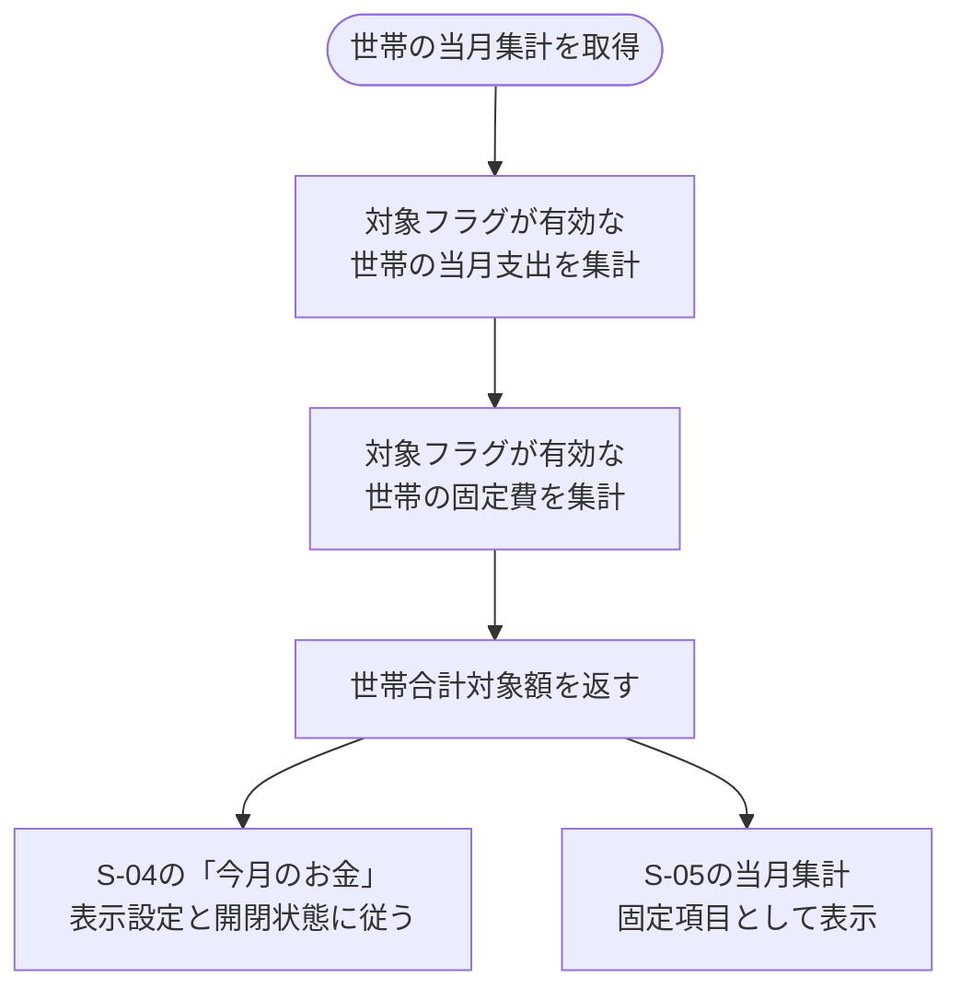

# F-12 世帯支出サマリー

[← 要件定義書に戻る](../../requirements.md)

---

## 使い方の概要

世帯の集計対象にした支出と固定費の合計を、「世帯合計対象額」で確認できます。表示するのは合計額のみです。

| 集計対象 | 条件 |
| --- | --- |
| 支出 | 世帯合計の対象にした、その世帯の当月（日本時間）の支出。 |
| 固定費 | 世帯合計の対象にした、その世帯の登録中の固定費。当月に計上される前も見込み額として含める。 |

トップ画面の「今月のお金」または家計簿の当月集計で確認できます。トップ画面での表示条件は[概要（1章）](#1-概要)、集計の詳細は[世帯合計支出の取得（4章）](#世帯合計支出の取得)を参照。

## 1. 概要

世帯全体としてどれだけ支出があったかを、個人の支出内訳を非公開にしたまま合計金額のみで確認できるようにする機能（[common-notes.md](../common-notes.md) 8章参照）。世帯全体の合算家計簿（個別の支出管理）ではなく、あくまで集計値の閲覧に限定する。

トップ画面（S-04）の「今月のお金」カードと、家計簿一覧画面（S-05）の当月集計に表示する。S-04では表示設定（S-21）でカード全体または世帯合計対象額の項目を非表示にでき、カードを折りたたむと明細は隠れる。S-05では当月集計の固定項目として表示する（[共通事項](../common-notes.md) 9章参照）。

## 2. 対象画面

| 画面ID | 画面名 |
| --- | --- |
| S-04 | トップ画面（表示設定と開閉状態に応じて「今月のお金」カードに表示） |
| S-05 | 家計簿一覧画面（当月集計に表示） |

## 3. 業務フロー

## 4. IPO

### 世帯合計支出の取得

| 項目 | 内容 |
| --- | --- |
| 入力 | household_id・対象期間（当月固定） |
| 処理 | `include_in_household_total=true` の世帯の当月支出（JST）と、登録中の世帯の固定費を合算する。固定費は当月の計上有無にかかわらず見込み額として扱う |
| 出力 | 世帯合計支出額（内訳は含まない） |

## 5. データ設計（関連テーブル）

[data-model.md](../data-model.md) の `expenses.include_in_household_total`, `fixed_costs.include_in_household_total` を参照。

## 6. 今後の検討事項

- 対象期間の指定方法（当月固定のままでよいか、期間を自由指定できるようにするか）
- カテゴリー別など、内訳を出さない範囲での集計軸追加の要否
