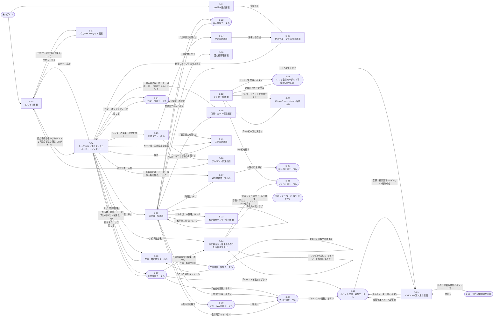

# 画面遷移図

[← 要件定義書に戻る](../requirements.md)

全画面のレイアウトは[wireframes.md](wireframes.md)を参照する。S-24イベント詳細モーダルを追加した。

「登録・編集は各機能画面、確認はトップ（S-04 生活ダッシュボード）に集約」という方針（[common-notes.md](common-notes.md) 9章）により、旧S-16（世帯合計支出画面）・旧S-20（イベント別支出サマリーモーダル）は独立画面として廃止し、S-04内のサマリーカードに統合した。S-04のイベント確認用としてS-24イベント詳細モーダルを新設する。

---

## 1. 全体の画面遷移

---

## 2. 画面一覧

| 画面ID | 種別 | 画面名 | 認証必要 | 詳細レイアウト |
| --- | --- | --- | --- | --- |
| S-01 | 画面 | ログイン画面 | 不要 | [wireframes.md](wireframes.md) 参照 |
| S-02 | 画面 | ユーザー登録画面 | 不要 | [wireframes.md](wireframes.md) 参照 |
| S-03 | 画面 | 世帯グループ作成/参加画面 | 必要 | [wireframes.md](wireframes.md) 参照 |
| S-04 | 画面 | トップ画面（生活ダッシュボード＋カレンダー） | 必要 | [wireframes.md](wireframes.md) 参照 |
| S-05 | 画面 | 家計簿一覧画面（サマリーカード付き） | 必要 | [wireframes.md](wireframes.md) 参照 |
| S-06 | モーダル | 支出登録モーダル | 必要 | [wireframes.md](wireframes.md) 参照 |
| S-07 | 画面 | 割り勘精算一覧画面 | 必要 | [wireframes.md](wireframes.md) 参照 |
| S-08 | 画面 | 固定費管理画面 | 必要 | [wireframes.md](wireframes.md) 参照 |
| S-09 | 画面 | イベント一覧・集計画面 | 必要 | [wireframes.md](wireframes.md) 参照 |
| S-10 | 画面 | 在庫・買い物リスト画面（上部タブで切替、在庫行から詳細編集を直接表示） | 必要 | [wireframes.md](wireframes.md) 参照 |
| S-12 | 画面 | レシピ一覧画面 | 必要 | [wireframes.md](wireframes.md) 参照 |
| S-13 | モーダル | レシピ登録モーダル | 必要 | [wireframes.md](wireframes.md) 参照 |
| S-14 | 画面 | 献立表画面（週単位の作りたい料理リスト、レシピ選択サイドパネル付き） | 必要 | [wireframes.md](wireframes.md) 参照 |
| S-15 | 画面 | 口座・カード管理画面 | 必要 | [wireframes.md](wireframes.md) 参照 |
| S-17 | 画面 | パスワードリセット画面 | 不要 | [wireframes.md](wireframes.md) 参照 |
| S-18 | モーダル | イベント登録・編集モーダル（編集時に支出集計・削除確認を含む） | 必要 | [wireframes.md](wireframes.md) 参照 |
| S-19 | モーダル | 日次詳細モーダル | 必要 | [wireframes.md](wireframes.md) 参照 |
| S-21 | 画面 | 表示設定画面（ダッシュボード表示カスタマイズ、`/settings/display`） | 必要 | [wireframes.md](wireframes.md) 参照 |
| S-22 | モーダル | 収入登録モーダル | 必要 | [wireframes.md](wireframes.md) 参照 |
| S-23 | 画面 | 家計簿カテゴリー管理画面 | 必要 | [wireframes.md](wireframes.md) 参照 |
| S-24 | モーダル | イベント詳細モーダル | 必要 | [wireframes.md](wireframes.md) 参照 |
| S-25 | 画面 | 設定メニュー画面（世帯設定・表示設定・アカウント設定への入口、`/settings`） | 必要 | [wireframes.md](wireframes.md) 参照 |
| S-26 | 画面 | アカウント設定画面（表示名・パスワード・メールアドレスの変更、退会、`/settings/account`） | 必要 | [wireframes.md](wireframes.md) 参照 |
| S-27 | 画面 | 世帯設定画面（世帯名・招待コード・メンバー・退出、`/household/settings`） | 必要 | [wireframes.md](wireframes.md) 参照 |
| S-28 | 画面 | iPhoneショートカット案内画面（`/recipes/iphone-shortcut`） | 必要 | [F09](features/F09_kondate_recipe.md) 参照 |
| S-29 | モーダル | 割り勘詳細モーダル（用途・負担額・状態と、請求・精算・削除などの操作） | 必要 | [wireframes.md](wireframes.md) 参照 |
| S-30 | モーダル | 支出・収入詳細モーダル（編集・削除） | 必要 | [F03](features/F03_kakeibo_expense.md) 7-2章 参照 |
| S-31 | モーダル | レシピ詳細モーダル | 必要 | [F09](features/F09_kondate_recipe.md) 参照 |

**廃止した画面ID**：旧S-11（買い物リスト画面）はS-10に統合。旧S-16（世帯合計支出画面）・旧S-20（イベント別支出サマリーモーダル）はS-04に統合し廃止。欠番として扱い、再利用しない。

## 3. 在庫・イベントの直接編集（#332 / #333）

在庫の品目行は詳細編集モーダルを直接開く。個数は表示枠の外側の＋／－で即時反映し、他の項目は保存で確定する。イベントの登録者はS-18の編集モードを直接開き、支出集計・削除確認まで同じモーダルで操作する。他の登録者の共有イベントは一覧内の閲覧専用詳細を開く。トップ画面から開くS-24は引き続き閲覧専用で、編集への遷移は設けない。
