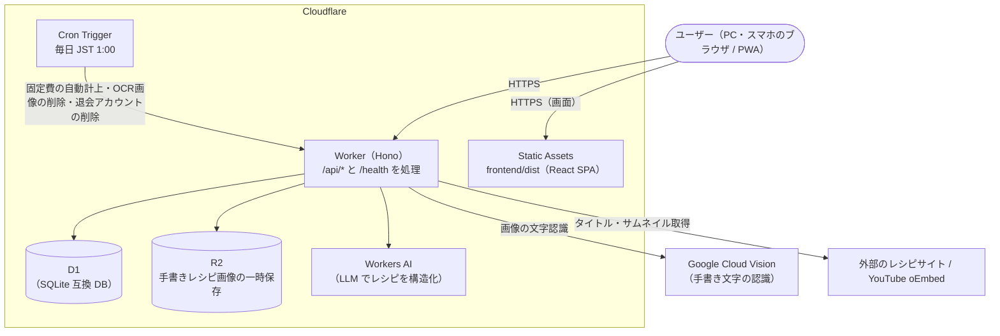

# システム構成図

[← 要件定義書に戻る](../requirements.md)

技術スタックの詳細は [技術スタック.md](../技術スタック.md)、デプロイ手順は [deployment.md](../deployment.md) を参照。

---

## 1. 構成図（Cloudflare Workers 版）

- 画面（SPA）と API は同じ Worker・同じオリジンから配信する。`/api` と `/health` は Worker の処理を先に通し、それ以外のパスは `index.html` に戻す（SPA フォールバック）。
- デプロイは `production` ブランチへの push を契機に Cloudflare Workers Builds が行う（マイグレーション適用 → デプロイ）。

## 2. 開発環境

| 役割 | 起動方法 |
| --- | --- |
| API | `backend-workers/` で `npx wrangler dev --local --port 8787`（ローカルの D1・R2 を使用） |
| 画面 | `frontend/` で `VITE_API_PROXY_TARGET=http://localhost:8787 npx vite --port 5181` |
| E2E | `e2e/` で `npm test`（上記2つを自動起動） |

## 3. 運用フェーズによる構成の違い

| フェーズ | 構成 |
| --- | --- |
| 初期（家族利用） | Cloudflare の無料枠で運用 |
| 利用拡大後 | D1 の容量・同時実行、Workers の実行時間制限を踏まえて再設計（詳細は今後） |
