# ワイヤーフレーム

[← 要件定義書に戻る](../requirements.md)

S-01〜S-24の全画面・モーダルについて、要件定義段階の骨組みレベルでワイヤーフレームをまとめる。実際のUIデザイン（配色・フォント・詳細CSS）の決定前段階の「叩き台」として、ASCIIアート風のレイアウト図で画面内の要素配置・サイズ感を示し、補足としてMermaidのブロック図（要素の関係性）も併記する。各画面の項目は対応する[機能別要件定義書](../requirements.md#5-機能要件)の内容に基づく。

---

## 共通ヘッダー（#257）

- 直下の関連機能タブは枠・角丸・塗りつぶしのないテキスト表示へ整理し、選択中だけ青い下線と文字色で示す（#370）。押せる高さはPC44px以上、スマホ40px以上。タブ順、キーボード操作、必要時の折り返し、スクロール追従は維持する。下部ナビの表示は後述の「下部の主要ナビゲーション（#462）」に従う。

- スクロール時はタイトルバーと、その直下にある在庫管理・家計簿・献立表の関連機能タブを一体で画面上部に残す（#364）。タブのない画面はタイトルバーだけを残す。320/390/1280pxで全タブとタイトルバー内の操作を維持し、折り返し後の高さにも対応する。本文は通常どおりスクロールし、モーダルは追従領域より前面に表示する。

世帯所属後の各画面では、白地のタイトルバーに左からシェファミロゴ（家のアイコン＋「シェファミ」。481px以上では補助表記「HomeLog」を併記）、通知、設定、アカウント名ボタン（人物アイコン＋ログイン本人の表示名）を全幅で1段に並べる（#462）。アカウント名ボタンを押すと「アカウント」ダイアログを開き、アカウント設定（`/settings/account`）とログアウトを利用できる。

- 表示名は `GET /api/auth/me` から取得し、メールや世帯の別メンバー名は代用しない。
- 長い名前は1行で省略し、DOMとtitle属性に全文を保持する。アカウント名ボタンは内容に合わせた幅とし、最大幅を`clamp(96px, 32vw, 144px)`に抑える。320pxでも操作部品とページ全体が横にはみ出さない。
- 取得中は「読み込み中…」、失敗時は「アカウント名を取得できません」。取得状態によらず、設定とアカウント名ボタンからのログアウトを利用できる。
- 「アカウント」ダイアログは閉じるボタン・Escape・背景クリックで閉じ、アカウント名ボタンへフォーカスを戻す。開いている間はダイアログ内でTab移動を循環させる。
- 世帯未所属画面へのヘッダー追加や、名前編集・全文表示専用UIは対象外。

### 下部の主要ナビゲーション（#462）

- 白地・5等分で画面下端に固定し、左からホーム（`/`）・献立（`/menu`。読み上げ名は「献立表」）・在庫（`/zaiko`）・家計簿（`/kakeibo`）・その他を、アイコン上・文字下で表示する。選択中は青い文字と太字で示し、操作領域は44px以上とする。
- 関連画面でも選択先は1つに定める（レシピは献立、割り勘・口座・固定費・イベント・カテゴリーは家計簿、買い物リストは在庫、設定・世帯設定は「その他」）。
- 「その他」は「その他の設定・管理」ダイアログを開く。表示設定・世帯設定・カテゴリー管理・固定費・口座・カード管理・割り勘・イベント・レシピ・買い物リストの9導線を置き、通知・本人名・ログアウト・アカウント設定は置かない（タイトルバー側で扱う）。
- ダイアログはリンク選択・画面遷移・閉じるボタン・Escape・背景クリックで閉じ、閉じたときは「その他」ボタンへフォーカスを戻す。「アカウント」ダイアログとは同時に開かない。

## S-01 ログイン画面

対応: [F01_auth](features/F01_auth.md)

```text
┌─────────────────────────────────┐
│            シェファミ              │
│                                  │
│  メールアドレス                  │
│  [_____________________________]│
│                                  │
│  パスワード                      │
│  [_____________________________]│
│                                  │
│          [   ログイン   ]        │
│                                  │
│  パスワードを忘れた場合          │
│  新規登録はこちら                │
└─────────────────────────────────┘
```

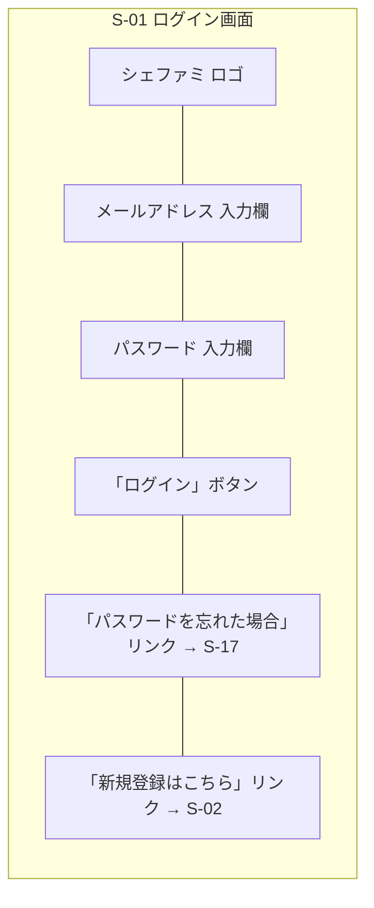

---

## S-02 ユーザー登録画面

対応: [F01_auth](features/F01_auth.md)

```text
┌─────────────────────────────────┐
│           新規登録               │
│                                  │
│  メールアドレス                  │
│  [_____________________________]│
│                                  │
│  パスワード                      │
│  [_____________________________]│
│                                  │
│  表示名                          │
│  [_____________________________]│
│                                  │
│          [  登録する  ]          │
│                                  │
│  ログインはこちら                │
└─────────────────────────────────┘
```

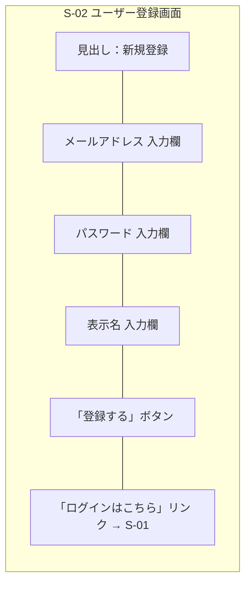

---

## S-03 世帯グループ作成/参加画面

対応: [F02_household](features/F02_household.md)

```text
┌─────────────────────────────────┐
│         世帯グループ             │
├───────────────┬─────────────────┤
│   新規作成     │   既存に参加    │
│               │                 │
│ 世帯グループ名  │  招待コード      │
│ [___________] │  [___________]  │
│               │                 │
│ [ 作成する ]   │  [ 参加する ]   │
└───────────────┴─────────────────┘
```

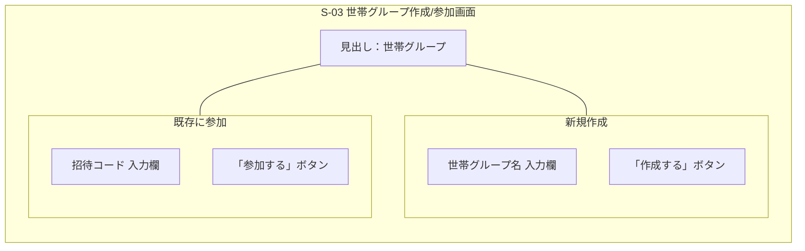

---

## S-04 トップ画面（生活ダッシュボード＋カレンダー）

日付詳細は `GET /api/dashboard/day-detail?date=YYYY-MM-DD`（#446/#431）を利用する。既存月間APIは維持し、月間には日付とカテゴリの有無、実額・明細はS-19に分離する。

対応: [F06_kakeibo_event](features/F06_kakeibo_event.md), [F12_kakeibo_household_summary](features/F12_kakeibo_household_summary.md), [F13_kakeibo_income](features/F13_kakeibo_income.md), [F07_zaiko_inventory](features/F07_zaiko_inventory.md), [F08_zaiko_shoppinglist](features/F08_zaiko_shoppinglist.md), [F10_kondate_menu](features/F10_kondate_menu.md)

確認系の情報を画面遷移なしで把握できる「生活ダッシュボード」として定義する（[common-notes.md](common-notes.md) 9章の方針）。表示設定で選択したカードを、保存済みカード順で表示するカードグリッドにコンテナとして配置する。カード順の編集用グリッドはS-21のチェックリスト下にのみ配置する。旧S-16（世帯合計支出画面）・旧S-20（イベント別支出サマリーモーダル）はここに統合し廃止した。

月間カレンダーを画面上部に全幅で配置し、その下にカードグリッドを置く。カレンダーが表示ONなら常に最上部、OFFなら非表示とする。カードはPCでは複数列、モバイルでは保存された順序の1列で表示する。標準のカード順は「今日の状況」「買い物・在庫」「個人の財政」「今月のお金」「イベント別支出」。

```text
┌──────────────────────────────────────────────┐
│ [家計簿] [在庫管理] [献立表] [設定]        🔔2  │
├──────────────────────────────────────────────┤
│                 ◀   2026年 7月   ▶            │
├────┬────┬────┬────┬────┬────┬────┤
│ 日 │ 月 │ 火 │ 水 │ 木 │ 金 │ 土 │
├────┼────┼────┼────┼────┼────┼────┤
│    │    │  1 │  2 │  3 │  4 │  5 │
│    │    │    │    │ ●● │    │ ●  │
├────┼────┼────┼────┼────┼────┼────┤
│  6 │  7 │  8 │  9 │ 10 │ 11 │ 12 │
│ ●● │ ●  │    │    │ ●● │    │ ●●●│
├──────────────────────────────────────────────┤
│ ●イベント ●収入 ●支出 ●固定費（色＋文字の凡例） │
│ 各セル：日付＋各カテゴリ1dot、最大4dot。        │
│ 日付クリック/Enter/SpaceでS-19を開く。          │
├──────────────────────┬───────────────────────┤
│ ■ 今日の状況（7/10）   │ ■ 買い物・在庫          │
│  今週の献立     [2件]  │  買い物リスト           │
│  イベント       [1件]  │  品名         値段      │
│  （各行で当日のS-19）   │  牛乳         1,280円    │
│                         │  卵           未設定    │
│                         │  在庫リスト（品名／残数）│
│                         │  米           残2       │
│                         │  洗剤         残0（不足）│
├──────────────────────┼───────────────────────┤
│ ■ 個人の財政            │ ■ 今月のお金             │
│  口座残高合計:126,200円 │  個人支出:32,000円       │
│  （本人のみ表示）        │  世帯合計対象額:45,300円  │
│                          │  未精算                   │
├──────────────────────────────────────────────┤
│ ■ イベント別支出（期間：今年 ▼）               │
│  旅行 15,000円 / 学習 3,000円                  │
└──────────────────────┴───────────────────────┘
```

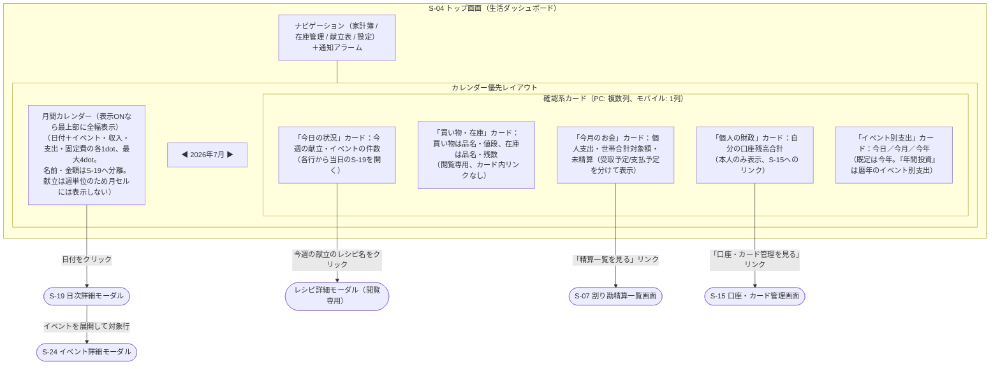

- 月間は7列を保ち、日付とイベント→収入→支出→固定費の固定順で各1dot（最大4）を表示する。同カテゴリ複数件でも増やさず、dot＋文字の4凡例を添える。日付ボタンの読み上げにも有無を含める。名前・金額はS-19へ分離する。
- 表示設定OFFのイベント・収入・支出はdotと日付読み上げから除外する。固定費トグルは追加しない。S-19の取得内容は設定から独立。月移動中・取得失敗・再試行を区別し、旧月応答は破棄する。
- 通知アラームはトップナビゲーションに配置し、通知有効な繰り返しイベントの当日発生件数をバッジで表示する。カレンダー内には通知件数を表示しない。取得中は読み込み状態、取得失敗時はエラー状態を件数と区別して表示する。
- モバイルではカレンダーと有効なカードを保存順に1列へ積み、横方向のスクロールや固定ナビゲーションとの重なりを生じさせない。カードの表示/非表示設定、カード内項目、カード順は画面幅にかかわらず維持する。
- 「イベント別支出」カードは**期間セレクト（今日／今月／今年、デフォルト今年）**を持つ。「年間投資」は投資専用集計ではなく、暦年（今年）のイベント別支出を意味する。他のカードにイベント別支出を含めない。
- 未精算は「受取予定（自分が立て替えて相手から貰う分）」と「支払予定（自分が負担して相手に払う分）」を分けて表示する。
- 「個人の財政」カードは自分が所有する口座の残高合計を表示し、その下の行に「口座・カード管理を見る」リンク（S-15、`/accounts`）を配置する。読み込み中・取得失敗・口座未登録でもリンクを表示する。口座残高は本人のみ閲覧可能のため、このカードの内容もログインユーザー自身の情報のみで構成される（[common-notes.md](common-notes.md) 2章、[F11_kakeibo_account](features/F11_kakeibo_account.md)参照）。
- イベント別支出には全イベントではなく、**表示対象として選択したイベント（`show_on_dashboard` = true）のみ**を表示する。ON/OFFはS-18登録モーダル・S-09一覧から直接開く編集モーダル内で登録者が他の項目と一緒に保存する（[F06_kakeibo_event](features/F06_kakeibo_event.md) 4章参照）。
- 「買い物・在庫」カードは買い物リストを「品名／値段」、在庫リストを「品名／残数」の見出し付き2列で表示する。買い物は未購入のみ、在庫は残数と閾値以下の「（不足）」を表示する。値段は現在の参考値を桁区切りの円表示（0は「0円」、未設定は「未設定」）とし、数量との乗算はしない。在庫欄には値段を表示しない。品名とカード末尾にリンクを設けず、管理画面へは主要ナビゲーションから移動する。先頭8件と残件数、読み込み中・空・取得失敗、表示設定とカード順を維持し、長い品名と値は320pxでも全文を折り返して横にはみ出させない。「よく使う品目」は廃止する。
- 「今日の状況」カードは「今週の献立」「イベント」の2行に件数だけを表示する（0件も「0件」と表示する。#462）。各行はボタンで、押すと当日のS-19日付詳細を開き、閉じると押した行へフォーカスを戻す。今日の収支はカードに表示せず、S-19の収支欄で確認する。献立・イベントの表示設定が両方OFFのときはカード自体を表示しない。
- 今週の献立のレシピ詳細は、S-19の献立欄にあるレシピ行から既存レシピ詳細モーダルを閲覧専用で開く。編集・削除ボタンは表示しない（S-12では従来どおり表示）。自由メモ・削除済みレシピは操作できない文字列として表示する。
- レシピ取得中はレシピ行の多重操作を防ぎ、取得失敗・対象消失はS-19内にメッセージで表示する。詳細は閉じるボタン・Escape・背景クリックで閉じ、元のレシピ行へフォーカスを戻す。モーダル内部のクリックでは閉じない。長いタイトル・材料・手順は狭い画面でも折り返す。レシピ詳細は上部44pxの明示×を初期フォーカスとし、長文の冒頭から表示する。上部の閉じるをスクロール中も利用でき、末尾の「閉じる」も維持する。Tab移動先はモーダル内スクロールで見える状態にする。
- S-19のイベント欄を展開して対象行から閲覧専用S-24を開く。編集・削除ボタンや編集遷移は提供しない。
- 各カードの数値・リンク先は、対応する各機能画面の情報をそのまま参照する（新たな計算ロジックは持たない）。
- 「収支」（S-19の収支欄）は、ログインユーザー本人のその日の収入合計－支出合計。支出側の世帯合計対象フラグの有無に関わらず本人が登録した全件を対象とし、他メンバーの収入・支出は権限方針上参照できないため常に本人個人の収支となる（世帯合計支出とは別の指標。[common-notes.md](common-notes.md) 8章、[F13_kakeibo_income](features/F13_kakeibo_income.md)参照）。
- どのカード（今日の状況／買い物・在庫／個人の財政／今月のお金／イベント別支出／カレンダー）を表示するかに加え、カード内の項目単位でも設定画面（S-21）でユーザーごとに表示を選択できる。カレンダーは表示ONなら最上部、OFFなら非表示とする。全カードを非表示にした場合は設定画面への案内を表示する。
- S-21のチェックリスト下には有効カードをコンテナとして並べる編集グリッドを表示する。ドラッグ操作でカード順を変更でき、キーボード利用者には上へ／下へ移動ボタンまたは同等の操作を提供する。保存時に表示設定とカード順を同一トランザクションで保存し、成功後はS-04へ遷移する。失敗時はS-21に留まり、変更内容を保持してエラーを表示する。

---

## S-05 家計簿一覧画面

#422の独立UI部分：履歴は初期全期間・新しい順を維持し、キーワード（用途/収入内容）・収支種別・対象月・既存カテゴリーで絞り込む。月未選択は全期間、検索・月の解除はその2条件だけを解除する。履歴期間と「当月サマリー（年月）」を区別し、当月収入・支出・差額を表示する。履歴の絞込で当月集計は変えない。前回口座は同じbrowser内で利用者別・収入/支出別に成功した選択を記憶し、新規登録の初期候補とする（S-06/S-22参照）。


対応: [F03_kakeibo_expense](features/F03_kakeibo_expense.md), [F04_kakeibo_warikan](features/F04_kakeibo_warikan.md)（未精算サマリー）, [F05_kakeibo_fixedcost](features/F05_kakeibo_fixedcost.md)（固定費予定サマリー）, [F06_kakeibo_event](features/F06_kakeibo_event.md)（イベント支出サマリー）, [F12_kakeibo_household_summary](features/F12_kakeibo_household_summary.md)（世帯合計対象額サマリー）, [F13_kakeibo_income](features/F13_kakeibo_income.md)（収入一覧タブ）

```text
┌──────────────────────────────────────────────┐
│ 今月支出:32,000円 今月収入:280,000円 世帯合計対象額:45,300円│
│ 未精算 受取:4,000円/支払:4,500円  固定費予定:89,200円 イベント支出[今年▼]:15,000円│
├──────────────────────────────────────────────┤
│ [収支を検索____] [履歴の対象月____] [検索・月を解除] │
│ [すべて/支出/収入▼] [精算] [固定費] [イベント] [口座]│
├──────────────────────────────────────────────┤
│ [収支を登録] [カテゴリー管理] （種別選択時:カテゴリー▼）│
├──────────┬──────────────────┬──────────────┤
│ 日付      │ 内容              │ 金額         │
├──────────┼──────────────────┼──────────────┤
│ 2026-7-25│ 7月分給与          │ +280,000円   │
│ 2026-7-03│ 電気代             │ -8,000円     │
│ 2026-7-01│ スーパー           │ -1,200円     │
└──────────┴──────────────────┴──────────────┘
```

収入の種別絞り込み選択時（日付・内容・金額の3列は共通）：

```text
┌──────────────────────────────────────────────┐
│ カテゴリー: [ すべて ▼ ]      [収支を登録]        │
├──────────┬──────────────────┬──────────────┤
│ 日付      │ 内容              │ 金額         │
├──────────┼──────────────────┼──────────────┤
│ 2026-7-25│ 7月分給与          │ +280,000円   │
└──────────┴──────────────────┴──────────────┘
```

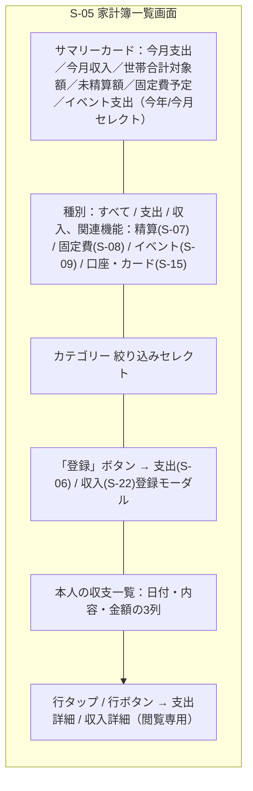

一覧テーブル（すべて／支出／収入で共通）：

| 日付 | 内容 | 金額 |
| --- | --- | --- |
| 2026-07-25 | 7月分給与 | +280,000円 |
| 2026-07-01 | スーパー | -1,200円 |

詳細閲覧（Issue #214）：

- 金額は収入を緑系の「+1,000円」、支出を既存支出配色の「-1,000円」と表示し、色だけに頼らない。
- 行ボタンのEnter／Space、日付・金額セルを含む行タップで詳細を開く。空用途は「内容なし」。3列を維持し、320pxでもページ全体の横はみ出しを防ぐ。
- 支出詳細：日付・内容・金額・種別・カテゴリー・口座／チャージ型カード・世帯合計対象・イベント・メモ・割り勘内訳（相手・割合／負担額・状態）。creditカードは親口座を表示する。
- 収入詳細：日付・内容・金額・種別・カテゴリー・口座・メモ。通常収入と精算収入の入金先を表示し、既存の`accountId: null`は「なし」。論理削除済み口座の名前は収入GETの`accountName`で解決する（#244 API対応、表示UIは#245）。世帯合計対象・割り勘内訳は表示しない。
- 割り勘は当該支出の支払者側内訳に限定し、読み込み中・取得失敗・0件を区別する。
- 閉じる・Escape・背景タップで閉じ、元の行ボタンへフォーカスを戻す。編集・削除ボタンは表示しない。支出／収入そのものの編集・削除とAPIは別Issueで検討する。

---

- 日付・内容・符号付き金額の3情報を維持し、狭幅では日付/金額を上段、内容を次段に配置する。長い内容と大きい金額は全文折り返し、日付・金額を読み上げにも関連付ける。行/各情報/余白・Enter/Spaceで既存詳細へ移動する。
- 詳細の既存削除は対象名付き右上ゴミ箱へ移す。削除不可の支出ではゴミ箱を表示せず、既存の請求中/精算済/取得失敗・409制約を維持する。別確認の取消で元ゴミ箱、編集取消/保存で元詳細へ戻り、最後closeで一覧起点へ戻る。

## S-06 支出登録モーダル

#422の配置：日付・金額・用途・カテゴリー・口座/カードは通常表示し、世帯合計・イベント・割り勘・メモを同じ「その他の設定」にまとめる。収納しても値と保存bodyを保持する。新規の口座/カードは、利用者別・支出用に記憶した前回の成功選択を初期候補とし、任意に変更・解除できる。収支切替では各種別の記憶候補を使う。編集の既存設定は確認できる初期展開とし、関連エラー時は設定を開く。

支払った人はF03に従い登録者本人固定で、選択欄を持たない。イベントは既存イベントから選択し、選択時にdefaultAmountを金額欄へ自動入力する（保存前に上書き可）。このフォームから新規イベントの登録モーダルは開かない。


割り勘は「その他の設定」→「割り勘する」ONで同じフォーム内に展開する（#425）。入力種類・相手・本人の円/割合を併記し、近傍エラーと収納時の値保持は[F04](features/F04_kakeibo_warikan.md)に従う。


対応: [F03_kakeibo_expense](features/F03_kakeibo_expense.md), [F04_kakeibo_warikan](features/F04_kakeibo_warikan.md), [F06_kakeibo_event](features/F06_kakeibo_event.md), [F11_kakeibo_account](features/F11_kakeibo_account.md)

```text
┌─────────────────────────────────┐
│        支出を登録                │
│ 日時       [__________]          │
│ 金額       [__________]          │
│ 使用用途   [__________]          │
│ カテゴリー [________▼]           │
│ 口座/カード[________▼]（任意）    │
│ [ その他の設定 ▼ ]              │
│ イベント  [________▼]（任意）    │
│  ※選択するとデフォルト金額を     │
│    金額欄へ自動入力（上書き可）   │
│ □ 世帯合計に含める                │
│ メモ       [__________]（任意）   │
│ ── 割り勘設定（任意） ──          │
│ 対象者: [________▼]              │
│ 入力方法: (●)％ ( )金額           │
│ 負担割合: [50]% : [50]%          │
│  ※「金額」選択時は各自の負担額を  │
│    円で直接入力（合計＝支出金額）  │
│                                  │
│     [ 保存 ]    [ キャンセル ]    │
└─────────────────────────────────┘
```

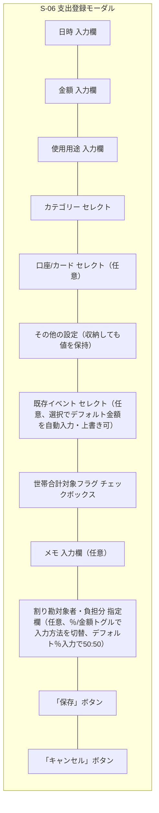

---

## S-22 収入登録モーダル

#422では通常項目の入金先口座を常時表示し、メモだけを「その他の設定」に収納する。世帯合計/イベント/割り勘は収入へ追加しない。新規の入金先は同じbrowser内で利用者別・収入用に記憶した前回の成功口座を初期候補とする。支出用の口座/カード記憶とは分離し、編集は元明細を優先する。


対応: [F13_kakeibo_income](features/F13_kakeibo_income.md)

```text
┌─────────────────────────────────┐
│        収入を登録                │
│ 日時       [__________]          │
│ 金額       [__________]          │
│ 内容       [__________]          │
│ カテゴリー [________▼]           │
│ 入金先口座 [________▼]（必須）   │
│ [ その他の設定 ▼ ]              │
│   メモ     [__________]（任意）   │
│                                  │
│     [ 保存 ]    [ キャンセル ]    │
└─────────────────────────────────┘
```

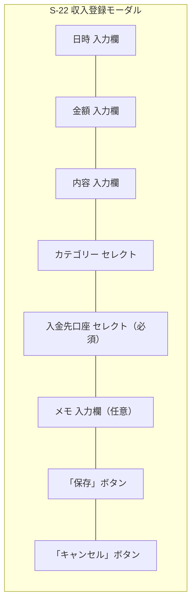

「支払った人」「世帯合計対象フラグ」に相当する入力欄は持たない。収入を得た人は常に登録者本人固定とし、収入は純粋に個人管理（世帯合計に算入する仕組みを持たない）とする（[F13_kakeibo_income](features/F13_kakeibo_income.md) 1章・6章参照）。入金先口座は必須とし、本人所有・同世帯・未削除の口座だけを選ぶ（カードは選択不可）。初回・記憶なし/破損・使用不能候補は未選択とし、自動で先頭口座を選ばない。口座の取得中・取得失敗時は登録できず、取得成功で0件の場合は口座管理へ案内する。登録成功時にモーダルを閉じ、収入と口座残高を再取得する。再取得失敗は「収入は登録済み」と区別して通知し、登録を再送しない。イベント・割り勘との連携は対象外。

前回口座の記憶は登録/更新API成功時だけ更新し、取消・入力エラー・API失敗では変更しない。支出の明示未選択も記憶する。成功後の一覧再取得失敗やbrowser記憶の例外は、成功済み明細を失敗扱いに戻さない。利用者未確定中は記憶を使わず、取得中/失敗中の口座を消失と扱わない。遅い候補取得で手動選択/解除を上書きせず、旧利用者の保存応答を別利用者へ反映しない。ログアウト後も本人の記憶は残し、他利用者へ候補・未保存入力を引き継がない。

S-15の口座一覧・各画面の口座選択肢・S-04の残高合計は論理削除済み口座とその子カードを除外する。収入が参照する口座の削除は名前を残す論理削除となり、過去の収入詳細で参照できる（F-11参照）。

---

## S-07 割り勘精算一覧画面

対応: [F04_kakeibo_warikan](features/F04_kakeibo_warikan.md)

一覧は日付・相手・用途・金額と、受け取り/支払いの方向・未請求/請求中/受領確認待ち/保留中/精算済みをコンパクトに表示する（#425）。行を押してS-29詳細を開き、既存権限と状態遷移で操作する。方向・状態は読み上げにも関連付け、スマホ幅でも横にはみ出させない。

```text
┌──────────────────────────────────────────┐
│ 割り勘・精算                 [家計簿に戻る] │
│ [ すべて ] [ 世帯内 ] [ 世帯外 ]            │
├──────────────────────────────────────────┤
│ 2026-10-17   花子 へ請求          2,500円 │
│ 共同購入                 受け取り予定・未請求 │
│ 2026-10-15   太郎 へ支払          1,200円 │
│ 夕食                       支払い予定・請求中 │
│ 2026-10-10   e2euser_ext へ請求     800円 │
└──────────────────────────────────────────┘
（行を押す → S-29 割り勘詳細モーダル）
```

- 初期表示は「すべて」とし、本人が立替者または負担者の内訳を世帯内・世帯外とも表示する。タブで相手の種別を絞り込め、請求・精算・削除後の再取得でも選択を維持する。
- 「すべて」の0件は「割り勘の内訳はありません」、種別の0件は「世帯内の割り勘の内訳はありません」／「世帯外の割り勘の内訳はありません」と表示する。

## S-29 割り勘詳細モーダル

```text
┌──────────────────────────────┐
│ 割り勘詳細          [ゴミ箱][×]│
│ 日付    2026-10-17            │
│ 用途    スーパー買い物         │
│ 相手    花子 へ請求            │
│ 負担額  2,500円（50%）         │
│ 状態    未請求                 │
│ [請求] [コメント] [閉じる]      │
└──────────────────────────────┘
```

- 表示するボタンは立場と状態で変わる。立替者＝「請求」「受け取りました」「まだ受け取っていない」「精算済みにする（世帯外のみ）」「削除」、負担者＝「支払う」「保留」。「コメント」は常に表示する。
- 右上ゴミ箱は立替者の未精算の内訳と、世帯外の相手との精算済みの内訳で表示する（精算済みの削除では精算の収入も消して残高を戻す、#301/#302）。
- 口座選択・削除確認・コメントは親の兄弟dialogとして開き、その間は親詳細をhiddenにする。最上位だけがEsc/Tabを処理し、子を閉じると元操作、親を閉じると一覧行へ戻る。上部×は初期focus/スクロール中の閉鎖に使い、末尾の閉じるも維持する。
- 精算口座は任意選択と既存送信値を維持。削除確認は取消を初期focusとし、影響説明と確定操作を分離する。精算/削除中は連打・取消・Esc・背景を抑止する。コメントは長文冒頭から表示してTab先をスクロールで見える状態にし、既存の投稿中closeを維持する。
- 負担者の支払報告で `payment_reported`（受領確認待ち）、立替者の受領確認で `settled` となる。支払い元・入金先口座の選択は任意で、精算完了時の家計簿への記録はF04第8章に従う。

---

## S-08 固定費管理画面

対応: [F05_kakeibo_fixedcost](features/F05_kakeibo_fixedcost.md)

```text
┌──────────────────────────────────────────────┐
│ [ 固定費を登録 ] ← 固定費登録モーダルを開く    │
├──────────┬────────┬────────┬────────────┤
│ 固定費名   │ 金額    │ 支払日  │ 引き落とし元 │
├──────────┼────────┼────────┼────────────┤
│ 家賃      │80000円 │ 27日   │ 生活費口座   │
│ 個人サブスク│1200円 │ 5日    │ なし         │
└──────────┴────────┴────────┴────────────┘
（公開範囲が「個人」の固定費は登録者本人にのみ表示される）

┌─ 固定費登録モーダル ─────────────┐
│ 基本情報                          │
│ 固定費名 [___________▼ or 入力]   │
│ 金額（月額の予定）[___________]  │
│ 支払日   [___________]           │
│ 引き落とし元（任意）[________▼]  │
│ 詳細設定（開閉しても入力を保持）    │
│ 公開範囲 (●世帯共有 ○個人)        │
│ □ 世帯合計に含める                │
│ ── 割り勘設定（任意） ──          │
│ 入力方法: (●)％ ( )金額           │
│ 種別（世帯内／世帯外）と相手・負担分 │
│  ※毎月の自動計上時にこの割合で    │
│    精算（expense_splits）を生成   │
│     [ 保存 ]    [ キャンセル ]    │
└─────────────────────────────────┘
```

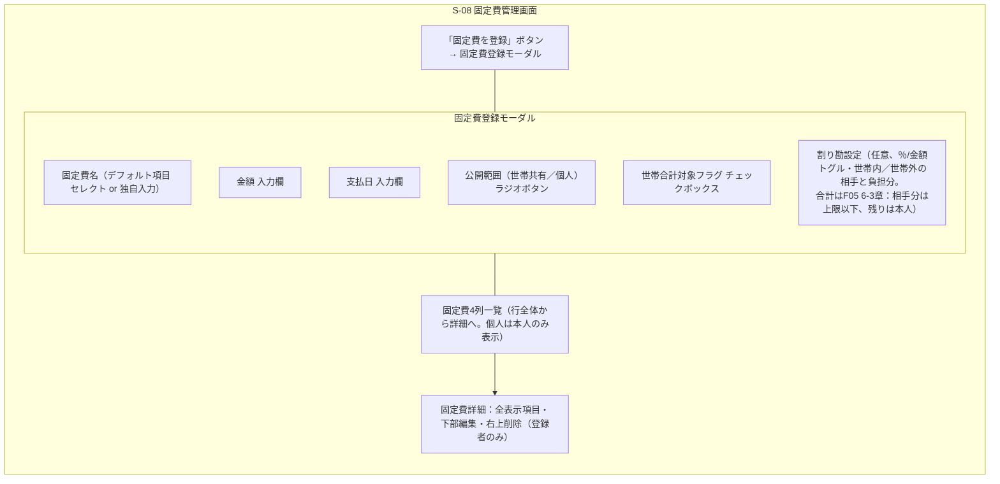

固定費一覧の列：

| 固定費名 | 金額 | 支払日 | 引き落とし元 |
| --- | --- | --- | --- |

行全体をネイティブbuttonにし、各セル・余白・Enter/Spaceから同じ詳細を開く。詳細は固定費名・金額・支払日・公開範囲・世帯合計対象・引き落とし元・割り勘設定（入力方法・相手・割合・金額）を表示する。引き落とし元と割り勘は他者なら「非公開」、本人未指定なら「なし」とし、名前取得失敗は未確認として区別する。登録・編集では世帯内／世帯外を行ごとに選び、最大20人まで混在できる。世帯外は名前（trim後1〜50文字）を入力し、詳細にはAPIの外部名を表示する。世帯取得失敗でも外部名は表示し、名前欠落時は「相手の名前を確認できません」とする。

既存外部名を変えなければIDを維持する。変更した場合はこの固定費の相手を新規相手へ差し替え、既存相手マスタ・過去精算は更新しない。種別を切り替えた行は相手を選び直す。相手の割合合計は100%以下（既存の0.01%許容を維持）、金額合計は固定費金額以下とし、残りを本人の負担として表示する（F05 6-3章）。

編集は登録者だけ詳細下部から操作し、削除は登録者の詳細/編集タイトルバー右上に対象名付きゴミ箱を置く。下部に削除を重複させない。編集保存／通常キャンセルは詳細へ、削除確認の取消/Esc・失敗は元の詳細または編集へ戻り、編集中の全下書きと詳細開閉状態を保つ。保存レスポンスを反映して最新値を表示し、再取得失敗を保存失敗として扱わない。初期フォーカス・Tab/Shift+Tab巡回・Escape／背景／閉じると起点復帰は共通規約に従い、削除・対象消失後は登録ボタンへ戻す。4列・詳細・フォームは320pxでも全文折り返し、下部操作へ縦スクロールできる。

---

### S-08のスマホ操作（#423）

取得成功で未登録の場合は空の表より説明と登録導線を優先する。上部登録は安定したフォーカス復帰先として残す。フォームは基本情報（名前・金額・支払日・引き落とし元）と詳細設定（公開範囲・世帯合計・割り勘）で整理し、詳細を閉じても値を消さない。毎月支払日の自動計上と月額の予定を案内し、実績の計上済み支出と区別する。

削除確認は対象名・影響・取消不能を説明する。送信中は確認を閉じず二重送信を防ぎ、編集親はhiddenで保持する。確認取消/Escや失敗後は元の削除ボタンへ戻る。登録専用・他者共有の閲覧には削除を出さない。44px程度の操作領域・入力16px以上・safe-area・320/390/1280px・Tab/ShiftTab/Escと末尾操作を維持する。計上/残高/割り勘の業務条件は変更しない。

## S-09 イベント一覧・集計画面

対応: [F06_kakeibo_event](features/F06_kakeibo_event.md)

日付ブロックと主情報/補助情報をまとめたコンパクト行（#426 A案）:

```text
[2026年]  父の日
[ 6/21 ]  終日 · 単発

[2026年]  学習
[ 6/22 ]  20:00〜21:00 · 毎日
```

- 一覧は左の日付ブロック（年・月日）、右のイベント名、その下の時刻/終日・繰り返しで構成し、3列見出しを置かない。上部の「イベントを登録」はPR #416の黒背景/白文字・44pxを維持する。期間選択と金額列は置かず、名前は全文折り返し、時刻は項目内で折り返さない。320pxでも横にはみ出させず、timeのdatetimeと行の説明で完全日付・時刻・繰り返しを読み上げられるようにする。
- イベント名・日時・繰り返し・余白を含む行全体をネイティブbutton＋span/gridとし、タップ・クリック・Enter／Spaceで登録者はS-18編集モーダルを直接開き、その他のメンバーはS-09の閲覧専用詳細モーダルを開く。詳細のフォーカス巡回・起点行（消失時は登録）への復帰は共通規約に従う。直接編集の保存／キャンセル後は一覧へ戻る。集計・削除・削除確認は同じ編集モーダル内にまとめ、削除を取りやめても未保存入力を保持する。
- 詳細はイベント名・日時・繰り返し・公開範囲・通知・デフォルト金額（未設定時は「未設定」）・ダッシュボード表示・本人の支出合計を表示する。既存summary APIを使い、期間は今年が既定、今月への切替は詳細内で行う。表示OFFによる404は「集計対象外」、その他の失敗は「取得失敗」とエラー案内を表示する。
- 登録者（editable=true）のS-18編集モードに入力項目・本人の支出集計・削除確認をまとめる。ダッシュボード表示も「更新」で保存し、チェック変更だけでは送信しない。他の登録者（editable=false）の共有イベントは一覧内の閲覧専用詳細を表示し、変更操作は表示しない。S-04のS-24も閲覧専用を維持する。
- 編集はイベント名へ、閲覧専用詳細は閉じるボタンへ初期フォーカスを置く。Tab／Shift+Tabをモーダル内で巡回させ、編集はキャンセル・Escape・背景クリック、閲覧専用は閉じる・Escape・背景クリックで閉じる。送信中は閉じる操作を抑止する。スマホではモーダル内を縦スクロールして全項目と操作へ到達できる。

---

一覧は取得成功0件と取得失敗を区別する。検索・絞り込み・日付順変更は追加しない。S-18の共通フォームと単発通知の保存時OFFは下記の確定仕様に従う。

## S-10 在庫・買い物リスト画面

#420：行下B方式の±1/0.1は即時delta更新、手入力は「増減量」を「数量を適用」で確定する。絶対在庫数入力ではない。既存一覧×は維持し詳細へ移設しない。自動消費は通常ON時だけ量を表示、OFFでもdraft保持/再ON復元、ON空欄保存は拒否する。例外として、OFFで空欄以外の不正なdraft値の保存を拒否した場合は、OFFと値を維持して修正入力と近傍のエラーを表示し、有効値になっても修正中は入力を表示し続ける。検証条件・送信内容は維持し、有効値のOFF保存は消費量/false、空欄のOFF保存はnull/falseとする。数量の結果不明は同品目の再送を停止して一覧確認・再読込を案内し、成功後GET失敗とは区別する。詳細な保存/失敗境界はF07に従う。

在庫一覧パネルでは検索欄（ラベル「商品を探す」）の下に「カテゴリーで絞り込み」の選択肢（すべて／各カテゴリー）を横に並べる（#369・#469）。既定は「すべて」。カテゴリーとキーワードのAND条件で表示し、狭幅では選択肢の枠だけを1行で横に流す。該当0件の案内を表示し、絞り込み中も詳細・編集・数量操作を利用できる。買い物リスト側は以下の#421を適用する。

対応: [F07_zaiko_inventory](features/F07_zaiko_inventory.md), [F08_zaiko_shoppinglist](features/F08_zaiko_shoppinglist.md)

在庫・買い物リストAPIは在庫ID単位の共通の値段（整数円またはnull）を返す（#235）。画面の値段入力・表示は#212、在庫の直接編集は#332、買い物の一覧・詳細は#242に従う。入力の省略・クリア・範囲等の契約は[api-design.md](api-design.md)の「値段の共通契約」を参照。

買い物一覧（#421）は店舗別グループ。独立checkboxと行buttonを並べ、行に品名・予定数・現在庫・チェック済み実購入数を表示する。全文折り返しで320pxでも横スクロール不要。checkboxはbuttonの子にせず、行を押すと買い物詳細を開く。

画面幅にかかわらず、上部タブ（他機能の上部タブと同じ見た目）で「在庫一覧」と「買い物リスト」を切り替え、選択中のタブの内容だけを表示する（#197）。タブはURLで表し、`/zaiko` が在庫一覧、`/zaiko/shopping` が買い物リスト。両タブは同じデータを共有し、在庫の増減による買い物リストへの自動追加・除外は、タブを切り替えた時点で最新の状態が表示される。

各タブの表示例（同時には表示しない）：

```text
在庫一覧タブ
[ 在庫一覧 ] [ 買い物リスト ]
在庫一覧
行を押すと数量を変更できます
商品を探す
[ 🔍 商品名で検索                      ]
(すべて) (野菜) (肉) (乳製品) …
[          ＋ 在庫を登録            ]
商品一覧                    (！補充対象)
┌──────────────────────────┐
│ □ 牛乳                 1.0  ∨ [×]│
│    乳製品                           │
└──────────────────────────┘
┌──────────────────────────┐
│ ！ 卵                   0.0  ∧ [×]│
│    卵                               │
│ ────────────────────── │
│ 在庫を変更                          │
│ 現在の数量                          │
│ [－]  [       0.0       ]  [＋]    │
│ 増減幅                  [1] [0.1]  │
│ (増減量) [ 例：1、-0.5           ]  │
│ [        数量を適用              ]  │
│ 補充基準：1.0        詳細を編集 ›  │
└──────────────────────────┘
※1品目を1枚のカードにする（#469）。品名・数量の部分を押すとカードの中に操作欄を展開し、「詳細を編集」で在庫の詳細編集を開く。右端の×を押すと削除の確認ダイアログを開く（#380）。数量の単位は表示しない。

買い物リストタブ
[ 在庫一覧 ] [ 買い物リスト ]
買い物リスト
店舗ごとにまとめて購入を管理
[          ＋ 品目を追加            ]
商品を探す            並び替え [買う店順▼]
[ 🔍 商品名で検索                      ]
店舗未指定  1件
┌──────────────────────────┐
│ □  卵                            › │
│     予定 1   在庫 0.0               │
└──────────────────────────┘
スーパーA  1件
┌──────────────────────────┐
│ ☑  牛乳                          › │
│     予定 3   在庫 0.5   実購入 2    │
└──────────────────────────┘
購入済み 1件                 在庫へ反映
[           購入を反映             ] （下部ナビ上に固定）
※1品目を1枚のカードにする（#471）。数量の単位は表示しない。予定数・実購入数の編集は買い物詳細で行う。
```

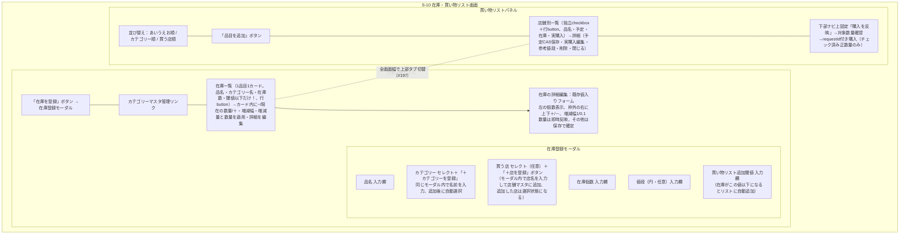

在庫一覧の行例（#241・#469、1品目1カード。行はbutton、右端に削除×）：

| 印（閾値以下だけ！） | 品名／カテゴリー名 | 在庫数 | 開閉の印 | 削除× |
| --- | --- | --- | --- | --- |

行の展開欄の「詳細を編集」から「在庫の詳細編集」を開き、品名・カテゴリー・買う店・閾値・値段・自動消費設定を編集する。同じ画面の在庫数欄に在庫個数を左に、その右隣に＋を上、－を下に配置し、右側の同じ行に増減幅1／0.1の選択ボタンを置く。主要操作は44px以上、入力は実効16px以上とする。増減は既存APIで即時反映し、それ以外は保存で確定する。数量更新後もフォームの未保存入力は保持する。数量通信中は増減・ステップ・保存・閉じる、保存中は数量操作を無効にする。保存成功後は一覧の再取得が終わってから閉じる。再取得だけ失敗した場合は保存済みと通知して閉じ、保存APIを再送しない。キャンセル後も一覧に戻る（確定した数量はキャンセルで戻さない旨を表示）。削除は追加しない。一覧は全文折り返しとし320pxでも横スクロール不要。モーダルは画面内の幅・高さに収める。閉じ方とフォーカスはcommon-notes 9章参照。

```text
在庫の詳細編集（編集する品目の既存値を表示）
品名       [ 牛乳                  ]
カテゴリー [ 乳製品              ▼ ] [＋カテゴリーを登録]
買う店     [ なし                ▼ ]

在庫個数（＋/－で即時反映）
               ［＋］    増減幅
［ 1.0      ］ ［－］  ［1］［0.1］
※主要操作は44px以上、入力は16px以上。
※個数の変更はキャンセルしても元に戻らない。

値段（円・任意）     [ 1280        ]
買い物リスト追加閾値 [ 0.5         ]
┌ 毎日の自動消費                  [スイッチ オフ/オン] ┐
│ 1日の消費量（任意）  [             ]（オン時だけ表示）│
└────────────────────────────┘
[     キャンセル     ] [        保存        ]
※登録時は「在庫個数」と「値段（円・任意）」を横に並べる（#469）。
```

買い物詳細の構成（入力は閉じても保持）：

買い物詳細のタイトル横に44pxの「買い物詳細を閉じる」（×）を置き、ここへ初期フォーカスを移す。末尾の「閉じる」も維持する。長名でも冒頭の閉じるを画面内に保ち、Tab/Shift+Tabで末尾操作へスクロールし、どちらで閉じても元の行へ戻る。削除の位置と権限は変更せず、削除へ初期フォーカスを置かない。

    品名：牛乳
    カテゴリー：乳製品
    買う店：なし
    参考値段：1,280円（nullは未設定）
    現在の在庫：0.5
    予定数：[ 3 ] [予定数を保存]（0.1〜99999.9、CAS）
    実購入数：[ 2 ]（チェック時だけ編集、0〜99999.9）
    [削除] [閉じる]

買い物一覧の行例（#421、店舗見出しごと）：

| 独立チェック | 行button（商品名／予定・在庫・実購入） |
| --- | --- |

買い物詳細の値段は例「1,280円」、nullは「未設定」。在庫の詳細編集は入力欄に数値を表示し、nullは空欄とする。値段の履歴・比較は設けない（#212）。
登録／編集モーダルに「値段（円・任意）」を追加する。編集は保存済み情報を初期表示しPATCH、空欄はnullでクリアする。
編集時の在庫個数は同じ詳細編集モーダルの＋/－から即時変更する。

登録・編集とも「＋カテゴリーを登録」で同じモーダル内に入力欄を展開する（#338）。名前は1〜50文字で前後空白を除去し、重複409などの失敗は入力を保持して追加欄内に通知する。成功時は選択肢に反映して自動選択し、カテゴリー欄へフォーカスを戻す。在庫の入力途中情報は保持する。追加中は重複送信・在庫保存・数量変更・閉じるを抑止する。「追加をやめる」は展開欄を閉じて追加ボタンへ戻す。カテゴリーは追加時に保存され、在庫のキャンセルでは取り消さないことを表示する。通常Enterはカテゴリーだけを追加し、日本語変換中の確定Enterでは送信しない。カテゴリー自体の編集・削除画面は追加しない。

手動追加は品目選択時に保存値を初期表示し、空欄は値段を省略して維持する。
買い物一覧は店舗別の行を全文折り返し320pxでも横スクロール不要。在庫一覧は品名・在庫数・条件付き！で折り返し、フォームは折り返し、モーダルは画面内に収める。
買い物詳細は品名・カテゴリー・店舗（未指定は「なし」）・現在庫・参考値段（nullは「未設定」）・予定数・実購入数・末尾の削除/閉じるを表示する。チェック時に予定→実数を初期設定し、予定保存では実数を変更しない。閉じる/検索/並替/タブ往復で下書きを保持する。予定と購入は小数第一位まで。外部revision変更は再チェックを求める。主要操作44px、入力16pxを確保する。

下部ナビの実測高の上に「購入済み N件」と全幅の「購入を反映」を固定し（#471）、visualViewport変化に追従する。最下行には固定欄の高さを余白に取る。チェック0件/正数量0件/入力不正/未解決pendingでは無効。「購入内容の確認」の「戻る」は入力を保持しフォーカスを戻す。「この内容で購入を反映」だけが送信前persist後に新購入を送る。通信中対象変更・削除を無効にし、閉じると閲覧は可能。在庫タブでは固定欄とモーダルを隠しbodylockを解除する。

初回取得中・失敗・成功0件を区別しGET再取得を提供する。購入200後GET失敗は「購入は反映済み。一覧を再取得してください」、GETだけを再試行する。結果不明は元key/bodyを保持し「前回の購入結果を確認」で明示回復する（未反映なら購入を実行する旨を表示）。保存terminal拒否だけは入力を保持して再取得・再確認へ進む。logoutでも秘密を含まないactor/世帯別pendingを残し、本人同世帯のfresh確認後だけ回復、別scopeへ表示/送信しない。購入/確認GETは同Bearer固定・自動refresh禁止、native Web Locksの短い排他と保存readback不可ではPOST0。詳細な状態・判定は[F08の9章](features/F08_zaiko_shoppinglist.md)を正とする。閉じ方とフォーカスはcommon-notes 9章参照。

---

- 在庫一覧・買い物リストの一覧の上に検索欄（ラベル「商品を探す」、入力欄の案内「商品名で検索」）を置き、品名で絞り込む（全角・半角、大文字・小文字、カタカナ・ひらがなを区別しない（#326）。該当なしは「該当する品目がありません」、#315）。

---

## S-12 レシピ一覧画面

対応: [F09_kondate_recipe](features/F09_kondate_recipe.md)

PC案内の下に同じ左右幅の「iPhoneからレシピを登録」パネルを配置し、「ショートカットを追加する」から `/recipes/iphone-shortcut` に遷移する（#223）。
専用手順ページは既存AppLayout・認証／世帯ガード下に置き、見出し、登録先URLの接頭辞の読み取り専用欄、「URLをコピー」、コピー結果（status）、番号付き作成手順、注意事項、「レシピ一覧に戻る」を縦に表示する。320pxでもページ全体が横にはみ出さない。
コピー対象は現在のorigin + `/recipes/share?url=`。入力URLだけを1回エンコードして末尾に変数を連結し、複数URLは先頭、空入力は終了と案内する。コピー失敗時は手動コピーを案内する。アクション名のiOSバージョン差、localhostの制約、WEBタブへの貼り付けを注記する。

一覧の下に「PCからレシピを登録」パネルを配置する（#222）。ドラッグ可能な「シェファミに登録」リンクと「ブックマークバー表示 → ドラッグして設置 → 閲覧ページで押す」の手順を表示し、320pxでも折り返す。通常クリックは設置案内を表示する。設置したブックマークは閲覧URLを `/recipes/share?url=...` に渡し、別タブでS-13のWEBタブをURL入力済みで開く。自動保存せず、ユーザーが登録操作を行う。使えないページでは既存のURL貼り付けを案内する。ログイン後の復帰は世帯所属済みユーザーを対象とする。

```text
┌──────────────────────────────────────────────┐
│   [ すべて ] [ お気に入り ]   [ レシピを登録 ] │
├──────────────┬──────────────┬─────────────────┤
│ [サムネイル]   │ [サムネイル]   │ [サムネイル]     │
│ カレー ★      │ 肉じゃが       │ パスタ ★        │
└──────────────┴──────────────┴─────────────────┘
```

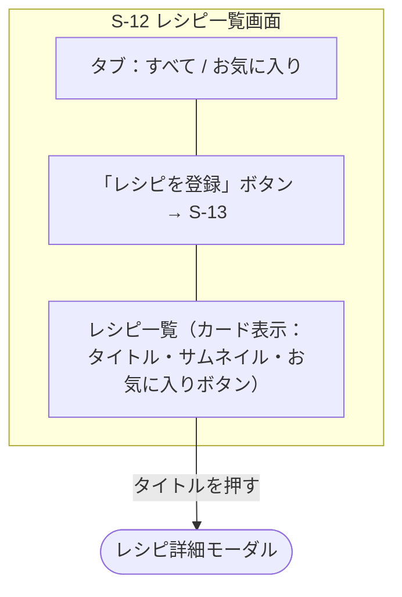

一覧にはタイトル（とサムネイル・お気に入り）だけを表示し、材料・手順などはタイトルを押して開く詳細モーダルで確認する（#195）。編集・削除も詳細モーダルから行う。

```text
┌─────────────────────────────────┐
│ (手動)                            │ ← 種別バッジ（手動 / 画像解析 / WEB）
│ 肉じゃが                          │ ← タイトルを大きく表示
│ ┃材料                             │
│  ・牛肉 200g                       │ ← 1行に1つの箇条書き
│  ・じゃがいも 3個                   │
│ ┃手順                             │
│  1. 材料を切る                      │ ← 番号付きで1行ずつ
│  2. 煮込む                         │
│ [ 編集 ] [ 削除 ] [ 閉じる ]        │
└─────────────────────────────────┘
```

- 未入力の項目は「未登録」と表示する。WEBレシピは材料・手順の代わりにサムネイル・元ページへのリンク・メモを表示する。
- 閉じるボタン・Escape・背景クリックで閉じる。長い内容はモーダル内でスクロールする。

---

## S-13 レシピ登録モーダル

対応: [F09_kondate_recipe](features/F09_kondate_recipe.md)

```text
┌─────────────────────────────────┐
│ [手動] [手書き画像解析] [WEBレシピ]│
├─────────────────────────────────┤
│ タイトル [_______________]       │
│ 材料     [_______________]       │
│ 手順     [_______________]       │
│                                  │
│      [ 登録する ]   [ キャンセル ]│
└─────────────────────────────────┘
```

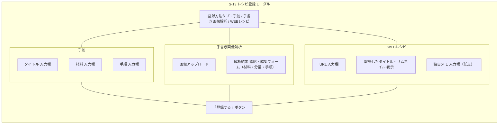

---

## S-14 献立表画面（週単位の作りたい料理リスト）

対応: [F10_kondate_menu](features/F10_kondate_menu.md)

献立は週単位で登録し、曜日へ割り当てない。#419では一覧を主表示とし、追加操作を上部から開く。#467で見た目を追加画像資料01・02の構成に合わせた。

```text
┌────────────────────────────────────────┐
│ 献立表                                  │
│ 2026年10月12日（月）〜10月18日（日）      │
│ ┌────────────────────────────────────┐ │
│ │ ‹ 前の週    10月 第2週    次の週 ›  │ │
│ └────────────────────────────────────┘ │
│ [       ＋ レシピを追加（全幅）        ] │
│ 登録済みの献立（2件）                    │
│ ┌────────────────────────────────────┐ │
│ │ カレー（2行省略⇔全文）            ⌄ │ │
│ │ recipe.example.com                 │ │
│ │ 展開時：[レシピを見る]       [削除] │ │
│ └────────────────────────────────────┘ │
│ ┌────────────────────────────────────┐ │
│ │ 外食（2行省略⇔全文）              ⌄ │ │
│ │ 自由メモ                           │ │
│ │ 展開時：                     [削除] │ │
│ └────────────────────────────────────┘ │
└────────────────────────────────────────┘
追加画面（スマホは下部シート／PCはモーダル）
┌────────────────────────────────────────┐
│ 献立に追加する                     [×] │
│ [ レシピから選ぶ │ 自由メモ ]            │
│ レシピを検索                            │
│ [料理名を検索______________________]    │
│ 選択中: 2件（検索外の選択を含む）         │
│                          [選択を解除]   │
│ カレー（2行省略⇔全文）    [登録済み] ☑ │
│ recipe.example.com                     │
│ 肉じゃが（2行省略⇔全文）             ☑ │
│ [      選択した2件を追加（全幅）       ] │
└────────────────────────────────────────┘
```

- 画面タイトルの下に週の期間を表示する。年をまたぐ週だけ、終わりの日付にも年を付ける。週移動は1枚のカードにまとめ、中央に「○月 第N週」を表示する（Nは、その週の月曜日がその月の何回目の月曜日か）。ボタンの読み上げ名は表示と同じ「前の週」「次の週」で、矢印は読み上げない。
- 登録済みの献立は1件を1枚のカードにし、見出しに件数を出す。2行目は出典で、WEBレシピはサイト名、それ以外のレシピは「レシピ」、自由メモは「自由メモ」とする（削除済みのレシピには出さない）。右端の印で開閉でき、「レシピを見る」と「削除」は開いたときだけ表示する。
- 追加画面は見出しを「献立に追加する」とし、右上の「×」（読み上げ名は「閉じる」）で閉じる。追加方法はラジオボタンのまま切り替えタブの見た目にする。候補はタイトル・出典を左、チェックを右端に置く。この週に登録済みのレシピには「登録済み」の印を付けるが、同じレシピをもう一度追加することは妨げない。追加ボタンは全幅で、レシピを選ぶと「選択したN件を追加」、未選択と自由メモでは「追加」と表示する。
- 画像資料にある行ごとの日付・食事区分（夕食など）は、献立を週単位で登録しておりデータが無いため表示しない。タイトル横の「…」ボタンとヘッダーの検索ボタンも、動作が未定義のため置かない。

- 候補はお気に入り先頭。即時正規化検索、複数チェック、選択件数、検索外選択保持、候補内スクロール。タイトルタップは全文展開だけで、選択・送信・原本閲覧と分離する。
- 登録済みと候補の長名は既定2行＋省略、再タップで閉じる。WEBのサイト名はURLホスト名を別行表示。展開内の「レシピを見る」はWEBなら新タブ、手動/画像ならS-31。メモ/削除済に原本閲覧導線は付けない。
- 自由メモとレシピ選択を維持。閉じる/追加方法/検索の切替で未送信入力を保持。確定時は選択順に単件保存し、部分成功後の再試行では成功項目を再送しない。送信中は閉じる・多重送信を防ぐ。
- 献立削除は対象名と「レシピ原本は削除されません」の説明を確認して実行。取消では元の操作へフォーカスを戻す。
- 320px/390px/PC、入力16px以上、safe-area、キーボード、スクロール、明示閉じる/Esc/背景、フォーカス復帰、手動ズームを確認。週保持仕様はF10のまま。

---

## S-15 口座・カード管理画面

対応: [F11_kakeibo_account](features/F11_kakeibo_account.md)

```text
┌──────────────────────────────────────────────┐
│ 口座・カード管理                             │
│ [ 口座・財布 ] [ カード ]                     │
│ [ 口座を登録 ]（選択タブに対応する登録操作）    │
├──────────────────────────────────────────────┤
│ ○○銀行       銀行            123000円         │
│ PayPay       電子マネー          3200円        │
│ （行を押すと紐づくカードと取引履歴導線を展開） │
└──────────────────────────────────────────────┘
```

- 初期タブは「口座・財布」。別タブ「カード」は名称・カード種別・親口座名の行を表示する。各タブの上部には対応する「口座を登録」「カードを登録」だけを配置する。タブはクリックと矢印/Home/Endで操作でき、選択状態を読み上げる。
- 口座行は名称・種別・本人残高を示し、タップ/Enter/Spaceで詳細を展開・収納する。紐づくカード名/種別と「口座名の取引履歴」を表示し、履歴は既存のモーダルで確認する。カード行も独立展開し親口座・種別を確認。chargeは自身の残高と既存チャージ操作を表示し、credit残高や新しい編集/カード削除操作を追加しない。
- 口座0件ではカード登録を無効にして理由と口座登録への導線を表示する。空・取得中・取得失敗を区別し、取得失敗時は再試行できる。口座/カード登録フォームは登録専用を維持する。
- 履歴は日付・内容・種別・金額（±）・取引後残高を日付降順で表示する。削除はタイトル右上の対象名付きゴミ箱から開始し、同モーダルの既存二段階確認で確定する。取引履歴は残るが、一覧・残高合計・新規入力選択肢から外れることを説明する。確認取消はゴミ箱へフォーカスを戻す。
- 削除中は確認・取消・閉じる・Esc・背景の操作を抑止。API拒否時は理由を表示して口座を残す。削除成功後の再取得失敗は「削除は完了」と区別し再削除させない。通常closeは履歴起点へ、削除で起点が消えたら登録など有効な操作へ復帰する。
- 履歴上部の閉じるはスクロール中も利用でき、末尾の「閉じる」も維持する。登録/チャージ3フォームは共通dialogのTab/Esc/背景・focusを適用し、送信中close/多重送信を抑止する。保存後GET失敗を再保存の理由にしない。
- 320/390/1280pxで長い名称・残高を折り返し横はみ出しを防ぐ。入力実効16px・主要操作44px程度・safe-area・キーボード・Tab先可視性を確認する。本人データ/残高計算/charge資金移動/論理削除の意味は変更しない。

---

## S-17 パスワードリセット画面

対応: [F01_auth](features/F01_auth.md)

```text
┌─────────────────────────────────┐
│ 利用不可の場合                   │
│  現在、パスワード再設定メールを  │
│  利用できません。                │
├─────────────────────────────────┤
│ Step1: メールアドレス            │
│  [_____________________________]│
│           [ 申請する ]           │
│ 申請後：登録済みの場合に案内。   │
│  届かない場合は[もう一度申請する]│
├─────────────────────────────────┤
│ Step2（メール内リンク /          │
│  password-reset#token=...）      │
│  新しいパスワード / （確認）     │
│  [_____________________________]│
│           [ 変更する ]           │
│ 無効・期限切れ：[再設定を申請し  │
│  直す]                           │
└─────────────────────────────────┘
```

- トークンの手入力欄はない。リンクのフラグメントから読み取った直後にURLから取り除き、確定時だけPOST本文で送る（リンクを開くだけでは消費しない）。再読み込みで失われた場合はメールのリンクを開き直す（#402）。

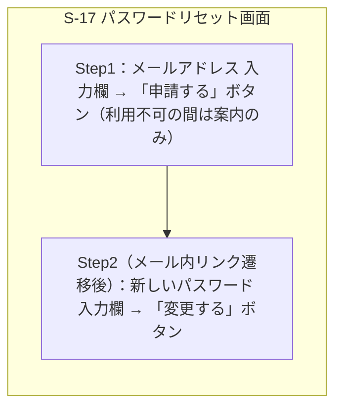

---

## S-18 イベント登録・編集モーダル

対応: [F06_kakeibo_event](features/F06_kakeibo_event.md)（#333、#426）

登録と編集で同じフォームを使う。S-09の登録者本人のイベント行は、既存値入りの編集モードを直接開く。編集では入力項目・支出集計・削除確認を1つのモーダルにまとめ、別モーダルへ切り替えない。

```text
イベントを登録 ／ イベントを編集       [ゴミ箱（編集時のみ）]
イベント名         [                      ]
日付               [                      ]
☑ 終日（登録時はON）
  開始時刻 [__:__]  終了時刻 [__:__]
  ※終日OFF時のみ。開始必須・終了任意。
繰り返し           [ 単発 ▼ ]
  （単発／毎日／毎週／毎月／毎年）
□ 通知する（単発時はOFF・操作不可）
公開範囲  (●世帯共有 ○個人)
[ その他の設定  金額未設定・サマリー表示 ▼ ]
  展開時のみ：デフォルト金額（任意） [         ]
  ☑ トップ画面のイベント別支出サマリーに表示する

── 編集時だけ表示 ──
集計対象期間 [ 今年 ▼ ]（今年／今月）
支出合計：0円

削除ボタンを押したときも、このモーダル内に表示：
「イベント名」を削除しますか？この操作は取り消せません。
                  [ 削除する ] [ 削除をやめる ]

登録時：                  [ 登録 ] [ キャンセル ]
編集時：                  [ 更新 ] [ キャンセル ]
※スマホは本文を独立スクロールし、保存／キャンセル欄をモーダル下部に保持。
```

- 基本欄は名前→日付→終日→終日OFF時の開始／終了（320pxでも横2列）→繰り返し→直下の通知→公開範囲。公開範囲は常時2択で表示し、「その他の設定」へ隠さない。時刻は開始必須・終了任意と前後関係の検証を維持する。
- 通知は新規OFF、単発はOFF・操作不可で理由を表示。旧単発trueも編集フォームはOFF表示し、明示保存でfalseを送る。単発へ切り替えると編集値をOFFにし、繰り返しへ戻しても自動復元せず手動でONにする。開く／取消だけでは書き換えず、一括移行はしない。閲覧専用詳細は従来どおり保存済み値を表示する。
- 「その他の設定」は金額とサマリー表示だけを保持し、閉じても現在値の概要をボタン上に表示する。開閉は入力を消さず、aria-expanded／操作対象の関連付けとhiddenでキーボード操作を保証する。
- スマホは本文独立スクロールと下部操作欄を分離し、末尾の入力・集計・エラーが隠れない余白、safe-area、16px入力、44px程度以上の操作領域を確保する。PCの保存→キャンセルの順と既存色は維持する。
- ゴミ箱は削除権限のある編集時だけタイトルバー右上に44×44pxで表示し、保存済み対象名を読み上げる。下部保存欄には置かず、新しい閉じる×は追加しない。
- ダッシュボード表示の初期値は登録時ON。編集では保存済み値を表示し、他の項目と一緒に「更新」で確定する。集計は保存済みの表示設定を使う。
- 集計は今年を既定として今月へ切り替えられる。404は「集計対象外」、その他の失敗は「取得失敗」と通知し、0円と区別する。
- 削除確認では「削除をやめる」へフォーカスし、取りやめると入力を保持して削除ボタンへ戻す。確認中は更新を無効にする。
- 登録・更新・削除の送信中は重複送信と閉じる操作を防ぐ。API失敗時は入力を保持し、role="alert"で通知する。登録・更新・削除成功後は一覧へ戻り、起点行（削除済みなどで消失した場合は登録ボタン）へフォーカスを戻す。
- S-09で他の登録者の共有イベントを押した場合の閲覧専用詳細と、トップのS-24はこの編集フォームへ遷移しない。

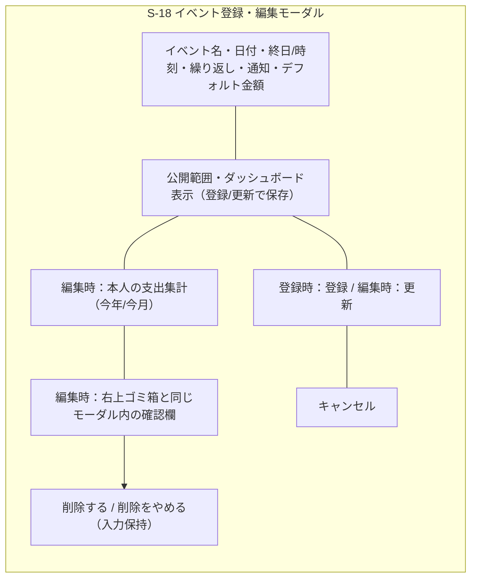

---

## S-19 日次詳細モーダル

トップ画面の日付から開く閲覧ハブ。取得は `GET /api/dashboard/day-detail?date=YYYY-MM-DD`。認可・実績/予定・6状態は[API設計書](api-design.md)を正とし、ホーム表示設定から独立する。

対応: [F06_kakeibo_event](features/F06_kakeibo_event.md)、[F03_kakeibo_expense](features/F03_kakeibo_expense.md)、[F05_kakeibo_fixedcost](features/F05_kakeibo_fixedcost.md)、[F10_kondate_menu](features/F10_kondate_menu.md)

```text
┌─────────────────────────────────┐
│ 2026-07-10 の詳細           [ × ]│
├─────────────────────────────────┤
│ 今週の献立 3件               ＋ │
│ イベント 2件                 ＋ │
│ 収支 4件                     ＋ │
│ 固定費 1件                   ＋ │
│ （全閉で開始、複数を独立展開）    │
│ [ 閉じる ]（本文末尾、固定しない） │
└─────────────────────────────────┘
```

- 見出しは献立→イベント→収支→固定費の順。全閉で開始し、複数を独立展開できる。件数はAPI配列長、収支は収入明細数＋支出明細数。差額0円でも明細があれば0件としない。0件でも見出し・空説明・導線を残す。取得中・HTTP失敗は0件にせず、再試行を用意する。
- 献立はAPIのweekStartDateを対象週とし、レシピ行から既存認可GET /recipesでID照会して閲覧専用詳細へ。自由メモ・削除済みは文字表示。照会中の連打を抑止し、失敗/対象消失は説明する。「この週の献立を編集」は対象週の献立表へ遷移する。
- イベント行から既存認可GET /eventsでID照会してS-24へ。発生日は選択日、原本eventDateは変更しない。未取得情報は推測しない。「イベントを追加」はイベント画面へ遷移する。
- 収入・支出・差額は展開した収支欄だけに置き、本人実績明細と分けて表示する。「支出を登録」は家計簿へ遷移する。固定費予定額や再掲した計上記録は日次収支へ再加算しない。
- 固定費は現在の予定額と、postedの場合だけ計上記録の実額・支出日を分離表示する。6状態はF05の固定ラベルを表示し、FEで再判定しない。unknownに私的な実額・抑止の存在を補完しない。「支出に計上済み」は記録作成済みであり、銀行引き落とし・カード決済・精算の完了ではないと説明する。
- 右上×は本文スクロール中も利用可能。末尾の非固定「閉じる」・背景・Escでも閉じる。内部操作・展開・スクロールでは閉じない。320/390/1280pxで横はみ出しを防ぎ、safe-areaと44px程度の操作領域を確保する。
- 子Event/Recipeは親overlayの兄弟として表示し、子表示中は親をinertにする。共通useDialogで最上位だけがEsc/Tabを処理し、最後の可視modalを閉じるまで背景位置を保つ。子closeで元行、親closeで日付起点へ復帰する。日付変更・再表示は全閉に戻し旧応答を破棄する。

---

## S-25 設定メニュー画面

ヘッダーの歯車アイコン（「設定を開く」）から開く。「世帯設定」「表示設定」「アカウント設定」の3つのカードを並べ、それぞれ S-27・S-21・S-26 を開く。

## S-21 表示設定画面

対応: 機能横断（ダッシュボード表示カスタマイズ）。表示設定は `user_settings` テーブル（[data-model.md](data-model.md)参照）にユーザーごとに保存する。

```text
┌─────────────────────────────────┐
│ 設定                             │
│                                  │
│ ■ ダッシュボードに表示する項目    │
│  ☑ 今日の状況                    │
│     ☑ 今週の献立                 │
│     ☑ イベント                   │
│  ☑ 買い物・在庫                  │
│     ☑ 買い物リスト               │
│     ☑ 在庫リスト                 │
│  ☑ 個人の財政                    │
│  ☑ 今月のお金                    │
│     ☑ 個人支出                   │
│     ☑ 世帯合計対象額             │
│     ☑ 未精算（受取・支払）        │
│  ☑ イベント別支出                │
│  ☑ カレンダー                    │
│     ☑ 収入                       │
│     ☑ 支出                       │
│     ☑ イベント                   │
│                                  │
│  ── 表示カードの並べ替え ──      │
│  [今日の状況]          ↑ ↓       │
│  [買い物・在庫]        ↑ ↓       │
│  [個人の財政]          ↑ ↓       │
│  [今月のお金]          ↑ ↓       │
│  [イベント別支出]      ↑ ↓       │
│                                  │
│            [ 保存 ]              │
└─────────────────────────────────┘
```

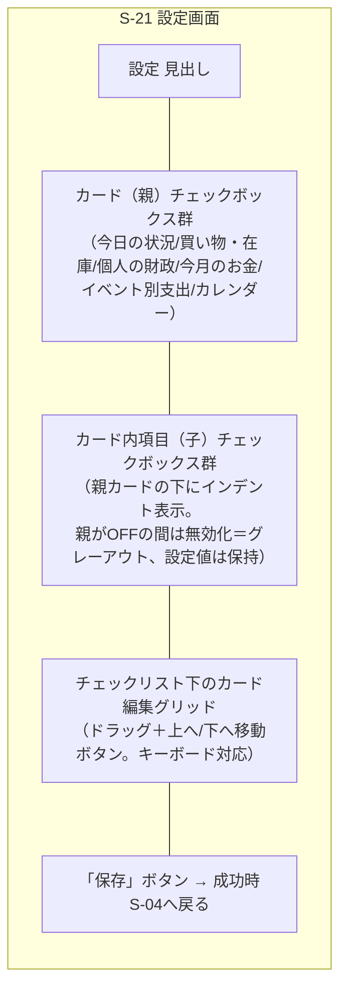

- S-25 設定メニュー画面の「表示設定を開く」から遷移する（`/settings/display`）。
- 表示設定は「カード（親）」と「カード内項目（子）」の2階層で選択でき、カード順も保存できる（`user_settings.dashboard_settings`、[data-model.md](data-model.md)参照）。
  - 親チェックOFF → カードごと非表示（子の設定値は保持され、親を再度ONにすると復元される）。
  - 子チェックOFF → カード内の該当行のみ非表示。
  - カレンダーの子項目は、日付セル内に表示する要素（収入／支出／イベント）を制御する。日付とクリック（日次詳細モーダル）は常に有効。イベントボタンのクリックはS-24イベント詳細モーダルを開く。献立は週単位のため日付セルには表示しない。
  - 「個人の財政」は表示項目が1つ（口座残高合計）のため子項目を持たない。
- 設定はユーザーごとに保存され、他の世帯メンバーには影響しない。
- カード順の標準値は `today → stock → finance → money → eventExpenses`。カレンダーは常にグリッドより上に固定される。表示OFFのカードは並べ替え対象から除外し、再度ONにしたとき保存済みの順序へ復帰する。
- イベント別支出の期間（今日／今月／今年、既定は今年）はS-04カード内のセレクトで切り替える画面状態であり、S-21のユーザー設定には保存しない。
- 保存成功時はS-04へ遷移する。保存失敗時はS-21に留まり、入力値を保持して再試行できるようにする。

---

## S-24 イベント詳細モーダル

S-19日付詳細のイベント欄にある対象行から開く。イベントの確認に必要な情報だけを表示する閲覧専用モーダルであり、編集操作は提供しない。

```text
┌──────────────────────────────┐
│ イベント詳細                  │
│ 学習会                        │
│ 日時：2026/7/10 19:00         │
│ 繰り返し：毎週                 │
│ 通知：有効                     │
│ 関連支出：3,000円              │
│                     [閉じる]  │
└──────────────────────────────┘
```

- イベント名、日時、繰り返し、通知設定、関連支出の概要を閲覧専用で表示する。
- 関連支出はログインユーザー本人が支払った当該イベント紐付き支出の合計だけを表示する。他人の支出は表示しない。不要な場合は関連支出自体を表示しない。
- [閉じる] またはモーダル外クリック、Escキーで元のS-04へ戻る。
- イベントの閲覧権限はイベントの共有範囲に従う。共有イベントは世帯メンバーが閲覧できるが、編集・削除は登録者だけが行う。個人イベントは登録者本人だけが閲覧できる。

## S-23 家計簿カテゴリー管理画面

対応: [F03_kakeibo_expense](features/F03_kakeibo_expense.md) 6-2章, [F13_kakeibo_income](features/F13_kakeibo_income.md) 7-2章

```text
┌──────────────────────────────────────────────┐
│ 家計簿カテゴリー管理     [家計簿に戻る]         │
│                          [ 支出カテゴリーを登録 ]│
│ (●支出カテゴリー) ( 収入カテゴリー)             │
├──────────────────┬────────┬──────────────┤
│ カテゴリー名        │ 種別    │ 操作           │
├──────────────────┼────────┼──────────────┤
│ 食費               │デフォルト│               │
│ 日用品             │デフォルト│               │
│ 交際費（自作）      │カスタム │ [編集][削除]   │
└──────────────────┴────────┴──────────────┘
（デフォルトカテゴリーは編集・削除ボタンを表示しない）

┌─ カテゴリー登録/編集モーダル ────┐
│ カテゴリー名 [___________________]│
│     [ 登録 or 更新 ]  [ キャンセル ]│
└─────────────────────────────────┘
```

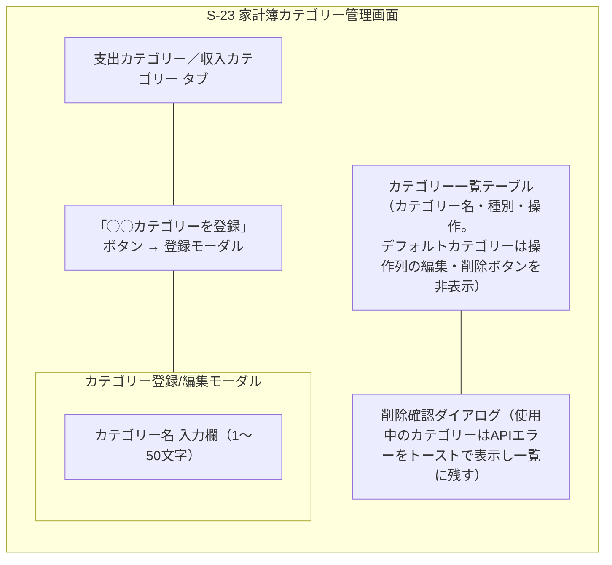

カテゴリー一覧テーブルの列例：

| カテゴリー名 | 種別（デフォルト／カスタム） | 操作（デフォルトは非表示） |
| --- | --- | --- |

- S-05（家計簿一覧画面）ツールバーの「カテゴリー管理」リンクから遷移する。
- タブ切り替えは初回マウント時に支出・収入両方のカテゴリーを取得済みのため、再フェッチせず即座に表示が切り替わる。
- デフォルトは全カード・全項目表示。

---

## S-26 アカウント設定画面

対応: [F01_auth](features/F01_auth.md) 8-1章・8-2章

```text
┌────────────────────────────────────┐
│ アカウント設定          [設定に戻る] │
├────────────────────────────────────┤
│ 表示名  [テスト太郎______] [保存]    │
├────────────────────────────────────┤
│ パスワード                          │
│ 現在のパスワード      [______] 👁    │
│ 新しいパスワード      [______] 👁    │
│ 新しいパスワード（確認）[______] 👁  │
│ [パスワードを変更]                  │
├────────────────────────────────────┤
│ メールアドレス                      │
│ 現在：taro@example.com              │
│ 新しいメールアドレス [__________]   │
│ 現在のパスワード     [______] 👁     │
│ [メールアドレスを変更]              │
├────────────────────────────────────┤
│ 退会                                │
│ （30日以内なら取り消せる旨の説明）   │
│ 現在のパスワード     [______] 👁     │
│ [退会を申し込む] → 確認ダイアログ    │
└────────────────────────────────────┘
```

- 各欄の結果は欄の下に表示する（成功は status、失敗は alert）。
- 退会欄は、未精算の割り勘や他の人が負担する固定費が残っている間は件数を表示してボタンを無効にする。申し込むとログアウトし、S-01 に削除予定日を表示する。
- 退会の取り消し期間中に S-01 でログインすると「退会手続き中です」と削除予定日を表示し、「退会を取り消してログイン」「取り消さない」を選べる。

## S-27 世帯設定画面

世帯グループ名・招待コード・メンバー一覧を表示し、「世帯グループから退出する」（確認ダイアログつき）を置く。最後のメンバーが退出すると、世帯と世帯のデータは削除される。

## S-10 在庫の自動消費入力（#329）

登録・編集モーダルの閾値欄の後に、次を縦配置する。

```text
1日の消費量（任意） [0.2]
空欄の場合は自動消費しません
[自動消費：オン / オフ] （role=switch）
毎日1:00（日本時間）に減ります。開始・再開は翌日から。
停止・消費量変更時は到来済みの未処理分を旧設定で精算します。
[保存] [キャンセル]
```

number入力はstep=0.1/min=0.1/max=99999.9。空欄でスイッチはオフ・無効、オフにしても消費量は保持する。登録初回入力でオン、その後の選択は維持する。詳細に「自動消費：未設定／0.2／日・オン／0.2／日・オフ」を追加する。一覧は品名・在庫数・閾値の3列のままとし、行ボタン内にスイッチは置かない。

1280/390/320pxで説明を折り返し、モーダル内の縦スクロールで保存へ到達できる。Tab巡回、Spaceでの切替、Escape・背景クリック、通信中の無効化とフォーカス復帰を維持する。保存失敗はrole=alertで入力を保持し、保存成功後の一覧取得失敗では保存を再送しない。
