# ワイヤーフレーム

[← 要件定義書に戻る](../requirements.md)

S-01〜S-24の全画面・モーダルについて、要件定義段階の骨組みレベルでワイヤーフレームをまとめる。実際のUIデザイン（配色・フォント・詳細CSS）の決定前段階の「叩き台」として、ASCIIアート風のレイアウト図で画面内の要素配置・サイズ感を示し、補足としてMermaidのブロック図（要素の関係性）も併記する。各画面の項目は対応する[機能別要件定義書](../requirements.md#5-機能要件)の内容に基づく。

---

## 共通ヘッダー（#257）

世帯所属後の各画面では、左にHomeLogロゴ、右に通知・設定・アカウント群を配置する。アカウント群は上にログイン本人の表示名、下にログアウトボタンを右寄せで表示する。

- 表示名は `GET /api/auth/me` から取得し、メールや世帯の別メンバー名は代用しない。
- 長い名前は1行で省略し、DOMとtitle属性に全文を保持する。320pxでも操作部品とページ全体が横にはみ出さない。
- 取得中は「読み込み中…」、失敗時は「アカウント名を取得できません」。取得状態によらず設定・ログアウトを利用できる。
- 世帯未所属画面へのヘッダー追加や、名前編集・全文表示専用UIは対象外。

## S-01 ログイン画面

対応: [F01_auth](features/F01_auth.md)

```text
┌─────────────────────────────────┐
│            HomeLog              │
│                                  │
│  メールアドレス                  │
│  [_____________________________]│
│                                  │
│  パスワード                      │
│  [_____________________________]│
│                                  │
│          [   ログイン   ]        │
│                                  │
│  パスワードを忘れた場合          │
│  新規登録はこちら                │
└─────────────────────────────────┘
```

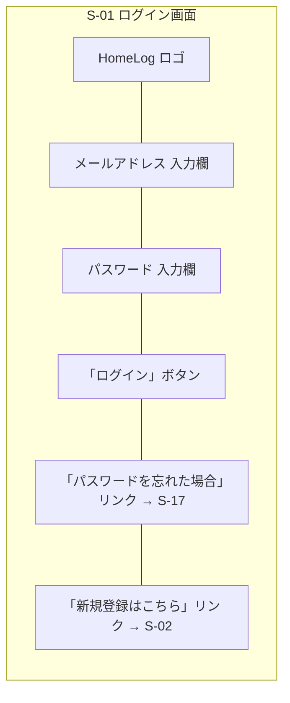

---

## S-02 ユーザー登録画面

対応: [F01_auth](features/F01_auth.md)

```text
┌─────────────────────────────────┐
│           新規登録               │
│                                  │
│  メールアドレス                  │
│  [_____________________________]│
│                                  │
│  パスワード                      │
│  [_____________________________]│
│                                  │
│  表示名                          │
│  [_____________________________]│
│                                  │
│          [  登録する  ]          │
│                                  │
│  ログインはこちら                │
└─────────────────────────────────┘
```

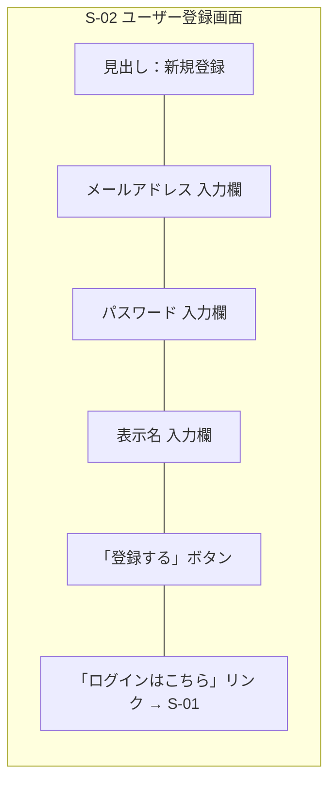

---

## S-03 世帯グループ作成/参加画面

対応: [F02_household](features/F02_household.md)

```text
┌─────────────────────────────────┐
│         世帯グループ             │
├───────────────┬─────────────────┤
│   新規作成     │   既存に参加    │
│               │                 │
│ 世帯グループ名  │  招待コード      │
│ [___________] │  [___________]  │
│               │                 │
│ [ 作成する ]   │  [ 参加する ]   │
└───────────────┴─────────────────┘
```

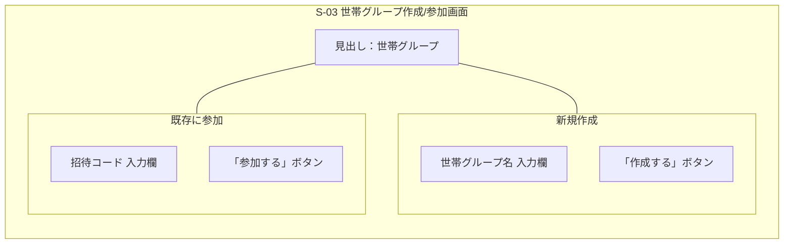

---

## S-04 トップ画面（生活ダッシュボード＋カレンダー）

対応: [F06_kakeibo_event](features/F06_kakeibo_event.md), [F12_kakeibo_household_summary](features/F12_kakeibo_household_summary.md), [F13_kakeibo_income](features/F13_kakeibo_income.md), [F07_zaiko_inventory](features/F07_zaiko_inventory.md), [F08_zaiko_shoppinglist](features/F08_zaiko_shoppinglist.md), [F10_kondate_menu](features/F10_kondate_menu.md)

確認系の情報を画面遷移なしで把握できる「生活ダッシュボード」として定義する（[common-notes.md](common-notes.md) 9章の方針）。表示設定で選択したカードを、保存済みカード順で表示するカードグリッドにコンテナとして配置する。カード順の編集用グリッドはS-21のチェックリスト下にのみ配置する。旧S-16（世帯合計支出画面）・旧S-20（イベント別支出サマリーモーダル）はここに統合し廃止した。

月間カレンダーを画面上部に全幅で配置し、その下にカードグリッドを置く。カレンダーが表示ONなら常に最上部、OFFなら非表示とする。カードはPCでは複数列、モバイルでは保存された順序の1列で表示する。標準のカード順は「今日の状況」「買い物・在庫」「個人の財政」「今月のお金」「イベント別支出」。

```text
┌──────────────────────────────────────────────┐
│ [家計簿] [在庫管理] [献立表] [設定]        🔔2  │
├──────────────────────────────────────────────┤
│                 ◀   2026年 7月   ▶            │
├────┬────┬────┬────┬────┬────┬────┤
│ 日 │ 月 │ 火 │ 水 │ 木 │ 金 │ 土 │
├────┼────┼────┼────┼────┼────┼────┤
│    │    │  1 │  2 │  3 │  4 │  5 │
│    │    │    │    │📌学習│    │    │
│    │    │    │    │収入0円│    │収入0円│
│    │    │    │    │支出500円│  │支出0円│
├────┼────┼────┼────┼────┼────┼────┤
│  6 │  7 │  8 │  9 │ 10 │ 11 │ 12 │
│    │    │    │    │📌学習│    │🎉父の日│
│収入0/支出1200│収入0/支出300│収入0/支出0│収入0/支出0│収入0/支出500│収入0/支出0│収入0/支出3000│
├──────────────────────────────────────────────┤
│（各セル：固定費支払日・収入・支出・イベントボタン。 │
│ 収入と支出は別表示。イベントボタンで詳細モーダル。 │
│ 📌=繰り返しイベント。日付クリックで日次詳細）       │
├──────────────────────┬───────────────────────┤
│ ■ 今日の状況（7/10）   │ ■ 買い物・在庫          │
│  収支: -500円          │  買い物リスト           │
│  今週の献立:カレー他    │  品名         値段      │
│  イベント: [📌学習]     │  牛乳         1,280円    │
│                         │  卵           未設定    │
│                         │  在庫リスト（品名／残数）│
│                         │  米           残2       │
│                         │  洗剤         残0（不足）│
├──────────────────────┼───────────────────────┤
│ ■ 個人の財政            │ ■ 今月のお金             │
│  口座残高合計:126,200円 │  個人支出:32,000円       │
│  （本人のみ表示）        │  世帯合計対象額:45,300円  │
│                          │  未精算                   │
├──────────────────────────────────────────────┤
│ ■ イベント別支出（期間：今年 ▼）               │
│  旅行 15,000円 / 学習 3,000円                  │
└──────────────────────┴───────────────────────┘
```

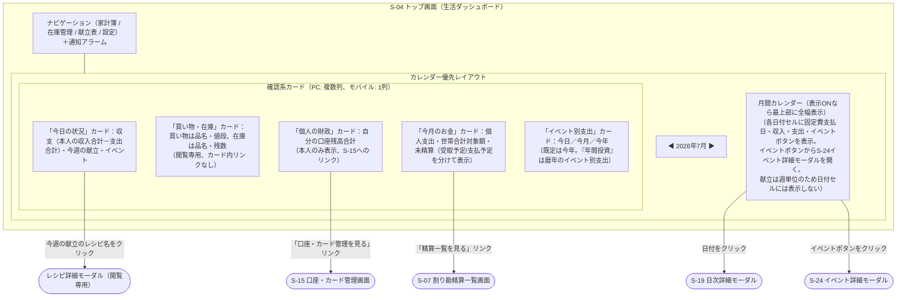

- カレンダーの各日付セルの具体的な情報密度・アイコンデザインは未定。今後の詳細検討事項とする。
- 通知アラームはトップナビゲーションに配置し、通知有効な繰り返しイベントの当日発生件数をバッジで表示する。カレンダー内には通知件数を表示しない。取得中は読み込み状態、取得失敗時はエラー状態を件数と区別して表示する。
- モバイルではカレンダーと有効なカードを保存順に1列へ積み、横方向のスクロールや固定ナビゲーションとの重なりを生じさせない。カードの表示/非表示設定、カード内項目、カード順は画面幅にかかわらず維持する。
- 「イベント別支出」カードは**期間セレクト（今日／今月／今年、デフォルト今年）**を持つ。「年間投資」は投資専用集計ではなく、暦年（今年）のイベント別支出を意味する。他のカードにイベント別支出を含めない。
- 未精算は「受取予定（自分が立て替えて相手から貰う分）」と「支払予定（自分が負担して相手に払う分）」を分けて表示する。
- 「個人の財政」カードは自分が所有する口座の残高合計を表示し、その下の行に「口座・カード管理を見る」リンク（S-15、`/accounts`）を配置する。読み込み中・取得失敗・口座未登録でもリンクを表示する。口座残高は本人のみ閲覧可能のため、このカードの内容もログインユーザー自身の情報のみで構成される（[common-notes.md](common-notes.md) 2章、[F11_kakeibo_account](features/F11_kakeibo_account.md)参照）。
- イベント別支出には全イベントではなく、**表示対象として選択したイベント（`show_on_dashboard` = true）のみ**を表示する。ON/OFFはS-18登録モーダル・S-09一覧から直接開く編集モーダル内で登録者が他の項目と一緒に保存する（[F06_kakeibo_event](features/F06_kakeibo_event.md) 4章参照）。
- 「買い物・在庫」カードは買い物リストを「品名／値段」、在庫リストを「品名／残数」の見出し付き2列で表示する。買い物は未購入のみ、在庫は残数と閾値以下の「（不足）」を表示する。値段は現在の参考値を桁区切りの円表示（0は「0円」、未設定は「未設定」）とし、数量との乗算はしない。在庫欄には値段を表示しない。品名とカード末尾にリンクを設けず、管理画面へは主要ナビゲーションから移動する。先頭8件と残件数、読み込み中・空・取得失敗、表示設定とカード順を維持し、長い品名と値は320pxでも全文を折り返して横にはみ出させない。「よく使う品目」は廃止する。
- 「今日の状況」カードは今週の献立を簡潔なリストで表示する。レシピIDとタイトルがある項目はボタンとし、クリック・Enter・Spaceで既存レシピ詳細モーダルを閲覧専用で開く。既存 `GET /recipes` の一覧から `summary.weeklyMenuEntries.recipeId` で選択し、編集・削除ボタンは表示しない（S-12では従来どおり表示）。自由メモ・削除済みレシピは操作できない文字列として表示する。
- レシピ取得中は献立ボタンの多重操作を防ぎ、取得失敗・対象消失はトーストで通知する。詳細は閉じるボタン・Escape・背景クリックで閉じ、元の献立ボタンへフォーカスを戻す。モーダル内部のクリックでは閉じない。長いタイトル・材料・手順は狭い画面でも折り返す。
- イベント名はボタンとして表示し、クリックでS-24イベント詳細モーダルを開く。イベントボタンのクリックは日付クリック（S-19）を発火させない。S-24は閲覧専用で、編集・削除ボタンや編集遷移は提供しない。
- 各カードの数値・リンク先は、対応する各機能画面の情報をそのまま参照する（新たな計算ロジックは持たない）。
- 「収支」（今日の状況カード・カレンダー各日付セル）は、ログインユーザー本人のその日の収入合計－支出合計。支出側の世帯合計対象フラグの有無に関わらず本人が登録した全件を対象とし、他メンバーの収入・支出は権限方針上参照できないため常に本人個人の収支となる（世帯合計支出とは別の指標。[common-notes.md](common-notes.md) 8章、[F13_kakeibo_income](features/F13_kakeibo_income.md)参照）。
- どのカード（今日の状況／買い物・在庫／個人の財政／今月のお金／イベント別支出／カレンダー）を表示するかに加え、カード内の項目単位でも設定画面（S-21）でユーザーごとに表示を選択できる。カレンダーは表示ONなら最上部、OFFなら非表示とする。全カードを非表示にした場合は設定画面への案内を表示する。
- S-21のチェックリスト下には有効カードをコンテナとして並べる編集グリッドを表示する。ドラッグ操作でカード順を変更でき、キーボード利用者には上へ／下へ移動ボタンまたは同等の操作を提供する。保存時に表示設定とカード順を同一トランザクションで保存し、成功後はS-04へ遷移する。失敗時はS-21に留まり、変更内容を保持してエラーを表示する。

---

## S-05 家計簿一覧画面

対応: [F03_kakeibo_expense](features/F03_kakeibo_expense.md), [F04_kakeibo_warikan](features/F04_kakeibo_warikan.md)（未精算サマリー）, [F05_kakeibo_fixedcost](features/F05_kakeibo_fixedcost.md)（固定費予定サマリー）, [F06_kakeibo_event](features/F06_kakeibo_event.md)（イベント支出サマリー）, [F12_kakeibo_household_summary](features/F12_kakeibo_household_summary.md)（世帯合計対象額サマリー）, [F13_kakeibo_income](features/F13_kakeibo_income.md)（収入一覧タブ）

```text
┌──────────────────────────────────────────────┐
│ 今月支出:32,000円 今月収入:280,000円 世帯合計対象額:45,300円│
│ 未精算 受取:4,000円/支払:4,500円  固定費予定:89,200円 イベント支出[今年▼]:15,000円│
├──────────────────────────────────────────────┤
│ [すべて/支出/収入▼] [精算] [固定費] [イベント] [口座]│
├──────────────────────────────────────────────┤
│ [登録] [カテゴリー管理] （種別選択時:カテゴリー▼）│
├──────────┬──────────────────┬──────────────┤
│ 日付      │ 内容              │ 金額         │
├──────────┼──────────────────┼──────────────┤
│ 2026-7-25│ 7月分給与          │ +280,000円   │
│ 2026-7-03│ 電気代             │ -8,000円     │
│ 2026-7-01│ スーパー           │ -1,200円     │
└──────────┴──────────────────┴──────────────┘
```

収入の種別絞り込み選択時（日付・内容・金額の3列は共通）：

```text
┌──────────────────────────────────────────────┐
│ カテゴリー: [ すべて ▼ ]      [ 登録 ]        │
├──────────┬──────────────────┬──────────────┤
│ 日付      │ 内容              │ 金額         │
├──────────┼──────────────────┼──────────────┤
│ 2026-7-25│ 7月分給与          │ +280,000円   │
└──────────┴──────────────────┴──────────────┘
```

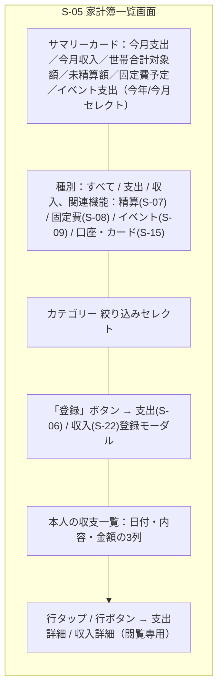

一覧テーブル（すべて／支出／収入で共通）：

| 日付 | 内容 | 金額 |
| --- | --- | --- |
| 2026-07-25 | 7月分給与 | +280,000円 |
| 2026-07-01 | スーパー | -1,200円 |

詳細閲覧（Issue #214）：

- 金額は収入を緑系の「+1,000円」、支出を既存支出配色の「-1,000円」と表示し、色だけに頼らない。
- 行ボタンのEnter／Space、日付・金額セルを含む行タップで詳細を開く。空用途は「内容なし」。3列を維持し、320pxでもページ全体の横はみ出しを防ぐ。
- 支出詳細：日付・内容・金額・種別・カテゴリー・口座／チャージ型カード・世帯合計対象・イベント・メモ・割り勘内訳（相手・割合／負担額・状態）。creditカードは親口座を表示する。
- 収入詳細：日付・内容・金額・種別・カテゴリー・口座・メモ。通常収入と精算収入の入金先を表示し、既存の`accountId: null`は「なし」。論理削除済み口座の名前は収入GETの`accountName`で解決する（#244 API対応、表示UIは#245）。世帯合計対象・割り勘内訳は表示しない。
- 割り勘は当該支出の支払者側内訳に限定し、読み込み中・取得失敗・0件を区別する。
- 閉じる・Escape・背景タップで閉じ、元の行ボタンへフォーカスを戻す。編集・削除ボタンは表示しない。支出／収入そのものの編集・削除とAPIは別Issueで検討する。

---

## S-06 支出登録モーダル

対応: [F03_kakeibo_expense](features/F03_kakeibo_expense.md), [F04_kakeibo_warikan](features/F04_kakeibo_warikan.md), [F06_kakeibo_event](features/F06_kakeibo_event.md), [F11_kakeibo_account](features/F11_kakeibo_account.md)

```text
┌─────────────────────────────────┐
│        支出を登録                │
│ 日時       [__________]          │
│ 金額       [__________]          │
│ 使用用途   [__________]          │
│ カテゴリー [________▼]           │
│ 支払った人 [________▼]           │
│ 口座/カード[________▼]（任意）    │
│ イベント [＋イベント登録]         │
│           [________▼]（任意）    │
│  ※選択するとデフォルト金額を     │
│    金額欄へ自動入力（上書き可）   │
│  ※「＋イベント登録」でS-18を     │
│    重ねて開き、保存すると新イベント│
│    が選択状態になる（入力値は保持）│
│ □ 世帯合計に含める                │
│ メモ       [__________]（任意）   │
│ ── 割り勘設定（任意） ──          │
│ 対象者: [________▼]              │
│ 入力方法: (●)％ ( )金額           │
│ 負担割合: [50]% : [50]%          │
│  ※「金額」選択時は各自の負担額を  │
│    円で直接入力（合計＝支出金額）  │
│                                  │
│     [ 保存 ]    [ キャンセル ]    │
└─────────────────────────────────┘
```

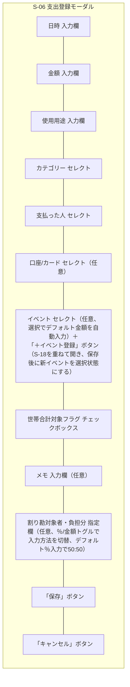

---

## S-22 収入登録モーダル

対応: [F13_kakeibo_income](features/F13_kakeibo_income.md)

```text
┌─────────────────────────────────┐
│        収入を登録                │
│ 日時       [__________]          │
│ 金額       [__________]          │
│ 内容       [__________]          │
│ カテゴリー [________▼]           │
│ 入金先口座 [________▼]（必須）   │
│ メモ       [__________]（任意）   │
│                                  │
│     [ 保存 ]    [ キャンセル ]    │
└─────────────────────────────────┘
```

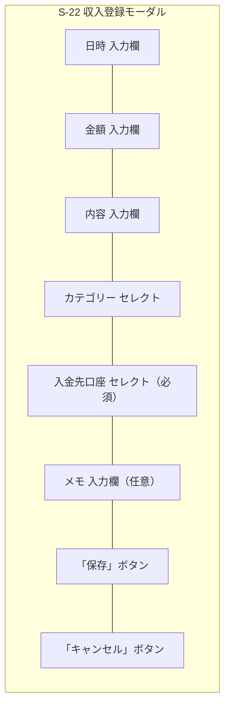

「支払った人」「世帯合計対象フラグ」に相当する入力欄は持たない。収入を得た人は常に登録者本人固定とし、収入は純粋に個人管理（世帯合計に算入する仕組みを持たない）とする（[F13_kakeibo_income](features/F13_kakeibo_income.md) 1章・6章参照）。入金先口座は必須とし、本人所有・同世帯・未削除の口座だけを未選択状態から選ぶ（カードは選択不可）。口座の取得中・取得失敗時は登録できず、取得成功で0件の場合は口座管理へ案内する。登録成功時にモーダルを閉じ、収入と口座残高を再取得する。再取得失敗は「収入は登録済み」と区別して通知し、登録を再送しない。イベント・割り勘との連携は対象外。

S-15の口座一覧・各画面の口座選択肢・S-04の残高合計は論理削除済み口座とその子カードを除外する。収入が参照する口座の削除は名前を残す論理削除となり、過去の収入詳細で参照できる（F-11参照）。

---

## S-07 割り勘精算一覧画面

対応: [F04_kakeibo_warikan](features/F04_kakeibo_warikan.md)

一覧は「日付・相手・金額」だけを表示し、用途・状態・操作は行を押して開く S-29 割り勘詳細モーダルで扱う（#286）。スマホ幅でも横スクロールしない。

```text
┌──────────────────────────────────────────┐
│ 割り勘・精算                 [家計簿に戻る] │
│ [ すべて ] [ 世帯内 ] [ 世帯外 ]            │
├──────────────────────────────────────────┤
│ 2026-10-17   花子 へ請求          2,500円 │
│ 2026-10-15   太郎 へ支払          1,200円 │
│ 2026-10-10   e2euser_ext へ請求     800円 │
└──────────────────────────────────────────┘
（行を押す → S-29 割り勘詳細モーダル）
```

- 初期表示は「すべて」とし、本人が立替者または負担者の内訳を世帯内・世帯外とも表示する。タブで相手の種別を絞り込め、請求・精算・削除後の再取得でも選択を維持する。
- 「すべて」の0件は「割り勘の内訳はありません」、種別の0件は「世帯内の割り勘の内訳はありません」／「世帯外の割り勘の内訳はありません」と表示する。

## S-29 割り勘詳細モーダル

```text
┌──────────────────────────────┐
│ 割り勘詳細                    │
│ 日付    2026-10-17            │
│ 用途    スーパー買い物         │
│ 相手    花子 へ請求            │
│ 負担額  2,500円（50%）         │
│ 状態    未請求                 │
│ [請求] [コメント] [削除] [閉じる]│
└──────────────────────────────┘
```

- 表示するボタンは立場と状態で変わる。立替者＝「請求」「受け取りました」「まだ受け取っていない」「精算済みにする（世帯外のみ）」「削除」、負担者＝「支払う」「保留」。「コメント」は常に表示する。
- 「削除」は未精算の内訳と、世帯外の相手との精算済みの内訳で表示する（精算済みの削除では精算の収入も消して残高を戻す、#301/#302）。
- 口座選択・削除確認・コメントのモーダルを重ねる間は、詳細モーダルを隠してフォーカスを譲る。
- 負担者の支払報告で `payment_reported`（受領確認待ち）、立替者の受領確認で `settled` となる。支払い元・入金先口座の選択は任意で、精算完了時の家計簿への記録はF04第8章に従う。

---

## S-08 固定費管理画面

対応: [F05_kakeibo_fixedcost](features/F05_kakeibo_fixedcost.md)

```text
┌──────────────────────────────────────────────┐
│ [ 固定費を登録 ] ← 固定費登録モーダルを開く    │
├──────────┬────────┬────────┬────────────┤
│ 固定費名   │ 金額    │ 支払日  │ 引き落とし元 │
├──────────┼────────┼────────┼────────────┤
│ 家賃      │80000円 │ 27日   │ 生活費口座   │
│ 個人サブスク│1200円 │ 5日    │ なし         │
└──────────┴────────┴────────┴────────────┘
（公開範囲が「個人」の固定費は登録者本人にのみ表示される）

┌─ 固定費登録モーダル ─────────────┐
│ 固定費名 [___________▼ or 入力]   │
│ 金額     [___________]           │
│ 支払日   [___________]           │
│ 公開範囲 (●世帯共有 ○個人)        │
│ □ 世帯合計に含める                │
│ ── 割り勘設定（任意） ──          │
│ 入力方法: (●)％ ( )金額           │
│ 種別（世帯内／世帯外）と相手・負担分 │
│  ※毎月の自動計上時にこの割合で    │
│    精算（expense_splits）を生成   │
│     [ 保存 ]    [ キャンセル ]    │
└─────────────────────────────────┘
```

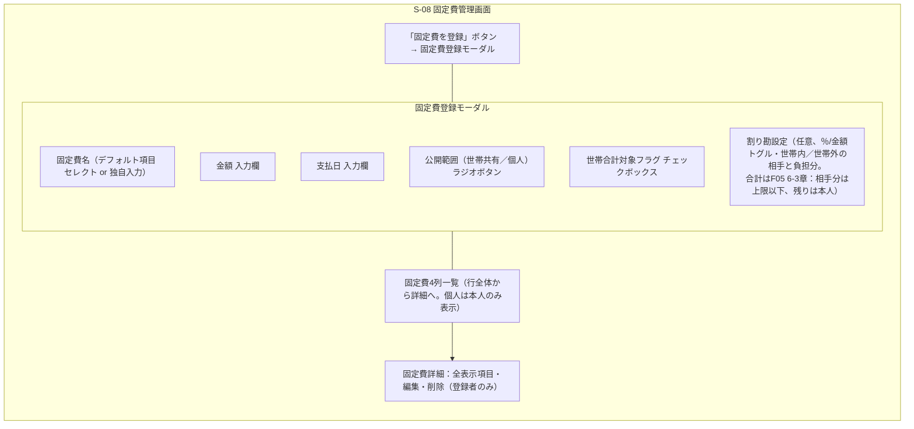

固定費一覧の列：

| 固定費名 | 金額 | 支払日 | 引き落とし元 |
| --- | --- | --- | --- |

行全体をネイティブbuttonにし、各セル・余白・Enter/Spaceから同じ詳細を開く。詳細は固定費名・金額・支払日・公開範囲・世帯合計対象・引き落とし元・割り勘設定（入力方法・相手・割合・金額）を表示する。引き落とし元と割り勘は他者なら「非公開」、本人未指定なら「なし」とし、名前取得失敗は未確認として区別する。登録・編集では世帯内／世帯外を行ごとに選び、最大20人まで混在できる。世帯外は名前（trim後1〜50文字）を入力し、詳細にはAPIの外部名を表示する。世帯取得失敗でも外部名は表示し、名前欠落時は「相手の名前を確認できません」とする。

既存外部名を変えなければIDを維持する。変更した場合はこの固定費の相手を新規相手へ差し替え、既存相手マスタ・過去精算は更新しない。種別を切り替えた行は相手を選び直す。相手の割合合計は100%以下（既存の0.01%許容を維持）、金額合計は固定費金額以下とし、残りを本人の負担として表示する（F05 6-3章）。

編集・削除は登録者だけ詳細下部から操作する。編集保存／キャンセル・削除キャンセルでは詳細へ戻る。保存レスポンスを反映して最新値を表示し、再取得失敗を保存失敗として扱わない。初期フォーカス・Tab/Shift+Tab巡回・Escape／背景／閉じると起点復帰は共通規約に従い、削除・対象消失後は登録ボタンへ戻す。4列・詳細・フォームは320pxでも全文折り返し、下部操作へ縦スクロールできる。

---

## S-09 イベント一覧・集計画面

対応: [F06_kakeibo_event](features/F06_kakeibo_event.md)

| イベント名 | 日時 | 繰り返し |
| --- | --- | --- |
| [父の日] | 6/21（終日） | 単発 |
| [学習] | 6/22（20:00〜21:00） | 毎日 |

- 一覧は「イベント名・日時・繰り返し」の3列のみ。上部に「イベントを登録」ボタンを配置し、期間選択と金額列は置かない。日時は基準日と時間帯（終日／開始〜終了／開始〜）を表示する。長い名前と日時は折り返し、320pxでも横にはみ出させない。
- イベント名・日時・繰り返し・余白を含む行全体をネイティブbutton＋span/gridとし、タップ・クリック・Enter／Spaceで登録者はS-18編集モーダルを直接開き、その他のメンバーはS-09の閲覧専用詳細モーダルを開く。詳細のフォーカス巡回・起点行（消失時は登録）への復帰は共通規約に従う。直接編集の保存／キャンセル後は一覧へ戻る。集計・削除・削除確認は同じ編集モーダル内にまとめ、削除を取りやめても未保存入力を保持する。
- 詳細はイベント名・日時・繰り返し・公開範囲・通知・デフォルト金額（未設定時は「未設定」）・ダッシュボード表示・本人の支出合計を表示する。既存summary APIを使い、期間は今年が既定、今月への切替は詳細内で行う。表示OFFによる404は「集計対象外」、その他の失敗は「取得失敗」とエラー案内を表示する。
- 登録者（editable=true）のS-18編集モードに入力項目・本人の支出集計・削除確認をまとめる。ダッシュボード表示も「更新」で保存し、チェック変更だけでは送信しない。他の登録者（editable=false）の共有イベントは一覧内の閲覧専用詳細を表示し、変更操作は表示しない。S-04のS-24も閲覧専用を維持する。
- 編集はイベント名へ、閲覧専用詳細は閉じるボタンへ初期フォーカスを置く。Tab／Shift+Tabをモーダル内で巡回させ、編集はキャンセル・Escape・背景クリック、閲覧専用は閉じる・Escape・背景クリックで閉じる。送信中は閉じる操作を抑止する。スマホではモーダル内を縦スクロールして全項目と操作へ到達できる。

---

## S-10 在庫・買い物リスト画面

対応: [F07_zaiko_inventory](features/F07_zaiko_inventory.md), [F08_zaiko_shoppinglist](features/F08_zaiko_shoppinglist.md)

在庫・買い物リストAPIは在庫ID単位の共通の値段（整数円またはnull）を返す（#235）。画面の値段入力・表示は#212、在庫の直接編集は#332、買い物の一覧・詳細は#242に従う。入力の省略・クリア・範囲等の契約は[api-design.md](api-design.md)の「値段の共通契約」を参照。

買い物一覧（#242）は品名・買う店・購入個数の3列。行全体をbutton＋gridとし、全文折り返しで320pxでも横スクロール不要。行を押すと買い物詳細を開く。

画面幅にかかわらず、上部タブ（他機能の上部タブと同じ見た目）で「在庫一覧」と「買い物リスト」を切り替え、選択中のタブの内容だけを表示する（#197）。タブはURLで表し、`/zaiko` が在庫一覧、`/zaiko/shopping` が買い物リスト。両タブは同じデータを共有し、在庫の増減による買い物リストへの自動追加・除外は、タブを切り替えた時点で最新の状態が表示される。

各タブの表示例（同時には表示しない）：

```text
在庫一覧タブ
[ 在庫一覧 ] [ 買い物リスト ]
在庫一覧                 [ 在庫を登録 ]
品名                 在庫数       閾値
牛乳                    1.0        0.5
卵                      0.0        1.0
※行全体を押すと「在庫詳細・編集」を開く。

買い物リストタブ
[ 在庫一覧 ] [ 買い物リスト ]
買い物リスト           [ 品目を手動追加 ]
品名                 買う店     購入個数
卵                   なし             0
牛乳                 店名             1
                            [ 更新 ]
```

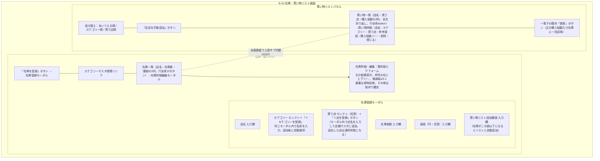

在庫一覧の列例（#241、行全体がbutton＋grid）：

| 品名 | 在庫数 | 閾値 |
| --- | --- | --- |

行を押すと「在庫詳細・編集」を直接開き、品名・カテゴリー・買う店・閾値・値段・自動消費設定を編集する。同じ画面の在庫数欄に在庫個数を左に、その右隣に＋を上、－を下に配置し、右側の同じ行に増減幅1／0.1の選択ボタンを置く。個数表示は他の入力欄と同じ14pxで、＋／－は表示枠の外側に32×26pxで配置する。増減は既存APIで即時反映し、それ以外は保存で確定する。数量更新後もフォームの未保存入力は保持する。数量通信中は増減・ステップ・保存・閉じる、保存中は数量操作を無効にする。保存成功後は一覧の再取得が終わってから閉じる。再取得だけ失敗した場合は保存済みと通知して閉じ、保存APIを再送しない。キャンセル後も一覧に戻る（確定した数量はキャンセルで戻さない旨を表示）。削除は追加しない。一覧は全文折り返しとし320pxでも横スクロール不要。モーダルは画面内の幅・高さに収める。閉じ方とフォーカスはcommon-notes 9章参照。

```text
在庫詳細・編集（編集する品目の既存値を表示）
品名       [ 牛乳                  ]
カテゴリー [ 乳製品              ▼ ] [＋カテゴリーを登録]
買う店     [ なし                ▼ ]

在庫個数（＋/－で即時反映）
               ［＋］    増減幅
［ 1.0      ］ ［－］  ［1］［0.1］
※個数は他の入力欄と同じ14px。＋/－は表示枠の外側に32×26px。
※個数の変更はキャンセルしても元に戻らない。

値段（円・任意）     [ 1280        ]
買い物リスト追加閾値 [ 0.5         ]
1日の消費量（任意）  [             ]
自動消費：オフ
                     [ 保存 ] [ キャンセル ]
```

買い物詳細の構成（入力は閉じても保持）：

    品名：牛乳
    カテゴリー：乳製品
    買う店：なし
    参考値段：1,280円（nullは未設定）
    購入個数：[－] 1 [＋]（1単位、下限0）
    [削除] [閉じる]

買い物一覧の列例（#242、行全体button＋grid）：

| 品名 | 買う店 | 購入個数 |
| --- | --- | --- |

買い物詳細の値段は例「1,280円」、nullは「未設定」。在庫の詳細編集は入力欄に数値を表示し、nullは空欄とする。値段の履歴・比較は設けない（#212）。
登録／編集モーダルに「値段（円・任意）」を追加する。編集は保存済み情報を初期表示しPATCH、空欄はnullでクリアする。
編集時の在庫個数は同じ詳細編集モーダルの＋/－から即時変更する。

登録・編集とも「＋カテゴリーを登録」で同じモーダル内に入力欄を展開する（#338）。名前は1〜50文字で前後空白を除去し、重複409などの失敗は入力を保持して追加欄内に通知する。成功時は選択肢に反映して自動選択し、カテゴリー欄へフォーカスを戻す。在庫の入力途中情報は保持する。追加中は重複送信・在庫保存・数量変更・閉じるを抑止する。「追加をやめる」は展開欄を閉じて追加ボタンへ戻す。カテゴリーは追加時に保存され、在庫のキャンセルでは取り消さないことを表示する。通常Enterはカテゴリーだけを追加し、日本語変換中の確定Enterでは送信しない。カテゴリー自体の編集・削除画面は追加しない。

手動追加は品目選択時に保存値を初期表示し、空欄は値段を省略して維持する。
買い物一覧は3列の全文を折り返し320pxでも横スクロール不要。在庫一覧は3列で折り返し、フォームは折り返し、モーダルは画面内に収める。
買い物詳細は品名・カテゴリー・買う店（未設定は「なし」）・参考値段（桁区切り円、例「1,280円」、nullは「未設定」）・購入個数の＋/－・削除・閉じるを表示する。購入個数は1単位で増減し下限0。購入済みチェックは追加しない。詳細入力は閉じても品目ごとに保持し、複数品目を入力後、一覧下の既存「更新」で正の個数だけ一括確定する。増減・閉じるではAPI送信なし。更新・削除の通信中は更新・削除・数量変更をdisabledとし、閉じるは可能。API失敗時は入力を保持する。API成功後の再取得失敗は操作自体の失敗と区別して通知し、確定済み操作を再送せず再取得する。閉じ方とフォーカスはcommon-notes 9章参照。

---

- 在庫一覧・買い物リストの一覧の上に「キーワード検索」欄を置き、品名で絞り込む（全角・半角、大文字・小文字、カタカナ・ひらがなを区別しない（#326）。該当なしは「該当する品目がありません」、#315）。

---

## S-12 レシピ一覧画面

対応: [F09_kondate_recipe](features/F09_kondate_recipe.md)

PC案内の下に同じ左右幅の「iPhoneからレシピを登録」パネルを配置し、「ショートカットを追加する」から `/recipes/iphone-shortcut` に遷移する（#223）。
専用手順ページは既存AppLayout・認証／世帯ガード下に置き、見出し、登録先URLの接頭辞の読み取り専用欄、「URLをコピー」、コピー結果（status）、番号付き作成手順、注意事項、「レシピ一覧に戻る」を縦に表示する。320pxでもページ全体が横にはみ出さない。
コピー対象は現在のorigin + `/recipes/share?url=`。入力URLだけを1回エンコードして末尾に変数を連結し、複数URLは先頭、空入力は終了と案内する。コピー失敗時は手動コピーを案内する。アクション名のiOSバージョン差、localhostの制約、WEBタブへの貼り付けを注記する。

一覧の下に「PCからレシピを登録」パネルを配置する（#222）。ドラッグ可能な「HomeLogに登録」リンクと「ブックマークバー表示 → ドラッグして設置 → 閲覧ページで押す」の手順を表示し、320pxでも折り返す。通常クリックは設置案内を表示する。設置したブックマークは閲覧URLを `/recipes/share?url=...` に渡し、別タブでS-13のWEBタブをURL入力済みで開く。自動保存せず、ユーザーが登録操作を行う。使えないページでは既存のURL貼り付けを案内する。ログイン後の復帰は世帯所属済みユーザーを対象とする。

```text
┌──────────────────────────────────────────────┐
│   [ すべて ] [ お気に入り ]   [ レシピを登録 ] │
├──────────────┬──────────────┬─────────────────┤
│ [サムネイル]   │ [サムネイル]   │ [サムネイル]     │
│ カレー ★      │ 肉じゃが       │ パスタ ★        │
└──────────────┴──────────────┴─────────────────┘
```

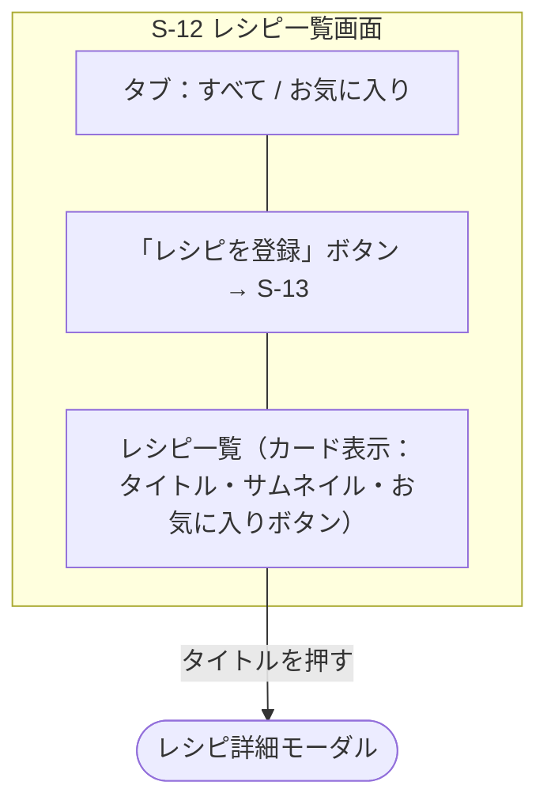

一覧にはタイトル（とサムネイル・お気に入り）だけを表示し、材料・手順などはタイトルを押して開く詳細モーダルで確認する（#195）。編集・削除も詳細モーダルから行う。

```text
┌─────────────────────────────────┐
│ (手動)                            │ ← 種別バッジ（手動 / 画像解析 / WEB）
│ 肉じゃが                          │ ← タイトルを大きく表示
│ ┃材料                             │
│  ・牛肉 200g                       │ ← 1行に1つの箇条書き
│  ・じゃがいも 3個                   │
│ ┃手順                             │
│  1. 材料を切る                      │ ← 番号付きで1行ずつ
│  2. 煮込む                         │
│ [ 編集 ] [ 削除 ] [ 閉じる ]        │
└─────────────────────────────────┘
```

- 未入力の項目は「未登録」と表示する。WEBレシピは材料・手順の代わりにサムネイル・元ページへのリンク・メモを表示する。
- 閉じるボタン・Escape・背景クリックで閉じる。長い内容はモーダル内でスクロールする。

---

## S-13 レシピ登録モーダル

対応: [F09_kondate_recipe](features/F09_kondate_recipe.md)

```text
┌─────────────────────────────────┐
│ [手動] [手書き画像解析] [WEBレシピ]│
├─────────────────────────────────┤
│ タイトル [_______________]       │
│ 材料     [_______________]       │
│ 手順     [_______________]       │
│                                  │
│      [ 登録する ]   [ キャンセル ]│
└─────────────────────────────────┘
```

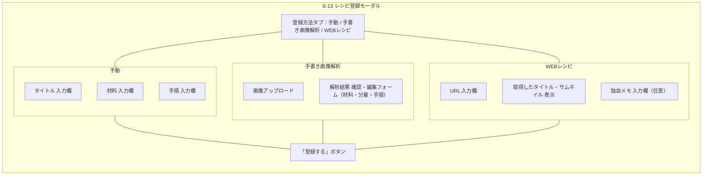

---

## S-14 献立表画面（週単位の作りたい料理リスト）

対応: [F10_kondate_menu](features/F10_kondate_menu.md)

献立は「その週に作りたい料理」のリストとして登録する。曜日への割り当ては行わない。当初はレシピ選択サイドパネル（PC）／下部ドロワー（モバイル）を想定していたが、実装では追加フォーム内の「キーワード検索＋レシピの選択欄」とした（#281）。

```text
┌────────────────────────────────────────┐
│ 献立表  [◀] 2026-10-12 の週 [▶]         │
│ 追加方法 (●) レシピから選ぶ ( ) 自由メモ │
│ [キーワードで絞り込み________]           │
│ [★ カレー                        ▼]     │
│ [追加]                                  │
├────────────────────────────────────────┤
│ カレー（リンク）                  [削除] │
│ 肉じゃが（リンク）                [削除] │
│ 外食                              [削除] │
└────────────────────────────────────────┘
```

- 選択欄はお気に入り（★）を先頭に並べる。キーワードは全角・半角、大文字・小文字を区別せずに名前で絞り込み、該当が無ければ「該当するレシピがありません」と表示する。
- リストのレシピ名は、WEBレシピなら元のページを新しいタブで、手動・手書きレシピなら S-31 レシピ詳細モーダルを開く（#289）。自由メモと削除済みレシピはリンクにしない。

---

## S-15 口座・カード管理画面

対応: [F11_kakeibo_account](features/F11_kakeibo_account.md)

```text
┌──────────────────────────────────────────────┐
│ 口座・カード管理 [ 口座を登録 ][ カードを登録 ]│
├──────────────────────────────────────────────┤
│ 口座名     │ 種別       │ 残高    │ カード     │
│ ○○銀行     │ 銀行       │123000円 │ ○○カード   │
│            │            │        │ Suica（チャージ型）残高: 500円 │
│ PayPay     │ 電子マネー │ 3200円 │ なし       │
└──────────────────────────────────────────────┘
（残高は本人のみ表示。支出登録で当該口座を選択すると自動的に減算される）
（口座名をクリックすると、その口座の取引履歴モーダルを開く。日付・内容・種別・金額（±）・取引後残高を日付降順で表示。[F11_kakeibo_account](features/F11_kakeibo_account.md) 4章）
（カードは親口座の行のカードセル内リストに表示。チャージ型カードからチャージモーダルを開く。クレジットカードは残高を表示しない）
（登録ボタン2個は隣接する同じ操作群。狭幅では見出しの下に移すが2個は同じ行。320pxでも4列を維持し、長い名前・残高は折り返して表内・ページとも横スクロールなし）
```

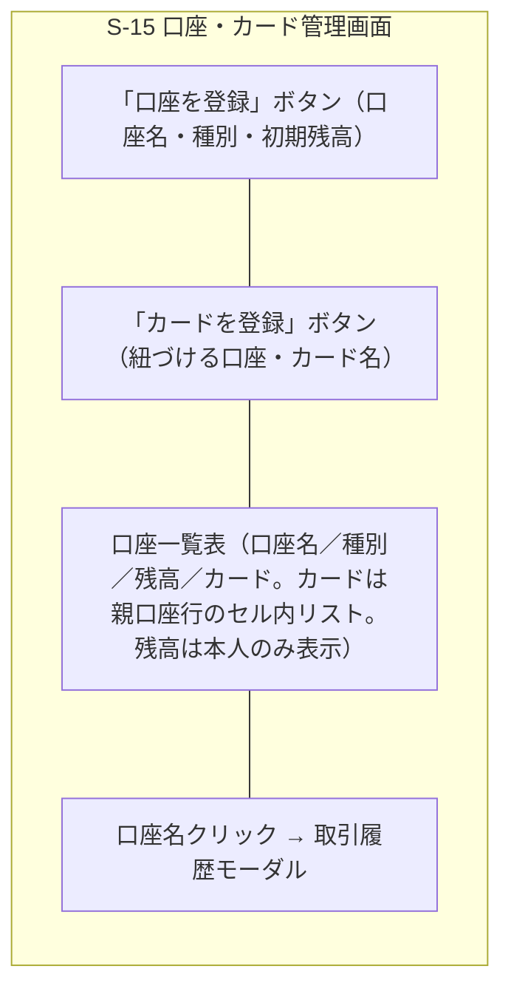

---

## S-17 パスワードリセット画面

対応: [F01_auth](features/F01_auth.md)

```text
┌─────────────────────────────────┐
│ Step1: メールアドレス            │
│  [_____________________________]│
│           [ 送信する ]           │
├─────────────────────────────────┤
│ Step2（メール内リンク遷移後）    │
│  新しいパスワード                │
│  [_____________________________]│
│           [ 変更する ]           │
└─────────────────────────────────┘
```

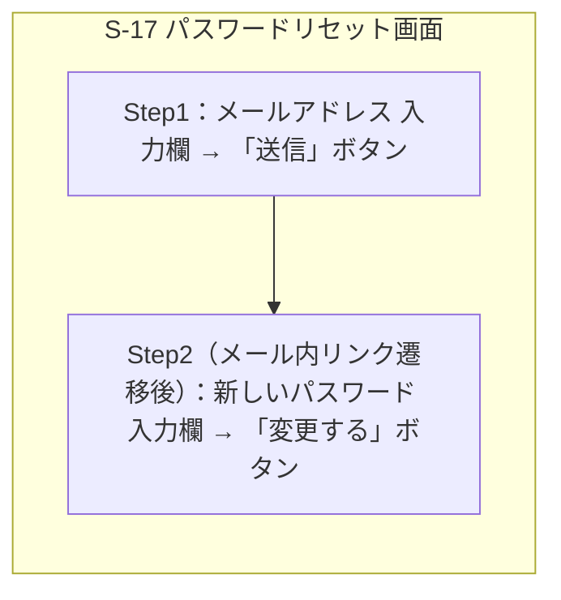

---

## S-18 イベント登録・編集モーダル

対応: [F06_kakeibo_event](features/F06_kakeibo_event.md)（#333）

登録と編集で同じフォームを使う。S-09の登録者本人のイベント行は、既存値入りの編集モードを直接開く。編集では入力項目・支出集計・削除確認を1つのモーダルにまとめ、別モーダルへ切り替えない。

```text
イベントを登録 ／ イベントを編集
イベント名         [                      ]
日付               [                      ]
☑ 終日（登録時はON）
  開始時刻 [__:__]  終了時刻 [__:__]
  ※終日OFF時のみ。開始必須・終了任意。
繰り返し           [ 単発 ▼ ]
  （単発／毎日／毎週／毎月／毎年）
□ 通知する
デフォルト金額（任意） [                  ]
☑ トップ画面のイベント別支出サマリーに表示する
公開範囲  (●世帯共有 ○個人)

── 編集時だけ表示 ──
集計対象期間 [ 今年 ▼ ]（今年／今月）
支出合計：0円

削除ボタンを押したときも、このモーダル内に表示：
「イベント名」を削除しますか？この操作は取り消せません。
                  [ 削除する ] [ 削除をやめる ]

登録時：                  [ 登録 ] [ キャンセル ]
編集時：[ 削除 ]          [ 更新 ] [ キャンセル ]
```

- ダッシュボード表示の初期値は登録時ON。編集では保存済み値を表示し、他の項目と一緒に「更新」で確定する。集計は保存済みの表示設定を使う。
- 集計は今年を既定として今月へ切り替えられる。404は「集計対象外」、その他の失敗は「取得失敗」と通知し、0円と区別する。
- 削除確認では「削除をやめる」へフォーカスし、取りやめると入力を保持して削除ボタンへ戻す。確認中は更新を無効にする。
- 登録・更新・削除の送信中は重複送信と閉じる操作を防ぐ。API失敗時は入力を保持し、role="alert"で通知する。登録・更新・削除成功後は一覧へ戻り、起点行（削除済みなどで消失した場合は登録ボタン）へフォーカスを戻す。
- S-09で他の登録者の共有イベントを押した場合の閲覧専用詳細と、トップのS-24はこの編集フォームへ遷移しない。

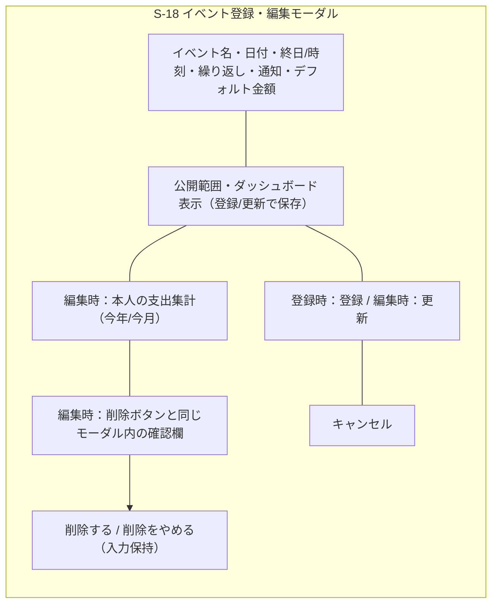

---

## S-19 日次詳細モーダル

対応: [F06_kakeibo_event](features/F06_kakeibo_event.md), [F03_kakeibo_expense](features/F03_kakeibo_expense.md), [F10_kondate_menu](features/F10_kondate_menu.md)

トップ画面（S-04）で日付をクリックすると開くハブモーダル。その日の詳細確認と、支出・イベント・献立の追加をまとめて行える。

```text
┌─────────────────────────────────┐
│         2026年7月10日            │
├─────────────────────────────────┤
│ 収支：－500円                     │
│                                  │
│ ▼ 支出一覧                       │
│  ・スーパー買い物  1,200円         │
│                    [ 支出を登録 ]│
│                                  │
│ ▼ イベント                       │
│  ・📌学習（毎日）20:00〜21:00     │
│                    [ イベントを追加 ]│
│                                  │
│ ▼ この週の献立                    │
│  ・カレー、魚料理（メモ）          │
│                [ この週の献立を編集 ]│
├─────────────────────────────────┤
│              [ 閉じる ]          │
└─────────────────────────────────┘
```

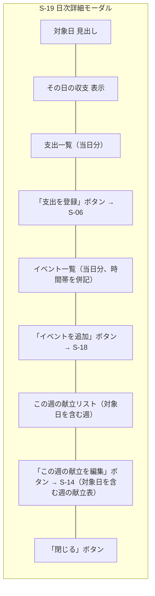

---

## S-25 設定メニュー画面

ヘッダーの歯車アイコン（「設定を開く」）から開く。「世帯設定」「表示設定」「アカウント設定」の3つのカードを並べ、それぞれ S-27・S-21・S-26 を開く。

## S-21 表示設定画面

対応: 機能横断（ダッシュボード表示カスタマイズ）。表示設定は `user_settings` テーブル（[data-model.md](data-model.md)参照）にユーザーごとに保存する。

```text
┌─────────────────────────────────┐
│ 設定                             │
│                                  │
│ ■ ダッシュボードに表示する項目    │
│  ☑ 今日の状況                    │
│     ☑ 収支                       │
│     ☑ 今週の献立                 │
│     ☑ イベント                   │
│  ☑ 買い物・在庫                  │
│     ☑ 買い物リスト               │
│     ☑ 在庫リスト                 │
│  ☑ 個人の財政                    │
│  ☑ 今月のお金                    │
│     ☑ 個人支出                   │
│     ☑ 世帯合計対象額             │
│     ☑ 未精算（受取・支払）        │
│  ☑ イベント別支出                │
│  ☑ カレンダー                    │
│     ☑ 収入                       │
│     ☑ 支出                       │
│     ☑ イベント                   │
│                                  │
│  ── 表示カードの並べ替え ──      │
│  [今日の状況]          ↑ ↓       │
│  [買い物・在庫]        ↑ ↓       │
│  [個人の財政]          ↑ ↓       │
│  [今月のお金]          ↑ ↓       │
│  [イベント別支出]      ↑ ↓       │
│                                  │
│            [ 保存 ]              │
└─────────────────────────────────┘
```

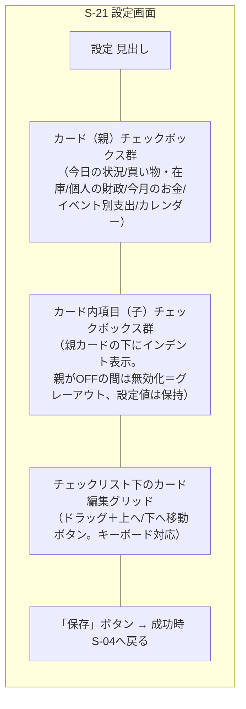

- S-25 設定メニュー画面の「表示設定を開く」から遷移する（`/settings/display`）。
- 表示設定は「カード（親）」と「カード内項目（子）」の2階層で選択でき、カード順も保存できる（`user_settings.dashboard_settings`、[data-model.md](data-model.md)参照）。
  - 親チェックOFF → カードごと非表示（子の設定値は保持され、親を再度ONにすると復元される）。
  - 子チェックOFF → カード内の該当行のみ非表示。
  - カレンダーの子項目は、日付セル内に表示する要素（収入／支出／イベント）を制御する。日付とクリック（日次詳細モーダル）は常に有効。イベントボタンのクリックはS-24イベント詳細モーダルを開く。献立は週単位のため日付セルには表示しない。
  - 「個人の財政」は表示項目が1つ（口座残高合計）のため子項目を持たない。
- 設定はユーザーごとに保存され、他の世帯メンバーには影響しない。
- カード順の標準値は `today → stock → finance → money → eventExpenses`。カレンダーは常にグリッドより上に固定される。表示OFFのカードは並べ替え対象から除外し、再度ONにしたとき保存済みの順序へ復帰する。
- イベント別支出の期間（今日／今月／今年、既定は今年）はS-04カード内のセレクトで切り替える画面状態であり、S-21のユーザー設定には保存しない。
- 保存成功時はS-04へ遷移する。保存失敗時はS-21に留まり、入力値を保持して再試行できるようにする。

---

## S-24 イベント詳細モーダル

S-04の月間カレンダーまたは「今日の状況」カードに表示されたイベントボタンから開く。イベントの確認に必要な情報だけを表示する閲覧専用モーダルであり、編集操作は提供しない。

```text
┌──────────────────────────────┐
│ イベント詳細                  │
│ 学習会                        │
│ 日時：2026/7/10 19:00         │
│ 繰り返し：毎週                 │
│ 通知：有効                     │
│ 関連支出：3,000円              │
│                     [閉じる]  │
└──────────────────────────────┘
```

- イベント名、日時、繰り返し、通知設定、関連支出の概要を閲覧専用で表示する。
- 関連支出はログインユーザー本人が支払った当該イベント紐付き支出の合計だけを表示する。他人の支出は表示しない。不要な場合は関連支出自体を表示しない。
- [閉じる] またはモーダル外クリック、Escキーで元のS-04へ戻る。
- イベントの閲覧権限はイベントの共有範囲に従う。共有イベントは世帯メンバーが閲覧できるが、編集・削除は登録者だけが行う。個人イベントは登録者本人だけが閲覧できる。

## S-23 家計簿カテゴリー管理画面

対応: [F03_kakeibo_expense](features/F03_kakeibo_expense.md) 6-2章, [F13_kakeibo_income](features/F13_kakeibo_income.md) 7-2章

```text
┌──────────────────────────────────────────────┐
│ 家計簿カテゴリー管理     [家計簿に戻る]         │
│                          [ 支出カテゴリーを登録 ]│
│ (●支出カテゴリー) ( 収入カテゴリー)             │
├──────────────────┬────────┬──────────────┤
│ カテゴリー名        │ 種別    │ 操作           │
├──────────────────┼────────┼──────────────┤
│ 食費               │デフォルト│               │
│ 日用品             │デフォルト│               │
│ 交際費（自作）      │カスタム │ [編集][削除]   │
└──────────────────┴────────┴──────────────┘
（デフォルトカテゴリーは編集・削除ボタンを表示しない）

┌─ カテゴリー登録/編集モーダル ────┐
│ カテゴリー名 [___________________]│
│     [ 登録 or 更新 ]  [ キャンセル ]│
└─────────────────────────────────┘
```

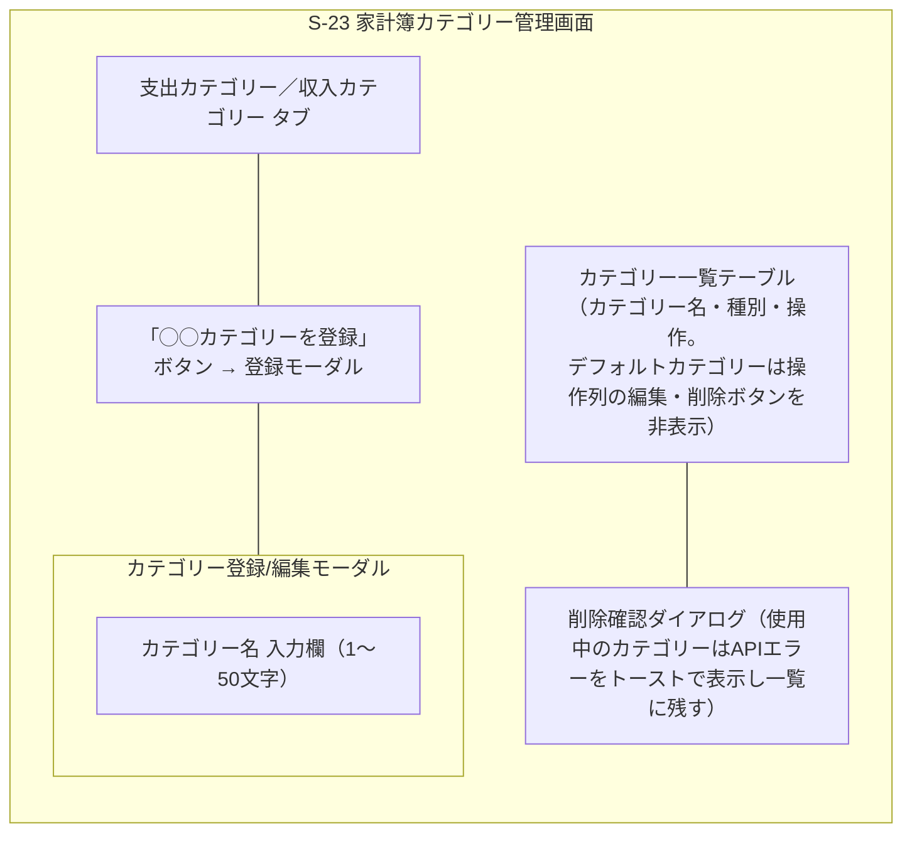

カテゴリー一覧テーブルの列例：

| カテゴリー名 | 種別（デフォルト／カスタム） | 操作（デフォルトは非表示） |
| --- | --- | --- |

- S-05（家計簿一覧画面）ツールバーの「カテゴリー管理」リンクから遷移する。
- タブ切り替えは初回マウント時に支出・収入両方のカテゴリーを取得済みのため、再フェッチせず即座に表示が切り替わる。
- デフォルトは全カード・全項目表示。

---

## S-26 アカウント設定画面

対応: [F01_auth](features/F01_auth.md) 8-1章・8-2章

```text
┌────────────────────────────────────┐
│ アカウント設定          [設定に戻る] │
├────────────────────────────────────┤
│ 表示名  [テスト太郎______] [保存]    │
├────────────────────────────────────┤
│ パスワード                          │
│ 現在のパスワード      [______] 👁    │
│ 新しいパスワード      [______] 👁    │
│ 新しいパスワード（確認）[______] 👁  │
│ [パスワードを変更]                  │
├────────────────────────────────────┤
│ メールアドレス                      │
│ 現在：taro@example.com              │
│ 新しいメールアドレス [__________]   │
│ 現在のパスワード     [______] 👁     │
│ [メールアドレスを変更]              │
├────────────────────────────────────┤
│ 退会                                │
│ （30日以内なら取り消せる旨の説明）   │
│ 現在のパスワード     [______] 👁     │
│ [退会を申し込む] → 確認ダイアログ    │
└────────────────────────────────────┘
```

- 各欄の結果は欄の下に表示する（成功は status、失敗は alert）。
- 退会欄は、未精算の割り勘や他の人が負担する固定費が残っている間は件数を表示してボタンを無効にする。申し込むとログアウトし、S-01 に削除予定日を表示する。
- 退会の取り消し期間中に S-01 でログインすると「退会手続き中です」と削除予定日を表示し、「退会を取り消してログイン」「取り消さない」を選べる。

## S-27 世帯設定画面

世帯グループ名・招待コード・メンバー一覧を表示し、「世帯グループから退出する」（確認ダイアログつき）を置く。最後のメンバーが退出すると、世帯と世帯のデータは削除される。

## S-10 在庫の自動消費入力（#329）

登録・編集モーダルの閾値欄の後に、次を縦配置する。

```text
1日の消費量（任意） [0.2]
空欄の場合は自動消費しません
[自動消費：オン / オフ] （role=switch）
毎日1:00（日本時間）に減ります。開始・再開は翌日から。
停止・消費量変更時は到来済みの未処理分を旧設定で精算します。
[保存] [キャンセル]
```

number入力はstep=0.1/min=0.1/max=99999.9。空欄でスイッチはオフ・無効、オフにしても消費量は保持する。登録初回入力でオン、その後の選択は維持する。詳細に「自動消費：未設定／0.2／日・オン／0.2／日・オフ」を追加する。一覧は品名・在庫数・閾値の3列のままとし、行ボタン内にスイッチは置かない。

1280/390/320pxで説明を折り返し、モーダル内の縦スクロールで保存へ到達できる。Tab巡回、Spaceでの切替、Escape・背景クリック、通信中の無効化とフォーカス復帰を維持する。保存失敗はrole=alertで入力を保持し、保存成功後の一覧取得失敗では保存を再送しない。
